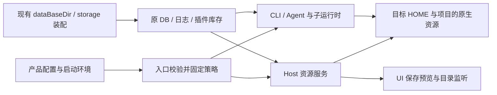

# Native Resource Directories

状态：2026-11-03，已批准实施。本文是原生配置／资源目录策略的单一规格；Aiscoo 产品默认值见 `docs/aiscoo/specs/desktop-product-identity.md`。

## 配置与生命周期

- 通用默认目录名为 `.zcode`。Aiscoo 产品装配提供 `.aiscoo`。
- `ZCODE_NATIVE_RESOURCE_DIR_NAME` 的非空值优先于产品默认；未设置或仅含空白时采用产品默认，再回退通用默认。
- 值是单层、跨平台合法的隐藏目录名；拒绝 `.`, `..`、绝对路径、盘符、分隔符、NUL、空名称及平台非法字符。非空非法值必须在资源初始化前报配置错误，不得静默扫描旧目录。
- 入口解析为不可变 `NativeResourceDirectoryPolicy`，由 options／依赖注入贯通。消费者不自行选择产品默认，不通过修改 HOME 或 storage.dir 实现目录切换。
- 一个目录名同时作用于用户 HOME 与项目原生资源目录。配置不存入正在被发现的文件中；不增加设置界面。完整重启 Host／Agent 后生效，既有运行会话不热切换。

启动入口是不可变策略快照的唯一所有者；服务与 Agent 接收该快照，UI 从服务结果取得实际目录。资源读写仍由既有配置／资源服务负责，不引入另一套状态。

## 资源与存储边界

原生资源根是 `HOME/<directoryName>` 与 `<workspace>/<directoryName>`。覆盖用户 CLI 配置 `cli/config.json`、用户 AGENTS、skills、commands、agents 定义、保存的 workflows、inline 插件资源、相关资源启停及信任记录。跨平台路径使用 Node path API；workspaceIdentity 仍用于身份，workspacePath 仍用于文件操作。

以下保持现有路径和 owner：

- HOME 和项目下 `.agents` 的通用兼容来源；各入口沿用各自既有合并／fallback 规则，不为资源换根统一来源策略。用户 skills 保留 native 与 `.agents` 合并／去重；Host commands 在同 scope native 发现有效命令时不参与 `.agents`，native 为空时才 fallback；CLI commands 保留其既有发现与合并规则。MCP 空 native scope fallback 不变。
- 项目根 AGENTS.md、zcode.json、插件包格式及来源枚举；显式配置文件、资源目录和绝对安装记录。
- App dataBaseDir、Electron userData、Application Support 下的 `.zcode/v2`、CLI 根绑定、数据库、日志、session、安装库存及版本缓存。
- 独立 CLI 的 storage.dir 默认及显式覆盖、运行时数据库／日志／执行产物、CUA／Server 安装与运行目录。

原生资源策略不能改写运行时 storageRoot。Desktop 插件库存与缓存来自既有绑定的运行时根；新资源根中的另一套 cli/plugins 不能让 Desktop 换库。Host 的技能、命令及子代理插件发现使用同一运行时插件根，资源启停配置取有效用户／项目资源文件。

## 配置与发现

- 显式 userConfigPath 高于派生用户文件；不能用其祖父目录反推资源根。skipUserConfig 的来源元数据也反映有效路径。
- 项目自动发现仍按 Git 根到 cwd，各层先 zcode.json、再原生目录 config.json；无 Git 根时只检查 cwd。显式 projectConfigPath 仍是追加，不替代原生发现。
- 原生项目 config.json 的 baseDir 为项目目录；相对 cwd、来源归属、editable 判断、写入目标和监听使用同一解析结果。
- 保留已有 scope／namespace／优先级、显式根目录和自定义 port 的优先权。skills 的 HOME、祖先链和 additionalDirectories 都接入；.agents 项不随原生目录名改变。
- Plugin 管理协议保留既有可选依赖兼容：旧嵌入上下文仅提供 logger、未提供 deps 时，新增的 env／nativeDirectories 读取继续使用既有默认依赖解析，不得因目录策略接入而抛出 TypeError。
- 主会话、草稿 catalog、list/inspect、TUI、管理 CLI、冷恢复、subagent 与 workflow 子运行时使用相同策略。用户 AGENTS 的编辑与实际读取一致。
- 技能／命令设置列表沿用现有初始化／显式刷新语义；资源换根不新增自动刷新订阅。新增或编辑文件后通过现有真实 UI 刷新入口验证当前根来源。已有自动监听（如工作流列表）继续使用服务返回的实际目录，不能自行拼接旧根。
- 通用缺省／显式选择 `.zcode` 时，保留上游已存在的 agents legacy 初始化与显式运行时根兼容语义，不改写上游默认。CLI 的 agents 定义及 agents-state 始终使用配置合并后的 storageRoot；用户文件 storage.dir=A、环境 ZCODE_STORAGE_DIR=B 时使用 B，不能按原始用户配置来源重新选回 A。选择其他原生目录名时，agents 资源根才按显式用户 storage.dir → HOME/native 选择，运行时环境 storage 覆盖仍只决定运行时根，且不得跨旧根触发 legacy 导入。

## 写入、安全与信任

MCP／hooks／插件项目配置的读写、scope 分类、审核快照、锁 key、路径安全检查及同步目标必须一致。稳定来源标签不充当实际文件路径。只有当前 workspace 原生配置可编辑；祖先配置、zcode.json 和独立 explicit 文件延续原只读语义。保留摘要比较、过期审核拒绝、原子写及符号链接／越界防护。

信任存储在没有显式用户 storage.dir 时从所选用户资源根派生；存在显式用户 storage.dir 时沿用既有解析和优先级。项目配置不能决定持久信任根。目录变化按实际来源和既有摘要规则重新评估，不复制或放宽授权。

## 兼容和迁移

不自动搬迁、复制、合并旧资源，不新增软链接别名，不改数据库 schema 或安装记录。新目录缺失按原有空配置／资源处理，不跨旧根触发 legacy 迁移。旧 `.zcode` 原生资源不参与自动发现；显式路径和 .agents 继续有效。设置环境变量为 `.zcode` 可显式恢复旧原生来源。

保存的工作流库使用资源策略，运行产物仍使用原 session/storage 路径。UI 使用服务返回的实际目录进行监听，不自行读取环境变量或拼品牌路径。

SSH／WSL／Docker 通过现有远端启动参数传递目录名，目标 Host 用自身 HOME 解析；不传本地绝对资源路径，不改变 Server 安装、启动和存储根。旧 remoteRuntimeEnv 白名单保留同一环境键；当前 Desktop 的 SourceServerConnectionManager → source-server transportAdapter.ensureDaemon／installRelease 使用可选 nativeResourceDirectoryName，未提供时不注入本地默认。SSH 交由 launchd／systemd 启动时，仅将该目录名写入服务环境，保留既有转义与缺省描述符。

已就绪的共享 Source daemon 继续复用自身启动快照，不因连接方目录策略自动停止、注册或重启。需要切换时通过既有服务管理显式完整重启；独立 Server 使用其自身启动策略。

## 验收

使用全新的合成 HOME、项目和 App 数据根，禁止访问真实用户资源。覆盖：

1. 通用默认、Aiscoo 默认、环境覆盖／空白／非法值；非法值不触发资源 IO。
2. 新旧 native 目录 canary 并存，仅选定根参与自动发现；.agents 原合并／fallback 保持。
3. 用户配置显式覆盖、项目层级／显式文件／baseDir 与相对 cwd；读写、metadata 和 scope 一致。
4. CLI list/inspect、草稿、主会话、subagent、两类 workflow 与冷恢复策略一致。
5. MCP 和 hooks 配置、同步、审核、信任／撤销／损坏记录和失效摘要；安全防护保持。
6. App 设置、DB、log、session、CLI 绑定及插件库存路径保持，伪造的新资源根插件库不被 Desktop 采用。
7. 工作流保存、列表、执行、实际目录监听一致；运行产物根不变。NCR05 UI 作为独立用例，只有真实产品能力可用时才执行完整 watch/save/run 验收。当前 Aiscoo 官方云策略拒绝 `getDynamicWorkflowClientConfig` 并返回 `AISCOO_OFFICIAL_CLOUD_UNAVAILABLE`，UI 部分标记 blocked / pending，不计为 covered；后端 saved-workflow-library 的 CLI 回归仍有效。只允许依据该已确认策略或现有只读公共能力响应跳过 NCR05，未知 tab 缺失仍失败，不开启、替换或旁路产品门禁。NCR01–04/06/07 独立完成真实 Agent 请求、DB 绑定和完整进程冷恢复，不能被 NCR05 阻塞。
8. POSIX／Windows 路径、远端目标解析和桌面／手机同 Host；未实机执行的平台如实记录。
9. CLI 通用缺省与显式 `.zcode` 分别覆盖用户 storage.dir=A、环境 ZCODE_STORAGE_DIR=B 的组合：agents 定义、启停状态及 legacy 初始化都取合并后的 B，A 的 canary 不进入运行时且原文件不变；其他 native 名保留显式用户资源根优先、无显式值时使用 HOME/native 的规则。

CLI 公共配置改动执行完整 CLI 测试；App 行为使用 E2E，不恢复退役业务单测。执行根与 CLI typecheck／lint、格式及架构门禁，记录真实结果。
