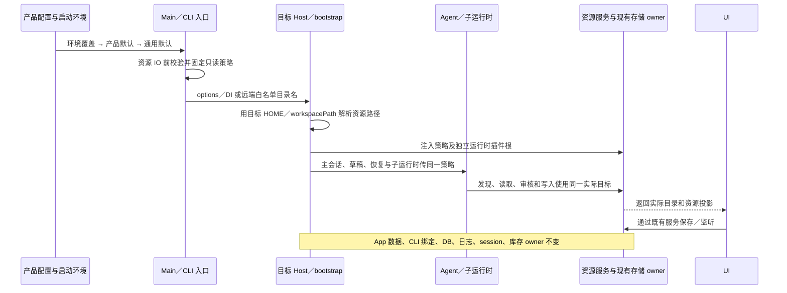

# 原生资源目录实现与验证报告

状态：2026-11-03，实现已本地提交，并已衔接最新 release 基线 `0c8c30d6`；整合后 macOS 默认与环境覆盖两模式核心验收再次通过。历史完整 CLI 和全仓格式仍有失败，NCR05 工作流 UI 被既有产品门禁阻塞，未声明所有验证全绿。未推送或发布；整合补验见第 8 节。

本文依据已批准的唯一规格 [Native Resource Directories](../../apps/zcode-cli/docs/design/v2/native-resource-directories.md)、[产品默认值](./specs/desktop-product-identity.md#原生资源目录2026-11-03)、[上游扩展规则](./UPSTREAM-EXTENSION.md)及[分支规则](./BRANCHING.md)编写。本文记录实现接线与证据，不替代或另立规格。

实现通过公共目录策略、产品配置和现有调用链的可选接线完成。所有运行时场景使用合成 HOME、项目和 App 根，未移动真实用户配置或会话；验证表按实际运行记录区分通过、失败与未执行。

## 1. 产品行为与配置

Aiscoo 产品装配的原生资源目录默认名为 `.aiscoo`；没有产品注入的通用 ZCode 默认仍是 `.zcode`。启动时的选择顺序为：`ZCODE_NATIVE_RESOURCE_DIR_NAME` 的非空值 → 产品默认 → 通用默认。环境变量仅含空白时视为未设置。Desktop 先合并本地环境，再由已定义的进程环境覆盖，随后固定本次启动的策略。

配置值是一个跨平台合法的单层隐藏目录名，不是路径。`.`、`..`、绝对路径、盘符、路径分隔符、NUL、非法字符等必须在资源初始化前报错，不能静默改读旧目录。同一个名称同时用于目标运行环境的 `HOME/<目录名>` 和 `<workspace>/<目录名>`。目录策略不存入正在发现的配置文件，也没有新增设置界面。

以下是仓库根目录的 POSIX shell 开发示例：

```sh
# Aiscoo 产品默认使用 .aiscoo
pnpm dev:desktop

# 显式选择另一套原生用户与项目资源
ZCODE_NATIVE_RESOURCE_DIR_NAME=.team-agent pnpm dev:desktop

# 显式恢复旧 .zcode 原生来源
ZCODE_NATIVE_RESOURCE_DIR_NAME=.zcode pnpm dev:desktop
```

PowerShell 的对应覆盖方式为：

```powershell
$env:ZCODE_NATIVE_RESOURCE_DIR_NAME = ".zcode"
pnpm dev:desktop
```

修改后必须完整退出并重启相关 Main、Host 和 Agent；远端目标同样需要重启其承载进程。既有会话不热切换目录，复用中的远端 daemon 不因本地改变量而即时换根。取消覆盖后，在下一次完整启动采用产品默认。

**没有自动迁移。** 本功能不搬迁、复制、合并旧资源，不建立软链接别名，不改数据库 schema 或安装记录。所选目录不存在时按既有空配置／空资源处理。旧 `.zcode` 原生资源不再自动参与发现，显式指定的路径和 `.agents` 兼容来源继续按既有规则生效。选择 `.zcode` 恢复的是旧原生来源，不是迁移 App 数据或会话数据库。

## 2. 资源与运行时存储边界

| 对象                                  | 所选策略的作用                                                                     | 保留的边界                                                                                                                                                       |
| ------------------------------------- | ---------------------------------------------------------------------------------- | ---------------------------------------------------------------------------------------------------------------------------------------------------------------- |
| 用户 CLI 配置                         | 默认读取 `HOME/<目录名>/cli/config.json`                                           | 显式 `userConfigPath` 优先；不能由其祖父目录反推资源根；`skipUserConfig` 的来源元数据仍准确。                                                                    |
| 项目配置                              | Git 根到 cwd 各层先 `zcode.json`，再 `<目录名>/config.json`；无 Git 根时只检查 cwd | 显式项目配置继续追加；原生项目文件的 `baseDir` 为项目目录，来源、相对 cwd、可编辑判断与写入目标共用解析结果。                                                    |
| 用户 AGENTS、skills、commands         | 用户与项目原生部分使用所选根                                                       | 项目根 `AGENTS.md`、`.agents` 兼容来源、scope、namespace、优先级和已有自定义 port 保持；MCP 空 native scope 的 fallback 保持。                                   |
| agents 定义、启停状态                 | 使用批准规格规定的资源根与显式配置优先级                                           | CLI 的通用 `.zcode` 分支仍使用配置合并后的 `storageRoot`，包括环境覆盖及原有 legacy 初始化语义，详见下文兼容修复。                                               |
| 保存的 workflows                      | 用户／项目库、列表、保存、命名执行、scope 分类和监听使用同一实际目录               | session、工作流执行产物与运行时存储根不变；UI 从服务返回值取得目录。                                                                                             |
| MCP、hooks、inline 插件资源及启停配置 | 原生文件的发现、读写、同步、安全检查与审核目标一起接入策略                         | 来源枚举是稳定标签，不是实际文件路径；祖先、`zcode.json` 及独立 explicit 文件的只读语义保持。                                                                    |
| 信任记录                              | 没有显式用户 `storage.dir` 时由所选用户资源根派生；有显式值时沿用既有解析          | 项目配置不能决定持久信任根；不复制或放宽授权，保持摘要、过期审核拒绝、原子写、锁及符号链接／越界防护。                                                           |
| App 数据                              | 不随原生目录名切换                                                                 | `dataBaseDir`、Electron `userData`、Application Support 下的 `<渠道目录>/.zcode/v2`、固定 settings、CLI 根绑定 sidecar、DB、日志和 session 保持原 owner 与路径。 |
| 插件安装库存及版本缓存                | 原生资源文件只决定相应配置                                                         | Desktop 从已绑定的运行时根取得插件库存和缓存；新资源根内另一套 `cli/plugins` 不能让 Desktop 换库。Host 的技能、命令、子代理插件发现复用同一运行时插件根。        |
| 独立 CLI、CUA、Server                 | 资源策略与运行时存储分离                                                           | 独立 CLI 的 `storage.dir` 默认及显式覆盖、运行时 DB／日志／执行产物、CUA／Server 安装与运行目录不因目录名重定向。                                                |
| SSH／WSL／Docker 与手机               | 现有远端启动链只传目录名，目标用自己的 HOME 解析                                   | 不传本地绝对资源路径，不新增 Host 或会话 owner；手机继续复用已有 Host attachment；独立 Server 使用自身启动策略。                                                 |

CLI 的 `.zcode` 兼容条件需要单独核对：用户配置 `storage.dir=A`、环境 `ZCODE_STORAGE_DIR=B` 时，通用缺省及显式 `.zcode` 的 agents 定义、启停状态与 legacy 初始化应使用合并后的 B，不能重新按原始用户配置选回 A。选择其他目录名时，agents 资源根遵循显式用户 `storage.dir` → `HOME/<目录名>`，环境 storage 覆盖继续只决定运行时根，不跨旧根导入。该修复及新增 A／B canary 已通过定向回归；完整 CLI 仍未全绿，详见第 5 节。

所选用户配置中的显式存储设置仍按既有配置合同生效；“资源与运行时分离”不表示忽略用户明确配置。

## 3. 所有者与传递顺序

纯目录策略与 Node 路径函数集中在新增的 [shared 模块](../../packages/shared/src/native-resource-directories/CONTRACT.md)；Aiscoo 产品默认值、Desktop 启动固定策略、运行时插件根绑定及原生目录监听分别由独立扩展承担。既有调用链只增加消费这些能力所需的可选字段、透传和路径解析接线。



`workspaceIdentity` 继续负责身份隔离，`workspacePath` 继续负责路径与 cwd；目录策略不替代身份 key。desktop-continuous 与 web-remote-replayable 的既有链路边界保持，本文的待验收状态不表示手机、远端或其他平台已经实测。

## 4. 上游文件逐项登记

### 4.1 清单口径与审计

本报告读取当前工作区 `git diff --no-renames --name-only --diff-filter=MD HEAD`，逐路径核对其是否存在于 `upstream/main`，再读取实际工作区差异。该口径包括 staged／unstaged 的本次修改，不把 release 已有的所有历史下游差异重新计入，也不把新增独立扩展误计为被修改上游文件。

最终复核共有 **124 个被修改上游文件**，与本地 [文件索引](../../.tmp/native-resource-upstream-files.json)一致，无新增或遗漏。下表编号沿用该清单；索引中的 reason 供定位，逐文件必要性以本表及实际 diff 为准。

**既有源码新增 XCODE marker 的文件级审计为全覆盖：112／112。** 本轮按 diff 的新增行核对，未发现缺少新增 marker 的既有源码路径。其余为文档、架构清单及两个严格 JSON。marker 存在不能替代默认兼容、扩展边界及逐接线的代码审阅。

共用前提：现有配置只能选单个文件或运行时存储，现有资源 port 只能替换相应能力，不能统一控制 Main、Host、CLI、草稿、子运行时及 UI。改 HOME 会越过用户身份边界，改 `storage.dir` 会影响运行时存储；两者均不能作为原生资源目录的替代扩展。下表进一步说明每个落点为何仍需最小接线。

### 4.2 CLI 既有设计文档（4 个）

| 编号／上游文件                                                                                                                     | 最小修改及不能只新增独立文档的原因                                                                                                                         |
| ---------------------------------------------------------------------------------------------------------------------------------- | ---------------------------------------------------------------------------------------------------------------------------------------------------------- |
| 001 [apps/zcode-cli/docs/design/v2/plugin-compat.md](../../apps/zcode-cli/docs/design/v2/plugin-compat.md)                         | 追加 canonical 引用，明确原生配置／inline 资源与运行时库存、版本缓存的分界。只新增规格会让既有插件兼容合同遗漏同库要求，容易把新资源根误作安装根。         |
| 002 [apps/zcode-cli/docs/design/v2/skill.md](../../apps/zcode-cli/docs/design/v2/skill.md)                                         | 追加可选策略与用户 AGENTS 的说明，保留 `.agents`、来源及 port 优先权。既有技能合同是主会话和管理入口的阅读入口，单独扩展文件不能消除其固定目录表述的歧义。 |
| 003 [apps/zcode-cli/docs/design/v2/tool/00-tool-change-chain.md](../../apps/zcode-cli/docs/design/v2/tool/00-tool-change-chain.md) | 追加从入口到工具、资源服务和 UI 的策略链及存储边界。工具变更链跨多个包，单个资源插件无法表达子运行时和权限输入应复用同一策略的合同。                       |
| 004 [apps/zcode-cli/docs/design/v2/workflow-script.md](../../apps/zcode-cli/docs/design/v2/workflow-script.md)                     | 追加保存库随策略、执行产物不变的说明。既有工作流合同同时描述保存与执行，只有新增目录模块会留下库目录与执行存储混用的解释空间。                             |

### 4.3 默认适配器（7 个）

| 编号／上游文件                                                                                                                                                     | 最小接线及既有扩展不足的原因                                                                                                                                                                           |
| ------------------------------------------------------------------------------------------------------------------------------------------------------------------ | ------------------------------------------------------------------------------------------------------------------------------------------------------------------------------------------------------ |
| 005 [apps/zcode-cli/packages/adapters/src/commands/roots.ts](../../apps/zcode-cli/packages/adapters/src/commands/roots.ts)                                         | 给 roots options／内部路径构造透传可选策略，覆盖 HOME、祖先链及 additionalDirectories 的 native 部分。自定义 commands port 无法修正仍使用默认 adapter 的入口；保留 `.agents`、稳定来源标签和原优先级。 |
| 006 [apps/zcode-cli/packages/adapters/src/config/config-factory.ts](../../apps/zcode-cli/packages/adapters/src/config/config-factory.ts)                           | 给配置装配传策略，保留显式用户路径、skip 元数据及用户原始 storage 来源。仅设置显式文件不能同时处理层级项目发现、信任和 agents 的资源／运行时根优先级。                                                 |
| 007 [apps/zcode-cli/packages/adapters/src/config/file-config.adapter.ts](../../apps/zcode-cli/packages/adapters/src/config/file-config.adapter.ts)                 | 默认文件路径、存在性检查和 adapter 默认 baseDir 接收同一可选策略；显式 baseDir 仍优先。仅包装 `createConfig` 会漏掉直接调用这些默认 helper 的登录、管理及冷启动路径。                                  |
| 008 [apps/zcode-cli/packages/adapters/src/config/project-config.adapter.ts](../../apps/zcode-cli/packages/adapters/src/config/project-config.adapter.ts)           | 透传目录策略，并使所选 native config 的 baseDir 回到项目目录。只改变发现路径会把相对 cwd 解析到隐藏目录内；既有显式项目文件追加参数不能覆盖 native 自动发现。                                          |
| 009 [apps/zcode-cli/packages/adapters/src/context/index.ts](../../apps/zcode-cli/packages/adapters/src/context/index.ts)                                           | 默认 context adapter 保存可选策略，用它定位用户 AGENTS。仅更改设置页写入或技能 adapter 不会改变实际上下文读取；现有自定义 context port 仍优先。                                                        |
| 010 [apps/zcode-cli/packages/adapters/src/skills/roots.ts](../../apps/zcode-cli/packages/adapters/src/skills/roots.ts)                                             | 给 HOME、祖先链及 additionalDirectories 的技能 roots 传策略，保留 `.agents`、namespace 和排序。只替换主会话的 skill port 会使 list／inspect、草稿及默认子运行时继续扫描旧根。                          |
| 011 [apps/zcode-cli/packages/adapters/src/storage/workspace-hook-trust-store.ts](../../apps/zcode-cli/packages/adapters/src/storage/workspace-hook-trust-store.ts) | 用户配置和无显式 storage 时的信任根接入策略；显式用户 storage 解析不变。只换 hook 文件路径会让审核与持久授权落在不同根，已有 runtime storage 参数不能替代资源信任的规则。                              |

### 4.4 bootstrap 与协议装配（35 个）

| 编号／上游文件                                                                                                                                                                                   | 最小接线及既有扩展不足的原因                                                                                                                                                                                     |
| ------------------------------------------------------------------------------------------------------------------------------------------------------------------------------------------------ | ---------------------------------------------------------------------------------------------------------------------------------------------------------------------------------------------------------------- |
| 012 [apps/zcode-cli/packages/bootstrap/src/app/create-app.ts](../../apps/zcode-cli/packages/bootstrap/src/app/create-app.ts)                                                                     | 在统一 app 入口解析／接收策略并传给配置、默认资源 port 和 runtime；agents 按 `.zcode` 与其他 native 名的批准规则选根。只从外层设置 env 无法保住内部重新装配及显式 port 优先级；不能用 runtime storage 改名代替。 |
| 013 [apps/zcode-cli/packages/bootstrap/src/app/legacy-cli-personal-provider-config-importer.ts](../../apps/zcode-cli/packages/bootstrap/src/app/legacy-cli-personal-provider-config-importer.ts) | 给默认用户配置路径增加可选策略；显式 filePath 不变。既有 importer 自己构造默认路径，外层资源 port 管不到，遗漏会在新目录模式下反读旧来源。                                                                       |
| 014 [apps/zcode-cli/packages/bootstrap/src/app/plugin-facade.ts](../../apps/zcode-cli/packages/bootstrap/src/app/plugin-facade.ts)                                                               | 把 configResult 中的策略传入插件管理 façade。独立插件资源模块不能改变 façade 内再次解析用户／项目配置的落点，需保留安装库存与配置分离。                                                                          |
| 015 [apps/zcode-cli/packages/bootstrap/src/app/process-provider-registry-runtime.ts](../../apps/zcode-cli/packages/bootstrap/src/app/process-provider-registry-runtime.ts)                       | 进程级 provider registry 接收策略并传给配置导入和 standalone header port。它可早于主 app 建立，主 app 的 DI 不会回溯影响这个独立运行时。                                                                         |
| 016 [apps/zcode-cli/packages/bootstrap/src/app/script-workflow-child-runtime.ts](../../apps/zcode-cli/packages/bootstrap/src/app/script-workflow-child-runtime.ts)                               | 将父策略及既有 additionalDirectories 传给脚本工作流子 runtime 的 context／资源适配器。子 runtime 自行构造默认 port，主会话已注入的 adapter 不能自动被继承。                                                      |
| 017 [apps/zcode-cli/packages/bootstrap/src/app/script-workflow-methods.ts](../../apps/zcode-cli/packages/bootstrap/src/app/script-workflow-methods.ts)                                           | 在工作流方法到 prepare 的调用点透传策略。只修改 prepare 的可选签名不会带入父级值，scope 推断仍会使用旧默认。                                                                                                     |
| 018 [apps/zcode-cli/packages/bootstrap/src/app/script-workflow-prepare.ts](../../apps/zcode-cli/packages/bootstrap/src/app/script-workflow-prepare.ts)                                           | prepare input 增加可选策略并交给 scope 推断。现有 script path 只描述文件位置，无法决定 native 根；遗漏会把新目录保存库误判为其他 scope。                                                                         |
| 019 [apps/zcode-cli/packages/bootstrap/src/app/script-workflow-runtime.ts](../../apps/zcode-cli/packages/bootstrap/src/app/script-workflow-runtime.ts)                                           | runtime 到准备流程继续传父 app 的策略。该运行路径不必经过外部管理 CLI，单改 CLI 或工作流库 helper 不能补齐内部调用参数。                                                                                         |
| 020 [apps/zcode-cli/packages/bootstrap/src/app/script-workflow-tool-port.ts](../../apps/zcode-cli/packages/bootstrap/src/app/script-workflow-tool-port.ts)                                       | tool port 接收策略，命名工作流的用户／项目候选路径改用公共解析器。现有显式 script 路径不覆盖按名称启动，包装工具外层也不能修正这里的候选枚举。                                                                   |
| 021 [apps/zcode-cli/packages/bootstrap/src/app/script-workflow-utils.ts](../../apps/zcode-cli/packages/bootstrap/src/app/script-workflow-utils.ts)                                               | scope helper 增加可选策略，仅替换用于归属判断的 native workflows 根。保存库位置可扩展不等于 scope 分类会随之变化，二者必须使用同一目标且不能拿来源标签当路径。                                                   |
| 022 [apps/zcode-cli/packages/bootstrap/src/app/standalone-account-provider-runtime.ts](../../apps/zcode-cli/packages/bootstrap/src/app/standalone-account-provider-runtime.ts)                   | standalone headers port 的配置装配接收策略，未传时按其 env 解析。它不共享主 app 实例，已有账户／凭据依赖不能告知用户配置目录，也不应改凭据库存根。                                                               |
| 023 [apps/zcode-cli/packages/bootstrap/src/app/startup-marks.ts](../../apps/zcode-cli/packages/bootstrap/src/app/startup-marks.ts)                                                               | 既有 options 的 Pick 追加 `nativeDirectories`，使启动期插件发现可以消费同一策略。只给运行期 façade 传值会漏掉启动期路径，窄 options 类型原本会丢掉该字段。                                                       |
| 024 [apps/zcode-cli/packages/bootstrap/src/app/types.ts](../../apps/zcode-cli/packages/bootstrap/src/app/types.ts)                                                                               | 给 app、会话及相关公共 options 追加可选策略类型。既有 DI 通道没有承载字段，调用方只能依赖全局环境或绕过类型，无法形成不可变的跨运行时合同。                                                                      |
| 025 [apps/zcode-cli/packages/bootstrap/src/app/workflow-facade.ts](../../apps/zcode-cli/packages/bootstrap/src/app/workflow-facade.ts)                                                           | 将策略传给另一类工作流及其默认 context／资源 port，保留 additionalDirectories。只接脚本工作流不能覆盖该 façade 独立创建的子 app。                                                                                |
| 026 [apps/zcode-cli/packages/bootstrap/src/app/workspace-hook-review-mutation.ts](../../apps/zcode-cli/packages/bootstrap/src/app/workspace-hook-review-mutation.ts)                             | 审核可编辑文件与后续 mutation 共用所选 native config 解析。只扩展发现会使批准快照与实际写回分离；需继续限制为当前 workspace，保留摘要和过期拒绝。                                                                |
| 027 [apps/zcode-cli/packages/bootstrap/src/app/workspace-hook-trust.ts](../../apps/zcode-cli/packages/bootstrap/src/app/workspace-hook-trust.ts)                                                 | 把策略透传给信任存储与对应操作。已有 trust adapter 扩展不改变此处选择 adapter 参数，遗漏会令审核读取与授权记录根不一致。                                                                                         |
| 028 [apps/zcode-cli/packages/bootstrap/src/auth-login.ts](../../apps/zcode-cli/packages/bootstrap/src/auth-login.ts)                                                                             | 登录入口创建配置时按自身 env 解析目录策略。登录可能独立于会话 app 执行，不能由主会话的 resource port 覆盖；仅调整配置落点，认证协议不因本功能改写。                                                              |
| 029 [apps/zcode-cli/packages/bootstrap/src/builtin-prompt-command.ts](../../apps/zcode-cli/packages/bootstrap/src/builtin-prompt-command.ts)                                                     | 内置初始化提示接收策略，生成当前项目候选及禁止写入的用户路径。现有命令注册只能替换整条命令，不能让固定提示与资源读取一致；保留 `.agents` 与项目限定。                                                            |
| 030 [apps/zcode-cli/packages/bootstrap/src/custom-commands.ts](../../apps/zcode-cli/packages/bootstrap/src/custom-commands.ts)                                                                   | list／inspect 等装配传 native 策略及独立 pluginStorageRoot 给配置、默认 roots 与插件发现。单个 roots port 无法同时调整启停配置及运行时插件库存，必须在既有工厂接线。                                             |
| 031 [apps/zcode-cli/packages/bootstrap/src/plugins.ts](../../apps/zcode-cli/packages/bootstrap/src/plugins.ts)                                                                                   | 插件配置装配、workspace 写入目标和 POSIX／Windows native scope 判断接入策略。现有安装根参数只控制库存，不能决定配置可编辑性或来源分类；显式安装记录保持不变。                                                    |
| 032 [apps/zcode-cli/packages/bootstrap/src/provider-endpoint-routing.ts](../../apps/zcode-cli/packages/bootstrap/src/provider-endpoint-routing.ts)                                               | endpoint routing options 增加并传递策略给 standalone provider 配置。既有 endpoint/provider 注册不负责配置文件发现，漏传会使路由读到另一套用户配置。                                                              |
| 033 [apps/zcode-cli/packages/bootstrap/src/sessions.ts](../../apps/zcode-cli/packages/bootstrap/src/sessions.ts)                                                                                 | 会话管理中独立的 `createConfig` 调用传入已给策略或按 env 解析。它们可能在主 app 创建前执行，单改 app 工厂不能覆盖，且不能借目录功能改变 session 存储合同。                                                       |
| 034 [apps/zcode-cli/packages/bootstrap/src/skills.ts](../../apps/zcode-cli/packages/bootstrap/src/skills.ts)                                                                                     | 技能管理入口透传策略、home、additionalDirectories 和独立库存根。只扩展默认 skill roots 会漏启停配置及插件技能投影，显式调用参数的优先权需在现有工厂保留。                                                        |
| 035 [apps/zcode-cli/packages/bootstrap/src/subagents.ts](../../apps/zcode-cli/packages/bootstrap/src/subagents.ts)                                                                               | 项目及 additionalDirectories 的 agents 根接收可选策略。既有 user storage 根不能控制项目 native 定义，不能用改变运行时根覆盖两类路径。                                                                            |
| 036 [apps/zcode-cli/packages/bootstrap/src/workspace-hook-trust-cli.ts](../../apps/zcode-cli/packages/bootstrap/src/workspace-hook-trust-cli.ts)                                                 | trust CLI target 传策略给配置、用户 hooks 和信任操作，显式 userConfigPath 优先。只改会话审核流程不能影响独立授权／撤销命令，可能造成读写不同根。                                                                 |
| 037 [apps/zcode-cli/packages/bootstrap/src/workspace-mcp-trust/index.ts](../../apps/zcode-cli/packages/bootstrap/src/workspace-mcp-trust/index.ts)                                               | MCP 信任流程向既有共享解析传策略。资源 adapter 本身不能决定此处审核来源和实际文件，需在现有信任装配调用上补参，保持授权语义。                                                                                    |
| 038 [apps/zcode-cli/packages/bootstrap/src/zcode-protocol-entrypoint.ts](../../apps/zcode-cli/packages/bootstrap/src/zcode-protocol-entrypoint.ts)                                               | stdio 入口在初始化前固定策略，并传给早期配置、provider registry 和协议服务。仅给 Host 服务注入值不会覆盖 Agent 进程中的独立 bootstrap。                                                                          |
| 039 [apps/zcode-cli/packages/bootstrap/src/zcode-protocol/mcp.ts](../../apps/zcode-cli/packages/bootstrap/src/zcode-protocol/mcp.ts)                                                             | MCP 协议处理给配置、服务选项和相关操作透传策略。现有 RPC 参数只描述 workspace／操作，不承载进程已固定的策略；不能让客户端另选目录造成审核分叉。                                                                  |
| 040 [apps/zcode-cli/packages/bootstrap/src/zcode-protocol/plugins.ts](../../apps/zcode-cli/packages/bootstrap/src/zcode-protocol/plugins.ts)                                                     | 插件管理处理传递 env／策略，库存根仍由既有配置解析；新增读取使用 `context.deps?.…`。logger-only 旧嵌入上下文没有 deps，外层插件扩展不能替它补对象，需保留可选依赖兼容；最终回归待闭合。                          |
| 041 [apps/zcode-cli/packages/bootstrap/src/zcode-protocol/saved-workflows-run.ts](../../apps/zcode-cli/packages/bootstrap/src/zcode-protocol/saved-workflows-run.ts)                             | 运行记录保存、覆盖／shadowing 检查及按名称执行共用策略。只改底层写入路径会让存在性判断、解析和执行继续看旧库，不能靠 UI 指定文件名修正。                                                                         |
| 042 [apps/zcode-cli/packages/bootstrap/src/zcode-protocol/saved-workflows.ts](../../apps/zcode-cli/packages/bootstrap/src/zcode-protocol/saved-workflows.ts)                                     | list 返回实际 dir，保存、目录操作、移动等全部透传策略。既有工具 store 的扩展不会自动覆盖 RPC 管理入口；UI 也必须获得服务实际落点才能正确监听。                                                                   |
| 043 [apps/zcode-cli/packages/bootstrap/src/zcode-protocol/server-operations.ts](../../apps/zcode-cli/packages/bootstrap/src/zcode-protocol/server-operations.ts)                                 | 将协议服务已固定策略传给新建／恢复及相关 app 操作。server 构造器持有策略不等于各 operation 会传参，缺此接线会在冷恢复时回落。                                                                                    |
| 044 [apps/zcode-cli/packages/bootstrap/src/zcode-protocol/server-types.ts](../../apps/zcode-cli/packages/bootstrap/src/zcode-protocol/server-types.ts)                                           | server deps 追加可选策略字段。既有协议类型没有该内部装配能力；使用可选字段保留调用者兼容，不新增客户端可任意切换目录的协议开关。                                                                                 |
| 045 [apps/zcode-cli/packages/bootstrap/src/zcode-protocol/server.ts](../../apps/zcode-cli/packages/bootstrap/src/zcode-protocol/server.ts)                                                       | server 构造时解析一次并包装既有 createZCodeApp 工厂，统一 runtime resources 与 deps。只改各 handler 不能保证内部懒创建 app 同值，也不能每次重读环境。                                                            |
| 046 [apps/zcode-cli/packages/bootstrap/src/zcode-protocol/skill-reference-catalog.ts](../../apps/zcode-cli/packages/bootstrap/src/zcode-protocol/skill-reference-catalog.ts)                     | 草稿技能引用 catalog 的加载传递协议策略。catalog 可在主会话运行前独立获取，主会话 adapter 注入不能自动影响它，否则展示与执行来源不一致。                                                                         |

### 4.5 CLI／TUI 入口（12 个；JSON 见 4.13）

| 编号／上游文件                                                                                                                           | 最小接线及既有扩展不足的原因                                                                                                                         |
| ---------------------------------------------------------------------------------------------------------------------------------------- | ---------------------------------------------------------------------------------------------------------------------------------------------------- |
| 048 [apps/zcode-cli/packages/cli/src/cli-types.ts](../../apps/zcode-cli/packages/cli/src/cli-types.ts)                                   | RunDependencies 追加可选策略。既有依赖注入是正确通道，但原类型不承载目录选择；新增类型字段使入口能统一向下传值而非各命令自行读产品默认。             |
| 049 [apps/zcode-cli/packages/cli/src/commands-command.ts](../../apps/zcode-cli/packages/cli/src/commands-command.ts)                     | commands list／inspect 转发策略、显式配置路径及 skip 标志。只改 bootstrap 可选参数不会让管理 CLI 自动带入既有覆盖，缺失会与会话发现不同。            |
| 050 [apps/zcode-cli/packages/cli/src/hooks-trust-command.ts](../../apps/zcode-cli/packages/cli/src/hooks-trust-command.ts)               | 将 RunDependencies 中的策略带到独立 trust target。既有授权命令不创建主 app，无法复用主 app 中已初始化的配置与信任根。                                |
| 051 [apps/zcode-cli/packages/cli/src/plugins-command-shared.ts](../../apps/zcode-cli/packages/cli/src/plugins-command-shared.ts)         | 插件命令共用 options 增加并传策略。插件安装根参数不能决定用户／项目配置目标，统一命令工厂才是保持所有插件管理动作同根的最小落点。                    |
| 052 [apps/zcode-cli/packages/cli/src/prompt-command.ts](../../apps/zcode-cli/packages/cli/src/prompt-command.ts)                         | prompt 启动、内置提示及资源列表回调均透传策略和已有配置覆盖。命令支持注入的 list 回调，只有扩展默认 bootstrap 会漏掉回调路径，必须保持两种调用一致。 |
| 053 [apps/zcode-cli/packages/cli/src/resume.ts](../../apps/zcode-cli/packages/cli/src/resume.ts)                                         | 冷恢复 app 传入入口策略。已有 session ID 只决定恢复对象，不能推导本次启动资源目录；不能从旧 session 存储根反推资源根。                               |
| 054 [apps/zcode-cli/packages/cli/src/run.ts](../../apps/zcode-cli/packages/cli/src/run.ts)                                               | 在顶层配置前校验／固定策略并写入传递用 env，随后给 app 和配置读者透传。只在具体命令解析会遗漏早期配置或非法值校验，顶层是各分支共享的最小接线点。    |
| 055 [apps/zcode-cli/packages/cli/src/skills-command.ts](../../apps/zcode-cli/packages/cli/src/skills-command.ts)                         | 技能 list／inspect 同时传策略、显式配置及 skip。仅替换 skill roots 不会保留命令层用户配置覆盖与启停来源，需沿用现有依赖入口。                        |
| 056 [apps/zcode-cli/packages/cli/src/tui-command-data.ts](../../apps/zcode-cli/packages/cli/src/tui-command-data.ts)                     | TUI commands／skills 数据加载向默认与注入回调传同一组配置参数。TUI 是独立 catalog 消费者，外层会话 port 不能修改其加载选项。                         |
| 057 [apps/zcode-cli/packages/cli/src/tui-prompt-handler-runtime.ts](../../apps/zcode-cli/packages/cli/src/tui-prompt-handler-runtime.ts) | TUI runtime app 创建及相关 prompt 处理传策略。只接非交互 prompt 入口不能覆盖 TUI 自行创建 runtime 的分支。                                           |
| 058 [apps/zcode-cli/packages/cli/src/tui-prompt-handler.ts](../../apps/zcode-cli/packages/cli/src/tui-prompt-handler.ts)                 | TUI 内置命令与默认用户配置 helper 使用同一策略，显式文件仍优先。独立 prompt handler 的固定路径不会因 resource port 变化而更新。                      |
| 059 [apps/zcode-cli/packages/cli/src/tui-startup-locale.ts](../../apps/zcode-cli/packages/cli/src/tui-startup-locale.ts)                 | 启动语言读取的配置装配传策略。语言初始化先于交互会话，不能靠之后创建的 app 修正其已读取的用户文件。                                                  |

### 4.6 core runtime、工具与保存库（15 个）

| 编号／上游文件                                                                                                                                                             | 最小接线及既有扩展不足的原因                                                                                                                                                         |
| -------------------------------------------------------------------------------------------------------------------------------------------------------------------------- | ------------------------------------------------------------------------------------------------------------------------------------------------------------------------------------ |
| 060 [apps/zcode-cli/packages/core/src/runtime/agent-runtime.ts](../../apps/zcode-cli/packages/core/src/runtime/agent-runtime.ts)                                           | runtime 保存 deps 中的可选策略供后续子运行时使用。只在工厂传一次而不保留会在延迟创建 subagent 时丢值；不增加第二个配置 owner。                                                       |
| 061 [apps/zcode-cli/packages/core/src/runtime/helpers/runtime-tools.ts](../../apps/zcode-cli/packages/core/src/runtime/helpers/runtime-tools.ts)                           | 工具执行器装配传策略。资源发现 port 不控制工具保存工作流及权限输入，需补齐现有 runtime→executor 边界。                                                                               |
| 062 [apps/zcode-cli/packages/core/src/runtime/internal.ts](../../apps/zcode-cli/packages/core/src/runtime/internal.ts)                                                     | 内部 runtime 形状追加与 deps 同源的可选策略字段。方法按此内部接口读取实例，外部新增模块无法补足接口合同。                                                                            |
| 063 [apps/zcode-cli/packages/core/src/runtime/methods/subagent.ts](../../apps/zcode-cli/packages/core/src/runtime/methods/subagent.ts)                                     | subagent 创建时继承父 runtime 策略。既有模型、工作目录或 storageRoot 参数都不能推导 native 选择，父级只注入默认 adapter 不保证子级自动一致。                                         |
| 064 [apps/zcode-cli/packages/core/src/runtime/types.ts](../../apps/zcode-cli/packages/core/src/runtime/types.ts)                                                           | AgentRuntimeDeps 追加可选策略。core 通过类型接收装配结果，不能直接引入 Aiscoo 默认或自行读取进程配置，否则破坏依赖方向。                                                             |
| 065 [apps/zcode-cli/packages/core/src/tool/executor/call-runner.ts](../../apps/zcode-cli/packages/core/src/tool/executor/call-runner.ts)                                   | 每次工具调用的 handler context 带入策略。executor 构造时拥有策略不会自动出现在单次调用上下文，saved-workflow handlers 因而需要这一透传。                                             |
| 066 [apps/zcode-cli/packages/core/src/tool/executor/impl.ts](../../apps/zcode-cli/packages/core/src/tool/executor/impl.ts)                                                 | executor options 向内部 deps 传可选策略。仅扩展调用者或 handler 类型会在实现层丢字段，这里只承担既有装配接线。                                                                       |
| 067 [apps/zcode-cli/packages/core/src/tool/executor/permission-input-adjustments.ts](../../apps/zcode-cli/packages/core/src/tool/executor/permission-input-adjustments.ts) | 权限输入归一化使用同一策略计算保存库路径、覆盖与 shadowing。只改实际执行会使用户审核的文件与最终写入文件不同，不能靠执行后的资源扩展补救。                                           |
| 068 [apps/zcode-cli/packages/core/src/tool/executor/types.ts](../../apps/zcode-cli/packages/core/src/tool/executor/types.ts)                                               | executor 的 options／deps 追加可选类型字段。现有权限与执行共用内部合同原先无该字段，必须在边界显式承载而非通过全局变量传递。                                                         |
| 069 [apps/zcode-cli/packages/core/src/tool/handlers/create-workflow-source.ts](../../apps/zcode-cli/packages/core/src/tool/handlers/create-workflow-source.ts)             | 命名来源解析及失败提示接受策略。已提供显式 script 路径的能力不覆盖 saved name 查找；错误信息也必须指向实际库，避免提示用户改旧根。                                                   |
| 070 [apps/zcode-cli/packages/core/src/tool/handlers/create-workflow.ts](../../apps/zcode-cli/packages/core/src/tool/handlers/create-workflow.ts)                           | 把 handler context 的策略传给来源解析。只扩展解析 helper 签名不能改变现有调用值，需在工具入口补一个参数。                                                                            |
| 071 [apps/zcode-cli/packages/core/src/tool/handlers/list-saved-workflows.ts](../../apps/zcode-cli/packages/core/src/tool/handlers/list-saved-workflows.ts)                 | list 工具传工作目录与策略。RPC list 的接线不覆盖模型工具调用，两个既有入口需落到同一 store。                                                                                         |
| 072 [apps/zcode-cli/packages/core/src/tool/handlers/save-workflow.ts](../../apps/zcode-cli/packages/core/src/tool/handlers/save-workflow.ts)                               | 输入解析、权限预览、默认文件名、覆盖及实际保存使用同一策略。只改 store 写入会留下旧根的审批与存在性判断，显式 path 仍应保留。                                                        |
| 073 [apps/zcode-cli/packages/core/src/tool/handlers/saved-workflows/store.ts](../../apps/zcode-cli/packages/core/src/tool/handlers/saved-workflows/store.ts)               | 既有 root／resolve／list／exists／save／move／shadowing helpers 追加可选策略，改用公共路径函数。现有 homeDir 只能换 HOME，无法同时控制项目 native 根，且不允许通过假 HOME 实现功能。 |
| 074 [apps/zcode-cli/packages/core/src/tool/types.ts](../../apps/zcode-cli/packages/core/src/tool/types.ts)                                                                 | 工具 context 与权限解析相关类型追加可选策略。只改 runtime 类型无法跨过工具边界，需保持审批与执行共享值而不改工具 schema。                                                            |

### 4.7 架构清单与 App 既有文档（5 个）

| 编号／上游文件                                                                                                         | 最小修改及既有扩展不足的原因                                                                                                                                                  |
| ---------------------------------------------------------------------------------------------------------------------- | ----------------------------------------------------------------------------------------------------------------------------------------------------------------------------- |
| 075 [architecture-policy.yaml](../../architecture-policy.yaml)                                                         | 只追加 native-resource-directories 依赖及既有 workflow 保存 UI 文件的受管归属。独立模块清单不能自行给已受管的上游调用者授权公开依赖／登记接线文件；不放宽既有基线或排除检查。 |
| 076 [docs/conversation-session-case-catalog.md](../conversation-session-case-catalog.md)                               | 追加 NCR01–NCR07 用例及 pending 状态，区分资源根与 App 根。只新增测试文件不能进入现有用例索引，也不能说明尚未执行的验收缺口。                                                 |
| 077 [docs/conversation-session-validation-matrix.md](../conversation-session-validation-matrix.md)                     | 追加每个 NCR 的 UI／协议与文件／运行时证据要求。既有矩阵是验收状态入口，单独报告不能替代它对 pending 的登记；本报告不修改该矩阵。                                             |
| 078 [docs/testing/conversation-session-e2e-coverage-matrix.md](../testing/conversation-session-e2e-coverage-matrix.md) | 追加 accepted／pending E2E 项并声明不计 formal／CI 覆盖。候选用例的存在不等于执行，必须在原覆盖矩阵明确保留缺口。                                                             |
| 079 [docs/ui/settings-personalization.md](../ui/settings-personalization.md)                                           | 将用户 AGENTS 单一事实源说明接到 canonical，区分通用 `.zcode` 示例与所选根。仅新增路径策略文档会使设置页的既有编辑合同仍指向固定旧路径。                                      |

### 4.8 Desktop 与远端启动（9 个）

| 编号／上游文件                                                                                                                                                 | 最小接线及既有扩展不足的原因                                                                                                                                                                |
| -------------------------------------------------------------------------------------------------------------------------------------------------------------- | ------------------------------------------------------------------------------------------------------------------------------------------------------------------------------------------- |
| 080 [packages/desktop/src/host/index.ts](../../packages/desktop/src/host/index.ts)                                                                             | Host 初始化前解析 Main 规范值，将策略与独立运行时 pluginStorageRoot 注入 Setting／服务和 Source 管理器。独立 Aiscoo 模块只有在既有注册入口被调用才会生效，不能借修改 App 根使服务换资源根。 |
| 081 [packages/desktop/src/host/sourceServerConnectionManager.ts](../../packages/desktop/src/host/sourceServerConnectionManager.ts)                             | manager options 追加目录名，创建默认 transport adapter 时透传；既有自定义 adapter 保持优先。只修改 adapter 无法获知该窗口固定的策略，不能重读任意本地环境决定目标值。                       |
| 082 [packages/desktop/src/main/desktopRuntimeEnv.ts](../../packages/desktop/src/main/desktopRuntimeEnv.ts)                                                     | Host／Agent 环境装配追加已固定的单个目录名键。原有 dataBaseDir／storage 三键描述不同存储边界，不能复用它们冒充资源选择。                                                                    |
| 083 [packages/desktop/src/main/index.ts](../../packages/desktop/src/main/index.ts)                                                                             | 在资源 IO 和 Main Setting 服务前调用独立策略初始化，并给服务传值。只在 Host 初始化不能修正 Main 自己的 MCP／AGENTS 操作，也无法保证非法配置先失败。                                         |
| 084 [packages/desktop/src/main/mcpUserDirectory/index.ts](../../packages/desktop/src/main/mcpUserDirectory/index.ts)                                           | 原生 descriptor 的用户／项目配置路径改接公共解析器，其他来源继续原规则。Main 的原生目录操作不经过 Host 服务 DI，仅给 Host 注入不能保证两端同文件。                                          |
| 085 [packages/desktop/src/main/mcpUserDirectory/types.ts](../../packages/desktop/src/main/mcpUserDirectory/types.ts)                                           | 原生 user descriptor 的 segments 使用已初始化策略 getter。固定描述符仍被既有调用者读取，只在操作实现改路径会留下元数据与真实目标不一致。                                                    |
| 086 [packages/desktop/test/e2e/helpers/dynamic-workflow-config-mock-server.ts](../../packages/desktop/test/e2e/helpers/dynamic-workflow-config-mock-server.ts) | 为既有 E2E mock 选择条件追加 native-resource 候选。单独新增候选文件不会让现有启动 helper 选择所需的合成服务；这是验收装配，不能据此声称已实跑。                                             |
| 087 [packages/server/src/remote/connect.ts](../../packages/server/src/remote/connect.ts)                                                                       | 现有 remoteRuntimeEnv 白名单追加目录名键。任意本地 env 不应整体透传，独立资源模块无法穿过白名单；只传名称，由目标 HOME 解析。                                                               |
| 088 [packages/server/src/source-server/transportAdapter.ts](../../packages/server/src/source-server/transportAdapter.ts)                                       | options 接收目录名，经校验／shell quoting 后只给现有安装启动链和新建 daemon 加环境。仅扩白名单不覆盖 Source 独立启动路径，且不能为换资源根重设 Server 安装目录或强行替换已复用 daemon。     |

### 4.9 Host 资源服务及同步（22 个）

| 编号／上游文件                                                                                                                     | 最小接线及既有扩展不足的原因                                                                                                                                                              |
| ---------------------------------------------------------------------------------------------------------------------------------- | ----------------------------------------------------------------------------------------------------------------------------------------------------------------------------------------- |
| 089 [packages/services/src/commands/commandsService.ts](../../packages/services/src/commands/commandsService.ts)                   | commands 服务 options 接收策略和独立插件根，用户／项目 roots、启停配置与插件发现一起传递。CLI roots 扩展不能影响 Host 自有列表和写入，单换资源根又会误用新根中的伪库存。                  |
| 090 [packages/services/src/data-sync/commandDataSync.ts](../../packages/services/src/data-sync/commandDataSync.ts)                 | commands 同步的枚举、导入目标、权限及路径安全检查传策略，`.agents` 保持。仅扩展列表服务不会改变同步类自己的文件解析，可能导致检查旧路径而写新路径。                                       |
| 091 [packages/services/src/data-sync/hookDataSync.ts](../../packages/services/src/data-sync/hookDataSync.ts)                       | hooks 同步工厂接收策略，用同一路径完成读取、写权限检查与保存。hook 运行服务不是该同步文件的路径 owner，不能靠替换运行服务覆盖同步落点。                                                   |
| 092 [packages/services/src/data-sync/inlinePluginDataSync.ts](../../packages/services/src/data-sync/inlinePluginDataSync.ts)       | inline 插件导出、归档导入、目标根和用户配置更新传同一策略。安装库存路径扩展不适用于 inline 资源复制，必须避免把资源同步当作切换插件安装库。                                               |
| 093 [packages/services/src/data-sync/mcpDataSync.ts](../../packages/services/src/data-sync/mcpDataSync.ts)                         | MCP 有效记录解析、兼容 fallback、权限和写入目标传策略。只改 Main 或 Host MCP 交互入口不会更新此独立同步通道，需保留 native／兼容来源判断。                                                |
| 094 [packages/services/src/data-sync/module.ts](../../packages/services/src/data-sync/module.ts)                                   | 模块 requires 只追加公共策略模块依赖。新模块不能自行改变既有受管调用者的依赖许可，需在原清单声明实际接线。                                                                                |
| 095 [packages/services/src/data-sync/skillDataSync.ts](../../packages/services/src/data-sync/skillDataSync.ts)                     | 技能候选、启停 overrides、导入及权限路径接收策略。技能显示服务与同步实现分开持有文件操作，仅改服务工厂不能覆盖该通道，`.agents` 来源继续原规则。                                          |
| 096 [packages/services/src/data-sync/subagentDataSync.ts](../../packages/services/src/data-sync/subagentDataSync.ts)               | 子代理同步对定义根、disabled IDs、导入／删除及写权限共传策略。仅改定义文件读取会令 agents-state 仍读写旧根，已有 runtime 库参数不能描述这组资源路径。                                     |
| 097 [packages/services/src/data-sync/userConfigSyncService.ts](../../packages/services/src/data-sync/userConfigSyncService.ts)     | 聚合同步工厂新增可选 options 并转交 commands／hooks／subagents 分类。各分类已支持策略也不会自动取得 Host 值，这个既有组合点需要最小透传。                                                 |
| 098 [packages/services/src/hooks/hooksService.ts](../../packages/services/src/hooks/hooksService.ts)                               | hooks 服务的原生 root／config、用户和项目操作、信任相关路径共用策略。只改 shared 发现 helper 不影响该服务自己构造的路径，需使读取、编辑与安全检查一致。                                   |
| 099 [packages/services/src/mcp-sync/mcpSyncService.ts](../../packages/services/src/mcp-sync/mcpSyncService.ts)                     | MCP 服务依赖及原生 descriptor 路径构造传策略，同时交给同步分类。Main 的修正不能覆盖 Host／远端服务；不能让稳定 source 名称继续被解释为 `.zcode` 实际目录。                                |
| 100 [packages/services/src/node.ts](../../packages/services/src/node.ts)                                                           | Node 服务总装配接收／固定策略并向各资源服务传递，CUA 用户配置探测使用同一有效文件；运行时插件根独立注入。独立扩展文件不能自行进入既有服务图，App 数据根也不是原生资源策略。               |
| 101 [packages/services/src/onboarding/localUsageEvidence.ts](../../packages/services/src/onboarding/localUsageEvidence.ts)         | 本地使用证据探测的默认用户配置改用可选策略，显式 userConfigPath 优先。只改实际会话读取不会改变引导阶段独立探测，可能从旧根推断错误状态。                                                  |
| 102 [packages/services/src/paths.ts](../../packages/services/src/paths.ts)                                                         | 用户指令文件 helper 接受 env／策略并用公共路径函数；App 路径逻辑保持。该 helper 被设置服务直接消费，CLI context adapter 扩展无法影响它，不能修改全局 HOME 或 App baseDir 替代。           |
| 103 [packages/services/src/plugin-sync/pluginSyncService.ts](../../packages/services/src/plugin-sync/pluginSyncService.ts)         | 用户插件配置、inline 根与归档导入透传策略，保持安装记录和版本缓存边界。单独给插件管理 façade 传值无法改写服务同步通道自己的导入／保存目标。                                               |
| 104 [packages/services/src/setting/settingService.ts](../../packages/services/src/setting/settingService.ts)                       | Setting 工厂新增可选 options，用户 AGENTS 读写调用同一 helper。只改设置 UI 不会改变服务落点，也不能与 Agent 实际 context 对齐；既有设置文件及迁移 owner 保留。                            |
| 105 [packages/services/src/settings-sync/settingsSyncService.ts](../../packages/services/src/settings-sync/settingsSyncService.ts) | 统一设置同步中的 native skills／commands／配置路径、操作归属及写入安全检查接入策略。仅扩展分类服务不会覆盖这个聚合实现中的直接路径构造，需使读取、校验与落盘同根。                        |
| 106 [packages/services/src/skill-sync/skillSyncService.ts](../../packages/services/src/skill-sync/skillSyncService.ts)             | 技能同步 façade、用户 native root 与候选收集接受策略，保留 maxArchiveBytes 等已有参数。仅改变底层分类不能让 façade 和其他调用者的候选枚举使用相同目录。                                   |
| 107 [packages/services/src/skills/skillsService.ts](../../packages/services/src/skills/skillsService.ts)                           | skills 服务接收策略和独立 pluginStorageRoot，覆盖用户／项目目录、配置及插件投影。只改 CLI adapter 影响不到 App 管理服务，插件库也不能从 native 根猜测；列表保留既有初始化／显式刷新语义。 |
| 108 [packages/services/src/subagents/subagentRuntimeConfig.ts](../../packages/services/src/subagents/subagentRuntimeConfig.ts)     | runtime config cache 接收策略，用实际 workspace agents 路径构建 document scope。只换磁盘读取根不改变缓存内归属匹配，可能使启停配置匹配不到已发现定义。                                    |
| 109 [packages/services/src/subagents/subagentStorage.ts](../../packages/services/src/subagents/subagentStorage.ts)                 | storage options 增加策略／独立插件根，agents 定义及 state 共用资源根，运行时解析 helper 保留。原 storage helper 同时被多处调用，仅在外层服务换目录会导致定义、状态与同步分叉。            |
| 110 [packages/services/src/subagents/subagentsService.ts](../../packages/services/src/subagents/subagentsService.ts)               | 项目 roots、用户配置、runtime config cache 和插件投影透传策略；插件发现优先使用独立注入的运行时库。只改 storage helper 不能覆盖插件候选与缓存 scope，需在既有服务组合点接齐。             |

### 4.10 shared 配置／安全解析（2 个；JSON 见 4.13）

| 编号／上游文件                                                                                             | 最小接线及既有扩展不足的原因                                                                                                                                               |
| ---------------------------------------------------------------------------------------------------------- | -------------------------------------------------------------------------------------------------------------------------------------------------------------------------- |
| 112 [packages/shared/src/workspace-hook-config.ts](../../packages/shared/src/workspace-hook-config.ts)     | 项目候选、native 配置目录判定与相关解析 options 传策略。该 helper 被 CLI 与 Host 共用，分别包装上层服务无法保证候选顺序、baseDir 和来源审核结果完全一致。                  |
| 113 [packages/shared/src/workspace-hook-mutation.ts](../../packages/shared/src/workspace-hook-mutation.ts) | mutation 的可编辑 native 目录判定增加可选策略；当前 workspace、config basename 和既有防护保持。只更换 discovery 路径会使新目录被拒写，放宽成任意配置文件又会破坏安全边界。 |

### 4.11 UI 工作流保存与监听（9 个）

| 编号／上游文件                                                                                                                                                       | 最小接线及既有扩展不足的原因                                                                                                                                       |
| -------------------------------------------------------------------------------------------------------------------------------------------------------------------- | ------------------------------------------------------------------------------------------------------------------------------------------------------------------ |
| 114 [packages/ui/src/components/workflow-timeline/WorkflowSavePopover.tsx](../../packages/ui/src/components/workflow-timeline/WorkflowSavePopover.tsx)               | host 接口追加可选实际目录查询，用返回值显示保存预览，scope／关闭变化丢弃迟到结果。服务已改目录不能自动修正旧 UI 拼接，UI 又不能读取目标环境或猜远端 HOME。         |
| 115 [packages/ui/src/components/workflow-timeline/workflowRunSave.ts](../../packages/ui/src/components/workflow-timeline/workflowRunSave.ts)                         | 预览 helper 接受服务目录；未取得时只显示文件名，按实际路径分隔符组合。只有文件名和 scope 无法推导目标目录，不能在纯 UI helper 注入产品默认。                       |
| 116 [packages/ui/src/project-workflow/CONTRACT.md](../../packages/ui/src/project-workflow/CONTRACT.md)                                                               | 追加 resolveSaveDirectory、服务实际 dir 与迟到结果边界。新路径模块合同不覆盖 UI host 接口，需在既有模块合同明确远端、窄屏和监听约束。                              |
| 117 [packages/ui/src/project-workflow/WorkflowRunSaveControls.tsx](../../packages/ui/src/project-workflow/WorkflowRunSaveControls.tsx)                               | 控件将 controller 的目录解析回调接入 popover host。仅扩展 controller 或 popover 类型不能建立实际连接，需在既有组合点透传。                                         |
| 118 [packages/ui/src/project-workflow/contract.ts](../../packages/ui/src/project-workflow/contract.ts)                                                               | controller 合同追加按 scope 查询实际目录的方法。现有保存动作只返回执行结果，不能让保存前的预览知道服务落点，需复用同一目标服务的 list。                            |
| 119 [packages/ui/src/project-workflow/module.ts](../../packages/ui/src/project-workflow/module.ts)                                                                   | 模块文件清单只追加已接线的保存 popover／helper。独立扩展模块不能替这些既有文件声明受管归属，需与 architecture-policy 的追加一致。                                  |
| 120 [packages/ui/src/project-workflow/useWorkflowRunSave.ts](../../packages/ui/src/project-workflow/useWorkflowRunSave.ts)                                           | hook 通过目标 agentService 的 listSavedWorkflows 返回 dir，提供给 controller。既有平台／资源模块不能在 UI 内提供目标 Host 的真实根；必须沿现有 hook 服务边界查询。 |
| 121 [packages/ui/src/settings/saved-workflows/SavedWorkflowProjectGroup.tsx](../../packages/ui/src/settings/saved-workflows/SavedWorkflowProjectGroup.tsx)           | 项目分组把列表 state.dir 传给目录 watcher。只改 watcher 参数仍没有数据来源，直接从 workspacePath 拼 native 目录会与服务保存落点分叉。                              |
| 122 [packages/ui/src/settings/saved-workflows/useSavedWorkflowsDirectoryWatch.ts](../../packages/ui/src/settings/saved-workflows/useSavedWorkflowsDirectoryWatch.ts) | watcher 接收实际 directory，停止自行拼 `.zcode/workflows`，保留既有监听与日志通道。后端扩展无法纠正客户端已经订阅的旧路径，且 UI 不应读取环境变量。                |

### 4.12 Server CLI 服务注册（2 个）

| 编号／上游文件                                                                                                                 | 最小接线及既有扩展不足的原因                                                                                                                               |
| ------------------------------------------------------------------------------------------------------------------------------ | ---------------------------------------------------------------------------------------------------------------------------------------------------------- |
| 123 [packages/zcode-server-cli/src/cli.ts](../../packages/zcode-server-cli/src/cli.ts)                                         | 创建 daemon service descriptor 时传自身启动环境的目录名。临时命令的 env 不会自动成为系统注册服务的持久启动配置，需在现有注册入口接线。                     |
| 124 [packages/zcode-server-cli/src/platform/serviceManager.ts](../../packages/zcode-server-cli/src/platform/serviceManager.ts) | descriptor options 增加可选目录名，校验后按支持的服务格式写入环境。只在 CLI 进程设置变量不会跨系统服务重启保留；未配置时不新增覆盖，也不改变安装／运行根。 |

### 4.13 严格 JSON 的两个例外（2 个）

严格 JSON 不支持注释，向文件插入 `// XCODE:` 会使解析失败；按扩展规则第 5 节，在本表逐条替代说明，最终 PR 描述也需保留。当前 diff 只追加以下内容，不删除、替换或重排上游已有清单项。

| 编号／上游文件                                                                                 | 只追加的内容                                                                                                                 | 必须修改清单的原因及兼容边界                                                                                                                                              |
| ---------------------------------------------------------------------------------------------- | ---------------------------------------------------------------------------------------------------------------------------- | ------------------------------------------------------------------------------------------------------------------------------------------------------------------------- |
| 047 [apps/zcode-cli/packages/cli/package.json](../../apps/zcode-cli/packages/cli/package.json) | 在既有 Aiscoo `test:aiscoo` 显式文件列表尾部追加 `tests/native-resource-directories.node-test.ts`。                          | 下游独立回归需要进入已存在的产品入口；只新增测试文件不会被该显式列表发现。保留原文件列表顺序、原命令参数及既有上游测试入口，没有把退役 App 业务套件恢复进工程清单。       |
| 111 [packages/shared/package.json](../../packages/shared/package.json)                         | exports 尾部追加 `./native-resource-directories` 与 `./native-resource-directories/node`，仅为前一项补 JSON 必需的分隔逗号。 | 跨包必须通过公开入口使用纯策略与 Node 路径函数，新增文件本身不能穿过 package exports 封装。原导出不变、不重排；分离 Node 子路径，避免 UI 为类型／策略导入 Node 路径能力。 |

### 4.14 独立下游扩展的位置

下列为新文件／既有 Aiscoo 专属模块的主要落点，不属于上述 124 个被修改上游文件，不应混入上游文件数量：

- [shared 原生目录策略](../../packages/shared/src/native-resource-directories/CONTRACT.md)：纯校验、不可变策略及 Node 路径函数。
- [bootstrap 接线合同](../../apps/zcode-cli/packages/bootstrap/src/aiscoo-native-resource-seams/CONTRACT.md)：目录 options 的下游装配边界。
- [Desktop 固定策略](../../packages/desktop/src/aiscoo-desktop-identity/nativeResourceDirectories.ts)及[运行时插件根](../../packages/desktop/src/host/aiscoo-data-directory/runtimePluginStorage.ts)：产品默认、启动生命周期和库存分离。
- [资源监听扩展](../../packages/services/src/aiscoo-native-resource-watch/CONTRACT.md)：服务侧对实际原生资源路径的监听接线。
- 各包独立 native-resource 回归、工程 Node 回归及 Desktop pending 候选：验证入口与已执行状态见下节。

这些扩展承载产品差异；上表的必要性说明不等于批准任意后续上游修改。最终代码审阅仍需检查每个接线是否维持缺省 `.zcode`、显式覆盖、自定义 port 优先权和存储合同。

## 5. 已有验证证据与当前缺口

### 5.1 证据性质

首轮执行记录位于 [verification results.json](../../.tmp/native-resource-verification-c4lafrh_/results.json)，测试数量来自同目录日志的精简汇总。本报告也读取了后续 [Desktop／根检查 results.json](../../.tmp/native-resource-desktop-jtbtuw4c/results.json)及 [CLI 最终入口批次 results.json](../../.tmp/native-resource-cli-final-64acqgqn/results.json)，以区分历史失败与已完成复跑。另有 [格式处理记录](../../.tmp/native-resource-format-report.json)、[上游文件索引](../../.tmp/native-resource-upstream-files.json)及[合并预演 receipt](../../.tmp/native-resource-merge-preview/result.json)。这些均是**被忽略的本地证据，不是持久 CI 工件**，其他检出或 CI 环境可能无法访问。最终工作树快照见第 6 节 receipt；两模式 E2E 的独立工件见下表，未上传或冒充 CI 证据。

本文只摘要退出码、计数、失败类型和必要的合成路径合同，不复制日志中的凭据、请求内容、用户数据或内部服务地址。已有批次发生在后续修复和本文新增之前，不能自动作为最终状态的证明。

### 5.2 已执行批次

| 检查／入口                                                      | 已有结果                                             | 证据与解释                                                                                                                                                                                                                                                                                                                                  |
| --------------------------------------------------------------- | ---------------------------------------------------- | ------------------------------------------------------------------------------------------------------------------------------------------------------------------------------------------------------------------------------------------------------------------------------------------------------------------------------------------- |
| 根 `pnpm typecheck`                                             | 首轮及后续复跑均通过，exit 0                         | 最新 [14-final-root-typecheck.log](../../.tmp/native-resource-desktop-jtbtuw4c/14-final-root-typecheck.log)。最终工作树快照见第 6 节 receipt；类型检查后仅更新验证文档。                                                                                                                                                                    |
| 根 `pnpm lint`                                                  | 首轮及后续复跑均通过，exit 0；306 warnings，0 errors | 最新 [15-final-root-lint.log](../../.tmp/native-resource-desktop-jtbtuw4c/15-final-root-lint.log)。不把 warnings 写成零警告。                                                                                                                                                                                                               |
| 架构 changed 检查                                               | 首轮及后续复跑均通过，exit 0                         | 最新 [16-final-architecture.log](../../.tmp/native-resource-desktop-jtbtuw4c/16-final-architecture.log)；实际执行 `node scripts/architecture/architecture-check.mjs check --changed`。                                                                                                                                                      |
| 根 `pnpm test:aiscoo`                                           | 67 个文件、763 个测试通过                            | [aiscoo-regressions.log](../../.tmp/native-resource-verification-c4lafrh_/aiscoo-regressions.log)。这是明确的下游回归结果，不代表完整 CLI 或 Desktop E2E 通过。                                                                                                                                                                             |
| 根 `pnpm test:unit:node`                                        | 326 通过，0 失败                                     | [native-node-regressions.log](../../.tmp/native-resource-verification-c4lafrh_/native-node-regressions.log)。                                                                                                                                                                                                                               |
| CLI `pnpm --dir apps/zcode-cli --filter @zcode/cli test:aiscoo` | 23 通过，0 失败                                      | [cli-aiscoo-entries.log](../../.tmp/native-resource-verification-c4lafrh_/cli-aiscoo-entries.log)。                                                                                                                                                                                                                                         |
| 根 `pnpm fmt:check`                                             | 失败，exit 1；1689 项                                | [root-format.log](../../.tmp/native-resource-verification-c4lafrh_/root-format.log)。与该批次改动路径相交 3 项，详见下文；不能写成全仓格式通过。                                                                                                                                                                                            |
| CLI 根 typecheck launcher                                       | 首轮 exit 1；补根 bin 到 PATH 后原入口通过，exit 0   | 首轮 [cli-typecheck-entry.log](../../.tmp/native-resource-verification-c4lafrh_/cli-typecheck-entry.log) 报 `turbo: command not found`；最新 [cli-typecheck-entry.log](../../.tmp/native-resource-cli-final-64acqgqn/cli-typecheck-entry.log) 已通过。原因是嵌套入口 PATH 不可见，根 `node_modules/.bin` 的 turbo／tsx 有效，无需依赖变更。 |
| CLI 根 test launcher                                            | 首轮受 PATH 阻塞；补 PATH 后实际执行仍 exit 1        | 首轮 [cli-test-entry.log](../../.tmp/native-resource-verification-c4lafrh_/cli-test-entry.log) 与最新 [cli-test-entry.log](../../.tmp/native-resource-cli-final-64acqgqn/cli-test-entry.log) 分开保留。最新日志含 telemetry 失败，不能再将本次失败统一归为 Turbo 不可见。                                                                   |
| CLI recursive build                                             | 通过，exit 0                                         | [cli-recursive-build.log](../../.tmp/native-resource-verification-c4lafrh_/cli-recursive-build.log)，使用 `-r --workspace-concurrency=1 --no-bail run build`。                                                                                                                                                                              |
| CLI recursive typecheck                                         | 通过，exit 0                                         | [cli-recursive-typecheck.log](../../.tmp/native-resource-verification-c4lafrh_/cli-recursive-typecheck.log)，使用同样递归范围的 `run typecheck`；后续原 typecheck 入口也已在补 PATH 后通过。                                                                                                                                                |
| CLI recursive 完整 tests                                        | **首轮失败，exit 1，最终完整通过状态仍未闭合**       | [cli-recursive-tests.log](../../.tmp/native-resource-verification-c4lafrh_/cli-recursive-tests.log)。日志按包输出多个汇总；后续标准入口亦 exit 1，不能把通过组或定向重跑当作全套通过，也不能将剩余失败标成 baseline。                                                                                                                       |
| CLI 原 lint 入口                                                | 通过，exit 0                                         | [18-cli-lint-entry.log](../../.tmp/native-resource-desktop-jtbtuw4c/18-cli-lint-entry.log)，对应 `pnpm --dir apps/zcode-cli lint`；无需将已执行的原入口写成 fallback。                                                                                                                                                                      |
| TUI 原 test 入口                                                | 217 通过，0 失败，exit 0                             | [tui-test-entry.log](../../.tmp/native-resource-cli-final-64acqgqn/tui-test-entry.log)，补 PATH 后执行 `pnpm --dir apps/zcode-cli --filter @zcode/tui test`。                                                                                                                                                                               |
| Desktop Agent staging                                           | 通过，exit 0                                         | [19-stage-desktop-agent.log](../../.tmp/native-resource-desktop-jtbtuw4c/19-stage-desktop-agent.log)，执行 `scripts/build-desktop-agent-cli.mjs`；不等于最终安装包验收。                                                                                                                                                                    |
| Desktop build                                                   | 通过，exit 0                                         | [20-desktop-build.log](../../.tmp/native-resource-desktop-jtbtuw4c/20-desktop-build.log)，对应 `pnpm --filter @zcode/desktop build:no-runtime-assets`。                                                                                                                                                                                     |
| Desktop E2E 类型检查                                            | 首轮及后续复跑均通过，exit 0                         | 最新 [17-final-e2e-typecheck.log](../../.tmp/native-resource-desktop-jtbtuw4c/17-final-e2e-typecheck.log)，对应 `pnpm --filter @zcode/desktop typecheck:e2e`；只证明类型检查。                                                                                                                                                              |
| Desktop 产品默认 E2E                                            | 核心通过，exit 0；1 passed／1 pending                | [21-e2e-product.log](../../.tmp/native-resource-desktop-jtbtuw4c/21-e2e-product.log)及[实际工件](../../packages/desktop/.e2e-artifacts/desktop-e2e-20261103-083456-703/native-resource-directories.json)：`.aiscoo` 资源读写、刷新／fallback、真实请求与完整冷恢复通过；NCR05 精确门禁阻塞。                                                |
| Desktop 环境覆盖 E2E                                            | 核心通过，exit 0；1 passed／1 pending                | [22-e2e-override.log](../../.tmp/native-resource-desktop-jtbtuw4c/22-e2e-override.log)及[实际工件](../../packages/desktop/.e2e-artifacts/desktop-e2e-20261103-083521-033/native-resource-directories.json)：`.native-e2e` 在 Main／Agent 和冷恢复后的实际请求中保持，数据库与原消息继续使用原 App 根；NCR05 独立 pending。                  |
| Windows／Linux、SSH／WSL／Docker、手机复用 Host                 | 未在本文记录实机通过                                 | 路径及协议接线的代码／合成回归不能代替各平台实际运行证据。                                                                                                                                                                                                                                                                                  |

### 5.3 格式失败的限定范围

该批次 1689 项格式问题中，与当前被修改路径相交的是：

1. [architecture-policy.yaml](../../architecture-policy.yaml)。
2. [docs/conversation-session-case-catalog.md](../conversation-session-case-catalog.md)。
3. [docs/testing/conversation-session-e2e-coverage-matrix.md](../testing/conversation-session-e2e-coverage-matrix.md)。

最终再次执行 [pnpm fmt:check](../../.tmp/native-resource-desktop-jtbtuw4c/postflight-root-format.log)，仍为 1689 个文件失败；上述 3 个修改路径在 [HEAD 格式对照](../../.tmp/native-resource-desktop-jtbtuw4c/final-format-head-comparison.json)均已不符合格式，未整份重排这些上游文件。非基线路径的 [83 个 Root 文件](../../.tmp/native-resource-desktop-jtbtuw4c/postflight-changed-format.log)和按 CLI 自身配置检查的 [72 个 CLI 候选](../../.tmp/native-resource-desktop-jtbtuw4c/final-cli-changed-format.log)通过；新增本报告包含在检查内。验证矩阵在 HEAD 已格式正确，本轮对应表格和报告已实际格式化，未把未执行的格式检查写成通过。

### 5.4 修复的回归与仍未通过的检查

完整 CLI 首轮有两类确定由本次接线引入的回归，均已修复，原上游断言保持不变：

| 问题                            | 根因与修复                                                                                                                                                     | 回归                                                                                                                        |
| ------------------------------- | -------------------------------------------------------------------------------------------------------------------------------------------------------------- | --------------------------------------------------------------------------------------------------------------------------- |
| 通用 `.zcode` agents 存储优先级 | 原始用户 storage 来源先于合并结果，导致环境 B 被用户 A 覆盖；现在先判断 `.zcode`，该分支始终使用原合并 `storageRoot`。其他 native 名沿用批准的独立资源根规则。 | 新增默认／显式 `.zcode` 的 A／B canary，修复前两例失败；修复后相关 5 个 bootstrap 文件 36／36 通过，bootstrap noEmit 通过。 |
| plugins 可选 deps 兼容          | logger-only 的旧上下文没有 `context.deps`；新增读取改为 `context.deps?.…`，继续使用原依赖默认值。                                                              | 原 plugins 协议、logger 和 subagent 回归包含在上述 36 项中，未削弱原断言。                                                  |

定向入口为 `@zcode/bootstrap` 下的 `native-resource-directories-aiscoo.test.ts`、`subagent-runtime-config.test.ts`、`app-subagent-legacy-init.test.ts`、`plugins-protocol.test.ts`、`plugins-protocol-logger.test.ts`。

完整套件仍未全绿，不能用定向通过替代：

- 首轮递归批次中，13 项明确新增回归已由上述修复覆盖；剩余 14 项中的大部分 5 秒超时和两项工作流断言在单 worker 定向通过，原并发失败的根因未全部确认。
- MCP 关闭尚未结束就删除测试目录，迟到的 `mcp.server.closed` 日志产生 `ENOTEMPTY`。使用 HEAD bootstrap 源码与同一插件资产的独立快照也复现了该清理竞态；本次没有添加 sleep 或修改相关产品行为。
- marketplace 用例的 GitHub URL 导入 120 秒超时。测试只将 Git URL 重写到本地仓库，adapter 仍先访问 GitHub Archive HTTP；该请求依赖公网。未将其称为已证实的 clone 卡死，也未为了重复等待而再跑一次。
- 双 hole 的默认 1 秒等待失败后，测试先关闭 SQLite，迟到事件再写日志，出现 `database is not open`。单 worker 通过，不据此宣布原并发问题已解决。
- 补根 bin 到 PATH 后，标准 CLI 测试实际运行，但遥测 installation-id 用例在 5 秒超时后中止其他任务。[单独复核](../../.tmp/native-resource-cli-final-64acqgqn/telemetry-targeted.log)为 4／4 通过、681ms；该次通过不能替代全套结果。

根 `node_modules/.bin` 中 Turbo、tsx 均存在。初次失败属于嵌套入口 PATH 不可见，补 PATH 后原 CLI typecheck 为 34 tasks 成功，TUI 原入口 217／217 通过，无需安装或修改依赖。

### 5.5 Desktop 验收范围与既有产品门禁

技能和命令列表保留既有初始化／真实 UI 显式刷新契约。用户 skills 合并／去重；Host commands 在同一 scope 的 native 有效时抑制 `.agents`，为空才 fallback。验收包含目录临时移开、真实刷新、fallback、原址恢复及再次刷新的完整过程，未增加自动订阅功能。

NCR05 保留独立的工作流列表、自动监听、保存和真实运行断言，但当前 Aiscoo 账号策略在网络请求前拒绝 `getDynamicWorkflowClientConfig` 为 `AISCOO_OFFICIAL_CLOUD_UNAVAILABLE`，UI 因此不创建工作流页签。mock 自述 alwaysOn 不表示真实包装服务已启用；本次没有旁路门禁。用例仅在本轮当前 Main PID 的真实 RPC 日志匹配该精确错误时标 pending／blocked，不计 covered；未知页签缺失仍失败。后端保存库的 CLI 回归与 UI 阻塞分别记录。

核心 NCR01–04／06／07 与 NCR05 已拆分，核心继续验证首轮实际模型请求、DB／sidecar、完整冷重启、新进程目录策略、第二轮真实请求指令来源及原会话消息。最终两模式执行结果见上表及[覆盖矩阵](../testing/conversation-session-e2e-coverage-matrix.md)；pending 候选不自动晋升 formal、Docker 或 CI。

## 6. 上游合并预演与分支

当前分支为 `feature/configurable-native-resource-directories`，从开工时最新的 release 基线 `15414f2854ba327c92e0ee432d93bca6d4db5324` 建立，开工 freshness 通过。以下表格保留首次实现验收的基线；该阶段尚未提交。后续 PR 目标为 `release`。

首次验证期间 `origin/release` 新增 `0c8c30d6`（内置模型来源改造），当时 freshness 提示 behind 1。收到用户提交指令后，已保全并提交功能改动、rebase 至该 release，解决两处依赖清单并集冲突，freshness 恢复通过；当前提交整合补验见第 8 节，不将旧基线证据冒充新基线结果。

重新 fetch 上游后，对已提交 HEAD 及**完整未提交工作树**分别执行真实 ORT 预演：

```sh
git merge-tree --write-tree --name-only HEAD upstream/main
# 临时 index：read-tree HEAD → add -A → write-tree，取得 working tree
# 不生成临时 commit，不改变真实 index、分支或工作文件
git merge-tree --write-tree --name-only --merge-base=<BASE> <WorkingTreeSHA> upstream/main
```

| 字段                                         | 结果                                                                                                                                                                                                                        |
| -------------------------------------------- | --------------------------------------------------------------------------------------------------------------------------------------------------------------------------------------------------------------------------- |
| 验证日期                                     | 2026-11-03；精确 UTC 时间见 receipt                                                                                                                                                                                         |
| HEAD                                         | `15414f2854ba327c92e0ee432d93bca6d4db5324`                                                                                                                                                                                  |
| upstream/main                                | `a60ba6a7e5a06742270ca605f5d2cc2766afa7e1`                                                                                                                                                                                  |
| merge-base                                   | `a60ba6a7e5a06742270ca605f5d2cc2766afa7e1`                                                                                                                                                                                  |
| HEAD ORT / working-tree ORT                  | 两项 exit 0                                                                                                                                                                                                                 |
| baseline／working／introduced conflict paths | 三组均为空                                                                                                                                                                                                                  |
| 上游文件审计                                 | 124 个文件；112／112 既有源码新增 XCODE marker；两个严格 JSON 仅追加                                                                                                                                                        |
| source tree 与输出                           | 见[最终 receipt](../../.tmp/native-resource-merge-preview/result.json)、[HEAD 输出](../../.tmp/native-resource-merge-preview/baseline-ort.txt)和[工作树输出](../../.tmp/native-resource-merge-preview/working-tree-ort.txt) |

本报告不内嵌自身工作树 SHA，最终 receipt 在文档稳定后重取，包含本报告和全部源码。预演结论只对应所列上游引用，不代表未来提交、最新 release 或未执行 CI 已获验证。

## 7. 交付边界

代码、单一规格、独立回归与待人工审阅 E2E 已按用户指令创建本地提交。CLI／格式未全绿、工作流 UI 门禁、部分宽矩阵及未实机平台已按实际状态登记，详见第 5 节和覆盖矩阵。没有迁移真实数据、自动晋升测试、推送、发布或修改既有产品门禁。

## 8. 提交与 release 整合补验（2026-11-03）

用户确认提交后，功能提交已 rebase 到 `origin/release=0c8c30d67090906d576bc251d0b5e910282a9ae8`。仅 `cli-aiscoo` 的 TS／YAML 两份依赖清单发生冲突，按原顺序保留 `shared`、`aiscoo-desktop-identity`、`native-resource-directories` 并集，并保留 release 的 `provider-runtime-env.ts` 公共入口。自动合并的 Host／bootstrap 接线经只读复核，同时保留管理端 origin 与 Native 策略；Provider 的 Built-in／Personal／缓存仍使用原运行时根。

四个测试数据库备份工件已逐字节核对并保存在忽略目录，未纳入 172 个源码／规格／回归文件的提交。

补验记录见 [commit checks](../../.tmp/native-resource-commit-checks-89zedmwm/results.json)；其 sourceCommit 记录实际执行的代码版本，之后仅更新本文验证记录。

| 检查                                 | 结果                                                                                                                                                                        |
| ------------------------------------ | --------------------------------------------------------------------------------------------------------------------------------------------------------------------------- |
| freshness                            | rebase 后通过，behind 0                                                                                                                                                     |
| 根 typecheck／lint／architecture     | 全部通过；Lint 306 warnings、0 errors                                                                                                                                       |
| CLI 逐包构建与原 typecheck 入口      | 通过                                                                                                                                                                        |
| bootstrap 原生目录与账号信封交集     | 7 文件、55 项通过                                                                                                                                                           |
| CLI Provider／登录 Node 回归         | 18 项通过；初次误用 Vitest 的入口错误已改回该包声明的 Node runner，未改产品源码或测试断言                                                                                   |
| CLI Aiscoo／原生目录入口             | 24 项通过                                                                                                                                                                   |
| 完整 Aiscoo 显式回归                 | 67 文件、763 项通过                                                                                                                                                         |
| Node 显式回归                        | 330 项通过                                                                                                                                                                  |
| Desktop Agent staging／Desktop build | 新基线重新构建通过                                                                                                                                                          |
| `.aiscoo` 默认核心链                 | [最新产品工件](../../packages/desktop/.e2e-artifacts/desktop-e2e-20261103-091446-888/native-resource-directories.json)：1 passed／1 pending，冷恢复及第二轮真实指令来源通过 |
| `.native-e2e` 覆盖核心链             | [最新覆盖工件](../../packages/desktop/.e2e-artifacts/desktop-e2e-20261103-091511-435/native-resource-directories.json)：1 passed／1 pending，冷恢复及第二轮真实指令来源通过 |

两模式 NCR05 仍按当前 Main PID 的精确 `AISCOO_OFFICIAL_CLOUD_UNAVAILABLE` 日志独立 pending，不计 UI 覆盖。历史完整 CLI 与全仓格式失败没有因本次定向补验而改记通过。最新提交与上游合并预演以 Git 记录和第 6 节 receipt 为准，未推送远端。
