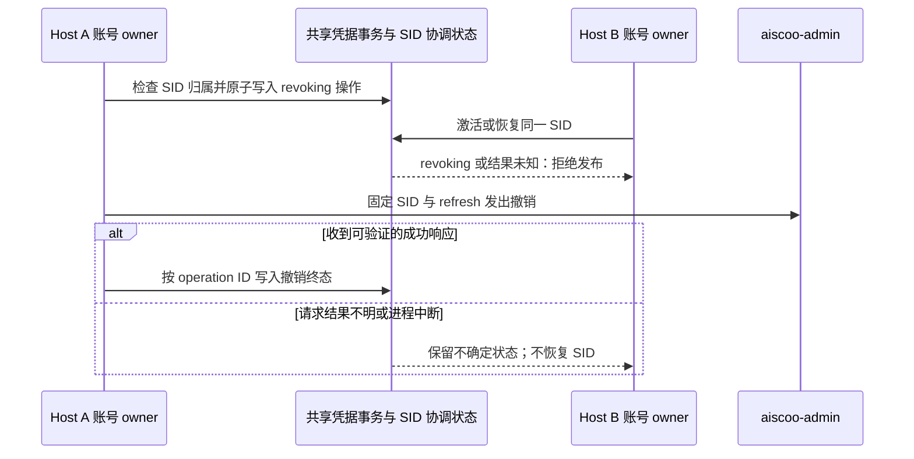
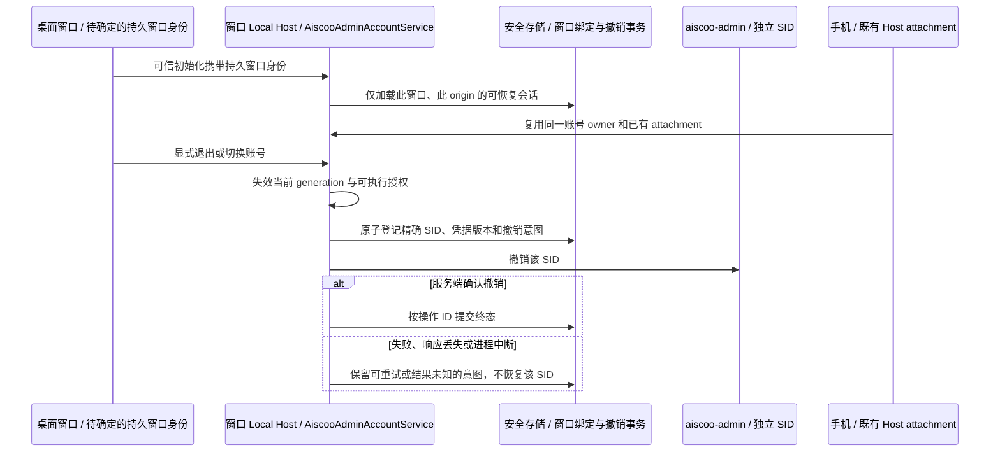
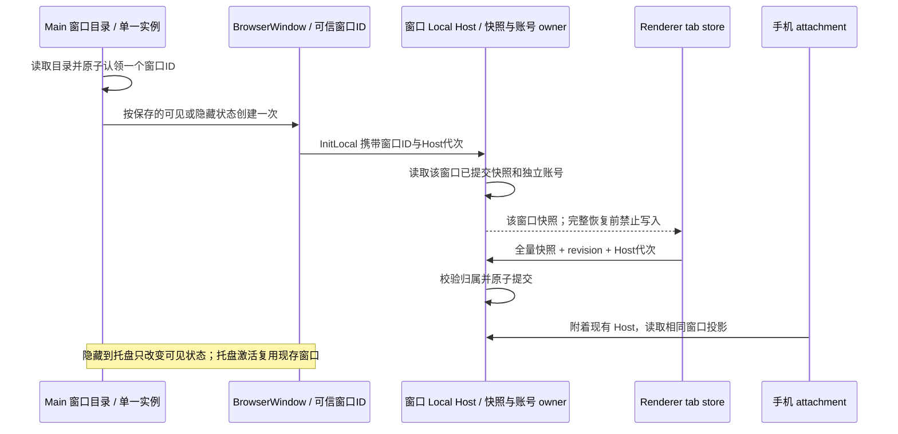

# aiscoo-admin：SID 协调与按窗口会话（草案，未实现）

状态：**草案，未实现、未验证、不属于任何已生效行为。** 本文件只记录设计与前置条件，不能作为验收依据。
实现前须先通过评审并拆成独立变更；已生效的 Native 登录规则以 [aiscoo-admin-integration.md](aiscoo-admin-integration.md) 为准。

已确认的产品决策（2026-11-01）：

- 账号切换保持自动撤销旧会话；显式退出撤销本窗口会话。
- 一个窗口切换账号时，不得撤销仍被其他窗口使用的会话。
- 启用新撤销协议时，旧客户端须更新并重新登录。
- 应用重启后恢复上次打开的窗口及各自账号；新建窗口单独授权登录。

当前产品里只有一个业务窗口入口（`primaryWindowCoordinator` 单飞创建，`second-instance` 只聚焦已有窗口），
`File` 菜单没有“新建窗口”。多个 Host 共享同一 SID 的前提目前只在“多个进程（桌面、CLI、不同 userData 的旧版本）读写同一凭据文件”时成立。
因此下述窗口隔离设计在出现第二个业务窗口入口之前不会被触发；开放该入口必须以本草案的前置条件全部满足为前提。

### SID 激活与撤销协调协议（候选，未实现）

同一 `origin + userId + sid` 的权威协调状态应由共享凭据事务持有；每个窗口的 `AiscooAdminAccountService` 只持有自己的代次与投影。SID 是协调键，不使用明文 token、计时器或进程内缓存作为权威。状态至少区分 `usable`、`revoking` 和 `revocation-unknown`；撤销意图携带不可重用 operation ID，持锁确认 active、精确凭据版本及意图后原子落盘。持久意图必须由所有登录 commit、恢复发布、refresh、取消补偿、显式退出和换号清理共同遵守，旧二进制也必须不能绕过；因此需要明确版本兼容与安全迁移机制，而不是仅给其中一个调用加锁。

1. **激活**：提交或恢复前在同一跨进程事务检查 SID 状态；`revoking` 或结果未知时拒绝激活。恢复的 `/me` 返回后再次检查同一 SID、凭据版本、持久状态和本窗口 generation，再发布 owner；已持有的其他窗口也须收到失效通知或在每次敏感操作前校验权威状态。
2. **撤销**：事务内检查该 SID 未被需要保护的其他 owner 激活，写入 `revoking(operationId)` 并冻结当前 refresh 版本；只有该 operation 可继续远端撤销。提交后释放文件锁执行网络调用，其他进程看到意图须失败关闭，不能靠等待多少秒推断撤销结束。
3. **失败与中断**：确认撤销后原子写入终态并清除精确记录；请求未发出可在证明条件满足时回退。请求已发送但响应丢失、进程死亡或网络结果不明，必须保留 `revocation-unknown`，禁止重激活该 SID，直到服务端提供可靠状态或明确的幂等撤销确认。文件损坏或写失败不抹掉意图，不把网络错误伪装成功。
4. **验证**：需覆盖两个真实 Host 进程同时激活与撤销、请求发出后进程中断、服务端成功但响应丢失、refresh 轮换、恢复 `/me` 迟到、旧客户端共存、意图存储失败与显式退出；同时验证 Desktop continuous 和手机 replayable 的身份失效投影。

当前存储抽象只提供整个凭据文件锁与当前 active 指针，缺少跨进程活跃 owner 注册、可靠失效广播、旧版本兼容门禁及持久撤销状态。现有服务端 logout 文档只规定 `revoked=true`，未证明对结果未知请求的幂等重试或可信查询；直接跨网络持有可被死进程回收的锁也不能证明请求未在服务端完成。候选是扩展兼容的持久协调状态并升级所有读写者，或由服务端提供按 SID 和操作 ID 的可查询幂等撤销；两者均需明确恢复、兼容及验收后才能落地。

### 按窗口独立 Native 会话（设计中，未实现）

已确认的产品规则：一个桌面窗口及其所有本地 workspace 共用该窗口的 Native 会话；不同窗口各自通过交互授权取得独立 SID。账号切换自动撤销本窗口旧 SID，显式退出撤销本窗口 SID；关闭窗口、Renderer reload、Host 重建和应用退出不撤销，保留可恢复状态。旧版共享 active 记录不自动分配给新窗口，升级后须重新登录。手机继续连接所属窗口已有 Host attachment，不能创建另一个账号 owner。远程 workspace 不因此获得 Native 凭据或改变既有私有远程不支持边界。

已核实的实现边界：`desktopWindowLifecycle.ts` 以运行期 `webContents.id` 路由 Host，关闭时销毁 Host；`primaryWindowCoordinator.ts` 只确保一个当前主窗口，`startupWorkspace.ts` 使用全局上次 workspace 记录，均未提供跨重启、跨关窗可认领的持久窗口身份。`aiscooAdminSessionRepo.ts` 仍按 origin 使用共享 active 指针，旧 Host 可以绕过新的隔离或撤销状态；`aiscooAdminSessionOperations.ts` 当前只记录并吞掉撤销失败。不能将 workspacePath、活动 tab、Electron 数字 ID 或仅在进程内生成的随机 ID 冒充持久窗口身份。

2026-11-01 已确认恢复策略：应用重启后自动恢复上次退出或崩溃时仍打开的窗口及各自账号；新建窗口分配新身份并单独登录，不认领其他窗口账号。关闭单个窗口保留其安全会话、不主动撤销，但它不再属于下次启动应自动打开的窗口；被关闭窗口的会话不得被新建窗口自动认领。Renderer reload 或同一窗口的 Host 重建沿用该窗口身份；托盘隐藏或最小化仍视为打开。应用退出时冻结关闭前的窗口集合，不能把正常退出造成的逐个 `closed` 事件误记成用户逐个关闭；崩溃恢复读取最后已持久确认的窗口集合。

窗口身份与打开集合由 Main 管理，随机身份须在创建 Host 前可靠持久化并通过可信 Main→Host 初始化传递；窗口集合的写入、退出冻结、崩溃重启及重复认领须有明确的原子性与失败处理。账号凭据和 generation 仍由各窗口 Host 持有，Renderer 与手机不得决定窗口身份。关闭窗口留下的安全会话与自动恢复集合是不同事实；未经显式账号动作不得把遗留凭据当作另一窗口的登录状态。

现有实现没有可用的独立新窗口业务入口，`useTabPersistence` 的恢复与写回使用全局设置，`projectWorkspaceSettings` 又从共享项目目录投影全局 workspace 集合。若多个窗口各自恢复或写回同一份全局快照，可能串用工作区、覆盖活动项或错误认领远端会话；必须先建立每窗口恢复快照及其唯一所有权，并保留 `workspaceIdentity?.trim() || workspacePath`、远端 `remoteSessionId` 和现有 Host attachment 边界。不能只补随机 ID 后宣称多窗口恢复已经可用；实现前须先维护对应 E2E，覆盖新建入口、多个窗口的本地/远程 workspace、退出与崩溃恢复、关闭单个窗口、托盘隐藏和并发写入。

#### 窗口目录与 workspace 快照的具体设计（尚未实现）

- **唯一所有者**：Main 的 Aiscoo 窗口目录负责分配持久随机窗口 ID、记录启动时应恢复的窗口集合与窗口生命周期；窗口 Local Host 的窗口快照服务负责该窗口的 workspace 成员、顺序及活动项。Main 不保存账号、任务或队列状态，Host 不自行分配窗口 ID。每个窗口的真实 tab 状态由 Renderer 通过受约束的窗口快照服务提交；项目/远端目录仍是共享的项目和连接事实，不是窗口 tab 列表的权威。手机只附着已有 Host，读取同一窗口的服务，不另建窗口目录或快照。
- **窗口目录**：在所选应用数据根下保存独立、版本化的 Aiscoo 窗口目录；记录随机 ID、恢复顺序和最后确认的可见/托盘隐藏状态，不保存账号 secret、动态 Electron ID 或 workspace 明文副本。以单实例 Main 为唯一写入者，串行化变更并使用私有原子替换；目录损坏、未知版本或写入失败要保留原文件并明确失败，不能静默按空集合覆盖。公开新窗口前先持久化新 ID；启动时按目录中的 ID 一次认领一个 Host，重复认领失败。新建窗口必须用新 ID 和空账号，不能认领已关闭窗口或旧的全局 SID。
- **窗口快照**：独立于全局 settings 和共享项目目录，按稳定窗口 ID 保存版本化的 `entries`、`activeKey` 与递增 revision；entry 使用已有 `PersistedWorkspaceSessionEntry` 的本地路径、目的和远程稳定身份/target，跨进程关联继续采用 `workspaceIdentity?.trim() || workspacePath`。`remoteSessionId` 属于当前连接生命周期，只能在现有 attachment 上重新获取，不从磁盘恢复旧值。写入按单窗口单飞顺序提交并校验 Host 实例 generation/revision，关闭或重建后的迟到写入不得复活旧快照；写入失败保留上次完整快照并呈现可诊断错误，不能用空快照覆盖。恢复完成前禁写，active-first 仅为展示投影；用户在延迟恢复期间关闭的 tab 不得复活。
- **现有接入点**：`primaryWindowCoordinator` 在 `app-ready` 增加一次启动恢复协调，继续让 `activate`、Dock 和托盘调用现有 `ensurePrimaryWindow` 并优先复用活窗口；新建入口单独调窗口目录，不复用 ensure。`desktopWindowLifecycle` 将可信窗口 ID 注入 `InitLocal`，Host 重建保留 ID，Renderer reload 继续 attach 原 Host；共享协议必须增加严格可选字段及校验，未启用扩展时原路径不变。`startupWorkspace` 用所属窗口快照计算 active 的本地预热目标，并保留失效目录与 conversation cwd 语义。Renderer 的 `Root`/`useTabPersistence` 通过注入的窗口快照端口恢复与提交，复用现有恢复门禁；不能把 `lastActiveWorkspace` 当完整快照，因为 `readPersistedWorkspaceSessionEntries` 在该字段存在时只返回单个活动项。`SyncWindowTabs` 只发路径、没有远端身份，继续用于当前窗口路由，不承担持久快照。
- **迁移与退出**：首次升级仅为旧主窗口创建一个新 ID，按当前单窗口现有读取逻辑导入其可确认的 workspace 投影，不把共享项目目录推断成多个窗口，也不自动认领旧全局账号。首次快照和目录初始化以可恢复事务顺序提交，崩溃后幂等重试且不能覆盖已有窗口快照。正常退出在关闭前冻结并持久确认打开窗口集合；只有用户明确关闭单窗才移出集合，保留安全会话但不自动认领。托盘隐藏或最小化不移除；重启恢复只创建一次该 ID，托盘隐藏窗口按其保存状态创建，托盘点击只唤回它，不能再创建第二份。如果本次启动托盘不可用，隐藏窗口必须显示出来，不能让用户失去入口；恢复过程中的 Dock/activate/托盘请求要与启动恢复共同单飞，不能依据尚未创建的窗口再创建一个主窗口。目录不存在是首次启动，空目录是无应恢复窗口；两者不可混淆。崩溃只恢复最后成功提交的目录与快照，不推断未提交写入已成功。
- **跨层顺序和窗口退出**：Main 在创建 Host 前只通过同一快照存储的只读启动端口获取当前窗口的最后提交版本，用于工作区预热；Host 初始化后成为该窗口快照唯一写入者，不能由 Main 或 Renderer 另维护一份可写快照。正常关闭在 `close` 准入后先使旧写入代次失效并等待已接纳快照落盘，再原子提交目录移除，最后释放 Host；失败时不得声称已持久关闭。整个应用退出必须先冻结集合、等待全部窗口已接纳写入与目录提交，再允许 Host 销毁；用户取消退出时解除冻结并保留原集合。macOS `quitAndInstall` 可能先关窗后触发 `before-quit`，更新安装路径必须复用同一退出屏障，不能只监听 `before-quit`。崩溃或强制终止不能保证最后未确认操作落盘，重启使用最后成功提交版本并明示该边界。

**验收入口**：桌面“文件”菜单追加可本地化的“新建窗口”，菜单项 ID 为 `aiscoo.file.new-window`，使用与已有 File 菜单相同的系统原生交互；自动化通过该菜单项触发真实命令，不直接创建 BrowserWindow。命令仅在窗口快照和 Native 主账号隔离均具备安全门禁时对实际用户放行；测试不能把未隔离的共享账号当成隔离成功。

**新窗口 Native 准入（设计中）**：窗口持久身份必须由可信 Main 经严格校验的 Host 初始化协议传入；每个窗口的 active 和 session 记录采用独立于旧版 `new-api:<origin-hash>:active` 及旧 SID 记录的私有命名空间，首次没有窗口记录时保持未登录并要求用户主动授权。验证新授权及 `/me`、窗口归属和代次后才提交并发布；不把旧版 active、其他窗口记录、同用户名、workspace 或浏览器 Cookie 当成此窗口授权。冷恢复只能读取同一窗口已提交的独立 SID，换号、退出和取消的清理严格限制该 SID。手机继续使用所属 Host attachment，不获取独立身份。目录/协议版本无法验证、身份缺失、旧版本共存不能安全判定或迁移未完成时，默认不提供或禁用新窗口入口，所有创建路径复用同一 Main 准入门，不能用 Renderer 隐藏或环境变量作为安全证明。原单窗口路径和已有凭据恢复候选不得在门禁失败时被覆盖或回收。

**旧版本共存边界**：现有旧 Host 从共享 active 加载凭据到内存，随后可不再读取磁盘；Electron 的单实例锁按 userData 目录作用，不能证明使用不同 profile、Headless Host 或旧二进制的进程已退出。新命名空间阻止旧版通常的按 key 读取新记录，但单靠本地重命名、删除旧 active 或检测单实例锁，不证明旧进程与当前授权 SID、共享文件写入、撤销请求之间不存在竞争。未建立并验收跨进程版本隔离和关闭旧写入者的可靠边界前，新入口保持关闭；必须用真实旧版 Host 共存和降级进程验收，而不是仅模拟两个新版 Repo。服务端单次授权签发独立 SID 的证据与撤销不确定结果的最终确认分别验证；旧客户端升级重新登录不代表旧进程已经停止。

**追加账号验收**：隔离新旧两个真实 Host，先在旧版取得 A、启动新版并验证门禁关闭且旧 A 仍可用；覆盖不同 userData/同数据根、旧 Host 已加载凭据后继续运行、旧版写入和重启、无窗口 ID、未知 schema、目录损坏及策略缺失。仅在准入证明完备后分别让两个窗口经真实授权获取不同 SID，重启各自恢复，退出/换号一窗不影响另一窗或其手机 attachment。网络响应丢失、刷新轮换和进程崩溃按既有不确定撤销语义处理。菜单不存在或禁用只证明入口当前关闭，不证明多 Host 并存或账号隔离通过。

**验收与测试环境**：先维护 Electron E2E 覆盖首次迁移、两个窗口各自本地和远程身份、同路径不同身份、不同活动项、各自登录及安全重启；覆盖正常退出、renderer reload、Host 重建、进程崩溃、托盘隐藏后点击、关闭一窗、并发快照写入、写入失败、损坏和重复认领。断言窗口数量、每个 Host 身份和真实快照，不只断言 UI 文案；用真实手机 attachment 验证同一 owner 和 replayable 投影。仓库桌面入口是 `pnpm --filter @zcode/desktop test:e2e:serial`，用 `ZCODE_E2E_SPEC` 或 WDIO `--spec` 选择实际用例；Node 必须为 24.14.0。运行前按照 `aiscoo-admin-integration-runbook.md` 的隔离清单核查 Electron user/session data、CLI 存储/数据库/日志、启动 workspace 和系统协议注册；其已记录的 `os.homedir()` 启动恢复及 CLI 用户配置隔离缺口必须处理，不能仅设置测试 HOME 就访问真实用户数据。不可用环境或未实现的用例分别记录，不能将确定性测试当作桌面/手机真实验收。

跨版本迁移必须证明旧 Host 不再持有或重用原共享 SID，且旧二进制无法将该 SID 再写回或对新窗口 SID 执行撤销；仅删除旧 active 指针不能约束已经加载的旧进程。新窗口授权必须使用全新独立 SID 和版本隔离存储，迁移期间不得撤销仍由旧 Host 使用的 SID。旧客户端并存、降级及其他进程的执行门禁须有实际可执行的约束；无法保证时迁移失败关闭，不声称已保护其他窗口。

撤销必须先持久记录意图及精确 refresh 版本，按窗口隔离串行处理 refresh、退出和切换；服务端只确认 `revoked=true`，当前合同没有可查询的操作 ID 或已证明可幂等重试的结果。请求可能已成功但响应丢失时，保留未知状态和安全凭据，禁止恢复或复用该 SID；不得将本地删除、普通网络错误或无凭据成功作为服务端撤销证明。是否能自动完成未知状态的清理，取决于服务端提供可验证的查询或幂等协议；在此之前不能承诺最终必达撤销。

验收门槛：真实两个独立 Host 分别登录 A/B，同一窗口打开多个 workspace；分别覆盖窗口关闭再打开、应用重启、Renderer reload 与 Host 崩溃重建。切换或退出一个窗口时另一窗口和手机 attachment 保持所属身份；并发 refresh、退出、切换、迟到 `/me`、存储失败、撤销请求发出后进程死亡及响应丢失均不得复活或误撤销其他 SID。用真实旧版 Host 验证升级共存及降级边界；桌面 continuous 与手机 replayable 均检查失效投影。所有测试使用隔离账号、凭据与数据目录；未通过前不得将本节标记为已实现。
