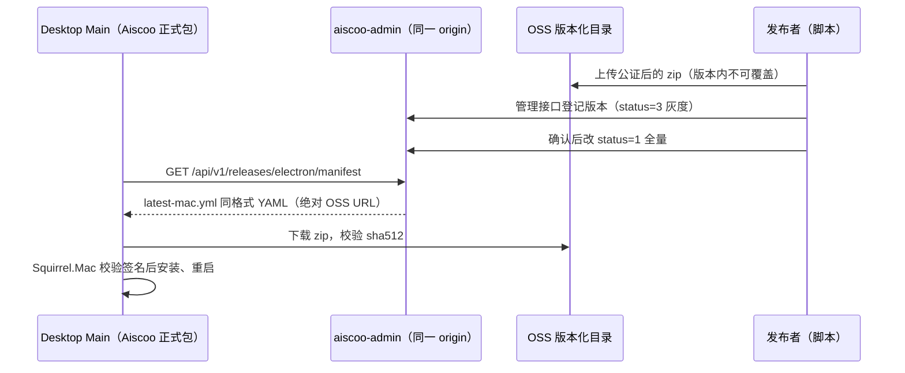
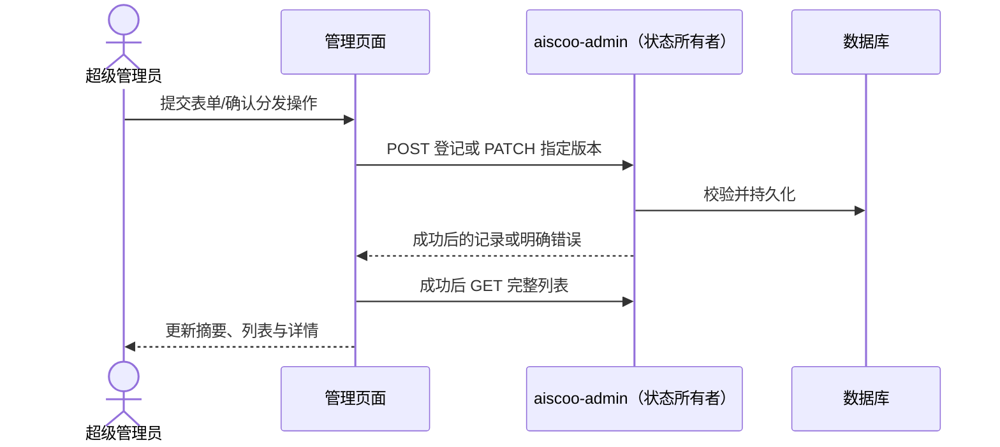

# Aiscoo 应用内更新

状态：用户于 2026-11-01 要求"完全按照上游的更新逻辑来实现，后端更换成用户自己的后端"，随后确认增加后台版本管理页面。本轮只覆盖 macOS arm64；服务端与管理页面实现在 aiscoo-admin；新版本经管理页面、管理接口或发布脚本登记；强制更新只把客户端指向 Aiscoo 后端，服务端暂不实现。

## 1. 产品规则与边界

- 客户端完全沿用上游更新逻辑：`electron-updater`、`ManifestUpdateProvider`、检查→发现→下载→安装状态机、stable/preview 通道、`device_mid` 灰度、更新窗口与 release notes。协议见 [上游 manifest 文档](../../desktop/auto-update-service-manifest.md)。
- 唯一差异是 manifest 来源：Aiscoo 正式包请求 Aiscoo 账号服务同一 origin（`AISCOO_ADMIN_BASE_URL`，构建期编译进 Main，见 [唯一账号登录](aiscoo-only-login.md) 的“正式安装包的账号源”），不请求 `https://zcode.z.ai`。
- 失败关闭：打包态取不到合法的 Aiscoo origin 时关闭自动更新并记 info 日志，不得回退官方地址。官方 origin 对 Aiscoo 包永远不是更新源，因为那里只分发 ZCode 安装包。
- 只有 production 渠道启用（上游门禁 `ZCODE_PRODUCT_FLAVOR === "production" && ZCODE_AUTO_UPDATE_ENABLED`）。Aiscoo production 打包必须设置构建期 `ZCODE_AUTO_UPDATE=1`；Preview、Dev 渠道保持关闭。
- 未设置 Aiscoo 受信 origin 的构建（上游通用构建）与上游行为完全一致：打包态只接受官方 origin。
- 强制更新闸门（`/api/v1/client/configs`）同样请求 Aiscoo origin。服务端未实现该接口时返回非 2xx，客户端按上游逻辑跳过强更（fail-open），不阻断启动。
- 现有 3.17.1 包未开启更新开关，已安装用户必须手动安装第一个带更新能力的版本，之后才能应用内升级。
- 第一个带更新能力的版本是 Aiscoo 的 `3.17.2`。仓库根 `package.json` 与 `package-lock.json` 的版本（共 3 处：`package.json` 1 处，锁文件顶层和 `packages[""]` 各 1 处）在 2026-11-02 起为 `3.17.2`；它是 Aiscoo 自己的版本，不对应任何上游 ZCode tag，上游最新仍是 `v3.17.1`。把版本号改为 `3.17.2` 只改变下一次构建产物的版本号，不构建、不签名、不公证、不上传、不登记、不打 tag；正式发布仍须按第 5 节流程并由用户单独批准。
- 下次同步上游时，`package.json` 与 `package-lock.json` 的版本行必然冲突：保留 Aiscoo 的版本，除非上游版本号已高于它。冲突的取舍写进同步记录；不得为了让冲突消失把版本改回上游的 `3.17.1`，因为已发布的 `3.17.1` 包没有更新能力，版本号回退会让新包被客户端判定为旧版本。

## 2. 所有者与顺序



- 版本可见性只由 aiscoo-admin 决定；客户端只传 `platform`、`channel`、`device_mid`，不在本地实现灰度。
- 安装包文件只由 OSS 托管；manifest 只下发绝对 HTTPS URL，不走账号服务端口下载。
- macOS 安装由 Squirrel.Mac 校验新旧 app 同一 Developer ID 团队签名；ad-hoc 签名包不能升级。

## 3. Manifest 接口契约

```text
GET {AISCOO_ADMIN_BASE_URL}/api/v1/releases/electron/manifest
```

| query        | header              | 取值                                                           |
| ------------ | ------------------- | -------------------------------------------------------------- |
| `platform`   | `X-Platform`        | `darwin-aarch64`；服务端同时接受 `darwin-arm64`，按 query 优先 |
| `channel`    | `X-Release-Channel` | stable `1`，preview `3`；缺失或其他值按 stable 处理            |
| `device_mid` | `X-Device-Mid`      | 桌面端 telemetry 设备 ID，可缺失                               |

- 匿名、只读，`Cache-Control: no-store`，`Content-Type: application/x-yaml; charset=utf-8`，正文直接是 YAML，不套 `{success,data}`。
- 响应字段：`version`、`files[{url,sha512,size}]`、`path`、`sha512`、`releaseDate`（RFC 3339）、`minimumSystemVersion`（macOS 为 Darwin 版本 `22.0.0`）、`releaseNotesByLocale`（`zh-CN`、`en-US`，可缺省）。`path`/`sha512` 等于第一个文件。
- 无可用版本、平台未知：`404`，正文为空。客户端把它当作一次检查失败，下次轮询再试。
- 限流使用单独档位（默认每 IP 每 180 秒 120 次），不得套用 `CriticalRateLimit`（20 次/20 分钟），否则同一出口 IP 的多台设备会被误限。

### 选版规则

- 只看对应平台、`status` 为 1（全量）或 3（灰度）的版本，按语义化版本取最高。`status=0` 为下线。
- stable：只返回 `status=1` 的最高版本。
- preview：返回对该设备可见的 `status=3` 最高版本与 `status=1` 最高版本中较高者。
- 灰度可见：`rollout_disabled=false`，且 `device_mid` 在白名单内，或 `FNV-1a(version + ":" + device_mid) mod 100 < rollout_percentage`。缺 `device_mid` 时只能命中全量版本。
- 同版本同平台唯一；版本登记后文件 URL、sha512、size 不可修改，换包必须发新版本。

## 4. 管理接口契约

均为 `RootAuth` + 审计 + `no-store`，仅 root 可调用；PAT 还须具备 `ops:read`（列表）或 `ops:write`（登记与修改），返回现有 `{success,message,data}` 包装。

| 方法与路径                         | 作用                                        |
| ---------------------------------- | ------------------------------------------- |
| `GET /api/v1/admin/releases`       | 列出所有登记版本（按创建时间倒序）          |
| `POST /api/v1/admin/releases`      | 登记新版本，初始 `status` 只能是 0 或 3     |
| `PATCH /api/v1/admin/releases/:id` | 改 `status`、灰度比例/开关/白名单、更新说明 |

登记校验：`version` 为语义化版本；`platform` 为已知平台；文件至少一个，URL 必须 `https` 且主机在 `DESKTOP_RELEASE_ALLOWED_HOSTS`（逗号分隔，默认空即拒绝全部）内；`sha512` 为 88 位 base64；`size > 0`；`rollout_percentage` 0–100；`minimum_system_version` 为点分数字。白名单最多 200 个设备 ID。

### 管理页面

- 入口为 aiscoo-admin「管理员 → 版本」(`/desktop-releases`)，放在任务插件与系统设置之间；页面标题仍是「版本管理」。菜单名用更短的「版本」，因为 13rem 的侧栏放不下「版本管理」的英文、法文和俄文标题，会被省略号截断。菜单和路由均仅 root 可访问，服务端仍由 RootAuth 决定操作权限。
- 管理接口拒绝请求时，每条原因同时是哨兵错误（控制器据此选 HTTP 状态）和带 `message_key`/`message_params` 的控制台消息；key 是英文原文，占位符为 `{{host}}`、`{{max}}`，中文等界面据此翻译，API 调用方仍得到渲染后的英文。
- 使用现有 SectionPageLayout、DataTablePage、移动卡片、Sheet、ConfirmDialog、CopyButton 与 Markdown。列表按语义版本倒序，搜索、状态筛选与分页均基于 GET 返回的完整列表。
- 顶部显示当前正式供给版本（对应平台具有文件的 status=1 最高语义版本）与灰度/暂停数量。版本日期来自 release_date，不作为正式发布操作时间；没有安装量、成功率或实际覆盖率。
- 状态呈现为「未分发」(0)、「预览灰度」(3)、「已暂停」(3 且 rollout_disabled)、「正式发布」(1)。status=0 无法区分未发布与已下线，统一称未分发。较低的正式版本标为历史正式版。
- 新建使用右侧约 720px 的表单，手机全屏；包含版本、固定 macOS Apple Silicon 平台、有序 files（首项主文件，最多 8 项）、双语说明、最低系统版本与版本日期。保存固定 status=0，创建成功后打开详情，再通过独立操作启动灰度或正式发布。
- 支持本地 latest-mac.yml 填充元数据：只读取文件，不访问清单地址、不上传二进制、不采纳清单中的分发状态。相对 URL 必须补全 HTTPS 地址；摘要需 base64 的 64 字节 SHA-512，size 为正的安全整数；导入体积与 YAML 别名展开有上限。登记成功不能宣称远端文件、签名、公证或下载摘要验证成功。
- 登记后版本、平台、files、最低系统版本、版本日期只读；仅说明和灰度配置可编辑。更新说明按 zh-CN/en-US 分别编辑/预览，切换时保留输入，关闭未保存表单需确认。
- 灰度配置提供 0–100 整数百分比和每行一个设备 ID（最多 200 项），支持 0/10/25/50/100 快捷值，保存前呈现范围摘要。0% 配合白名单可只给指定设备；100% 仍只覆盖预览通道。暂停同时阻止白名单命中，不作用于 status=1。
- 正式发布、暂停/恢复与停止分发使用具名确认，说明具体版本和影响。正式发布展示当前→操作后的正式供给版本；较低版本发布不会降级。停止当前正式版展示剩余最高正式版或明确的无版本状态，已安装设备保持原版本。
- API 是状态唯一所有者；页面仅保留表单/提交状态，成功后刷新列表，不在请求成功前展示已发布或已停止。失败保留输入并展示具体错误，提交期间禁止重复提交。列表请求传递 Query 的取消信号并绕过 HTTP 层在途去重，防止保存后的刷新复用旧快照；编辑灰度只 PATCH 实际修改的字段，避免修改比例时覆盖并发更新的白名单。版本比较与服务端接受的 int64/预发布标识比较行为保持一致。



## 5. 发布产物（macOS arm64）

1. `notarize-macos.sh` 原地对 `.app` 做 Developer ID 签名、生成并公证 DMG。DMG 用于官网首次下载。
2. `scripts/aiscoo/build-macos-update-feed.sh` 对同一个已签名的 `.app` staple 公证票据，`ditto -c -k --keepParent` 打 zip，计算 base64 sha512 与字节数，生成 `latest-mac.yml`。重签前 electron-builder 生成的 zip 与 yml 一律作废。
3. `scripts/aiscoo/publish-macos-update.mjs` 默认 dry-run，只流式校验本地产物并打印对象与登记载荷，不联网、不启动云 CLI、不读取管理 token；`--execute` 才按“本地 sha512/size 校验 → OSS 原子上传 → 公开 HTTPS GET 完整流式 sha512/size 校验 → 管理接口登记”的顺序执行。OSS 路径沿用 `releases/aiscoo/<版本>/macos/arm64/<构建标识>/`；feed 的 `files[0].url` 与可选 `path` 必须是同一个 zip basename，拒绝目录、编码路径、查询或片段，版本必须是合法语义化版本。
   发布配置为 `AISCOO_RELEASE_OSS_BUCKET`（桶）、`AISCOO_RELEASE_OSS_HOST`（公开下载 host，可含端口，始终 HTTPS）、`AISCOO_RELEASE_OSS_REGION`（默认 `cn-hangzhou`）、`AISCOO_RELEASE_OSS_ENDPOINT`（服务 endpoint，默认 `oss-cn-hangzhou.aliyuncs.com`，与下载 host 分开）、可选 `AISCOO_RELEASE_OSS_PROFILE`（显式透传，否则沿用当前 profile）及 `AISCOO_ADMIN_BASE_URL`。上传复用 `aliyun --auto-plugin-install false ossutil api put-object`，使用 ossutil 2.3.0 支持的 `--cache-control`、`--object-acl public-read` 与服务端 `--forbid-overwrite=true`；`public-read` 仅用于本次上传的公开发布对象，不修改桶 ACL，避免对象继承 private 桶权限后无法公开下载；不以 `stat` 预检代替原子拒绝覆盖，不把权限、网络或其他上传失败当作不存在。任何上传或公开下载校验失败均停止登记；下载不跟随重定向。管理认证复用现有 root PAT `ops:write`，只在 execute 时从 `AISCOO_ADMIN_ACCESS_TOKEN` 读取，以 Bearer 头发送到管理 origin，不写入日志。

## 6. 验收场景

1. 打包态编译了 Aiscoo origin：manifest 请求发往该 origin，不发往官方。
2. 打包态未编译或编译值非法：更新关闭，不发出任何 manifest 请求。
3. 未传 Aiscoo 受信 origin（上游通用构建）：非官方 origin 仍被改回官方，上游 `packaged-backend-override` 场景继续通过。
4. 服务端选版：stable/preview、灰度 0/50/100、白名单、总开关、缺 `device_mid`、平台别名、无版本 404，YAML 可被客户端 `ManifestUpdateProvider` 解析。
5. 管理接口：非 https、非白名单主机、坏 sha512、非法版本、登记后修改文件均被拒绝。
6. 真实安装：旧、新两个 Developer ID 签名公证包，旧包检查到新版本、下载、重启后版本号更新。涉及签名与上传，需用户单独批准后执行。
