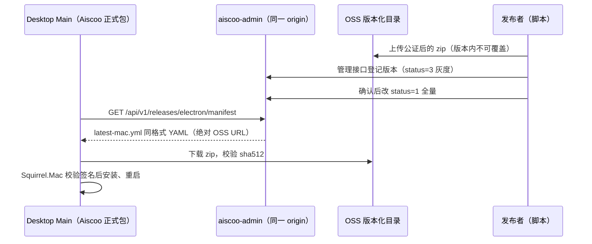

# Aiscoo 应用内更新

状态：用户于 2026-11-01 要求"完全按照上游的更新逻辑来实现，后端更换成用户自己的后端"。本轮只覆盖 macOS arm64；服务端实现在 aiscoo-admin；新版本经管理接口与发布脚本登记，不做后台页面；强制更新只把客户端指向 Aiscoo 后端，服务端暂不实现。

## 1. 产品规则与边界

- 客户端完全沿用上游更新逻辑：`electron-updater`、`ManifestUpdateProvider`、检查→发现→下载→安装状态机、stable/preview 通道、`device_mid` 灰度、更新窗口与 release notes。协议见 [上游 manifest 文档](../../desktop/auto-update-service-manifest.md)。
- 唯一差异是 manifest 来源：Aiscoo 正式包请求 Aiscoo 账号服务同一 origin（`AISCOO_ADMIN_BASE_URL`，构建期编译进 Main，见 [唯一账号登录](aiscoo-only-login.md) 的“正式安装包的账号源”），不请求 `https://zcode.z.ai`。
- 失败关闭：打包态取不到合法的 Aiscoo origin 时关闭自动更新并记 info 日志，不得回退官方地址。官方 origin 对 Aiscoo 包永远不是更新源，因为那里只分发 ZCode 安装包。
- 只有 production 渠道启用（上游门禁 `ZCODE_PRODUCT_FLAVOR === "production" && ZCODE_AUTO_UPDATE_ENABLED`）。Aiscoo production 打包必须设置构建期 `ZCODE_AUTO_UPDATE=1`；Preview、Dev 渠道保持关闭。
- 未设置 Aiscoo 受信 origin 的构建（上游通用构建）与上游行为完全一致：打包态只接受官方 origin。
- 强制更新闸门（`/api/v1/client/configs`）同样请求 Aiscoo origin。服务端未实现该接口时返回非 2xx，客户端按上游逻辑跳过强更（fail-open），不阻断启动。
- 现有 3.17.1 包未开启更新开关，已安装用户必须手动安装第一个带更新能力的版本，之后才能应用内升级。

## 2. 所有者与顺序



- 版本可见性只由 aiscoo-admin 决定；客户端只传 `platform`、`channel`、`device_mid`，不在本地实现灰度。
- 安装包文件只由 OSS 托管；manifest 只下发绝对 HTTPS URL，不走账号服务端口下载。
- macOS 安装由 Squirrel.Mac 校验新旧 app 同一 Developer ID 团队签名；ad-hoc 签名包不能升级。

## 3. Manifest 接口契约

```text
GET {AISCOO_ADMIN_BASE_URL}/api/v1/releases/electron/manifest
```

| query        | header              | 取值                                                           |
| ------------ | ------------------- | -------------------------------------------------------------- |
| `platform`   | `X-Platform`        | `darwin-aarch64`；服务端同时接受 `darwin-arm64`，按 query 优先 |
| `channel`    | `X-Release-Channel` | stable `1`，preview `3`；缺失或其他值按 stable 处理            |
| `device_mid` | `X-Device-Mid`      | 桌面端 telemetry 设备 ID，可缺失                               |

- 匿名、只读，`Cache-Control: no-store`，`Content-Type: application/x-yaml; charset=utf-8`，正文直接是 YAML，不套 `{success,data}`。
- 响应字段：`version`、`files[{url,sha512,size}]`、`path`、`sha512`、`releaseDate`（RFC 3339）、`minimumSystemVersion`（macOS 为 Darwin 版本 `22.0.0`）、`releaseNotesByLocale`（`zh-CN`、`en-US`，可缺省）。`path`/`sha512` 等于第一个文件。
- 无可用版本、平台未知：`404`，正文为空。客户端把它当作一次检查失败，下次轮询再试。
- 限流使用单独档位（默认每 IP 每 180 秒 120 次），不得套用 `CriticalRateLimit`（20 次/20 分钟），否则同一出口 IP 的多台设备会被误限。

### 选版规则

- 只看对应平台、`status` 为 1（全量）或 3（灰度）的版本，按语义化版本取最高。`status=0` 为下线。
- stable：只返回 `status=1` 的最高版本。
- preview：返回对该设备可见的 `status=3` 最高版本与 `status=1` 最高版本中较高者。
- 灰度可见：`rollout_disabled=false`，且 `device_mid` 在白名单内，或 `FNV-1a(version + ":" + device_mid) mod 100 < rollout_percentage`。缺 `device_mid` 时只能命中全量版本。
- 同版本同平台唯一；版本登记后文件 URL、sha512、size 不可修改，换包必须发新版本。

## 4. 管理接口契约

均为 `AdminAuth` + 审计 + `no-store`，返回现有 `{success,message,data}` 包装。

| 方法与路径                         | 作用                                        |
| ---------------------------------- | ------------------------------------------- |
| `GET /api/v1/admin/releases`       | 列出所有登记版本（按创建时间倒序）          |
| `POST /api/v1/admin/releases`      | 登记新版本，初始 `status` 只能是 0 或 3     |
| `PATCH /api/v1/admin/releases/:id` | 改 `status`、灰度比例/开关/白名单、更新说明 |

登记校验：`version` 为语义化版本；`platform` 为已知平台；文件至少一个，URL 必须 `https` 且主机在 `DESKTOP_RELEASE_ALLOWED_HOSTS`（逗号分隔，默认空即拒绝全部）内；`sha512` 为 88 位 base64；`size > 0`；`rollout_percentage` 0–100；`minimum_system_version` 为点分数字。白名单最多 200 个设备 ID。

## 5. 发布产物（macOS arm64）

1. `notarize-macos.sh` 原地对 `.app` 做 Developer ID 签名、生成并公证 DMG。DMG 用于官网首次下载。
2. `scripts/aiscoo/build-macos-update-feed.sh` 对同一个已签名的 `.app` staple 公证票据，`ditto -c -k --keepParent` 打 zip，计算 base64 sha512 与字节数，生成 `latest-mac.yml`。重签前 electron-builder 生成的 zip 与 yml 一律作废。
3. `scripts/aiscoo/publish-macos-update.mjs` 默认 dry-run，打印将上传的对象与登记载荷；`--execute` 才上传 OSS 并调用管理接口。OSS 路径沿用 `releases/aiscoo/<版本>/macos/arm64/<构建标识>/`，已存在的对象拒绝覆盖。管理凭据只从环境变量读取，不写入日志。

## 6. 验收场景

1. 打包态编译了 Aiscoo origin：manifest 请求发往该 origin，不发往官方。
2. 打包态未编译或编译值非法：更新关闭，不发出任何 manifest 请求。
3. 未传 Aiscoo 受信 origin（上游通用构建）：非官方 origin 仍被改回官方，上游 `packaged-backend-override` 场景继续通过。
4. 服务端选版：stable/preview、灰度 0/50/100、白名单、总开关、缺 `device_mid`、平台别名、无版本 404，YAML 可被客户端 `ManifestUpdateProvider` 解析。
5. 管理接口：非 https、非白名单主机、坏 sha512、非法版本、登记后修改文件均被拒绝。
6. 真实安装：旧、新两个 Developer ID 签名公证包，旧包检查到新版本、下载、重启后版本号更新。涉及签名与上传，需用户单独批准后执行。
