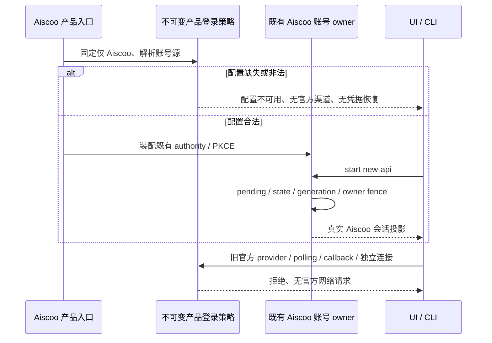
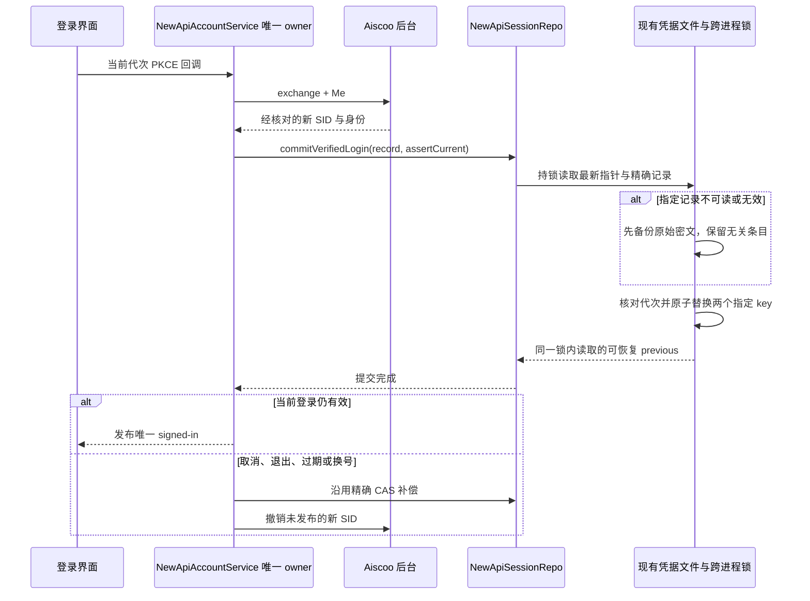
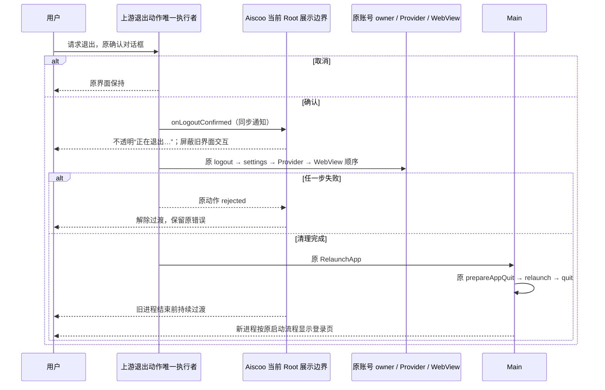
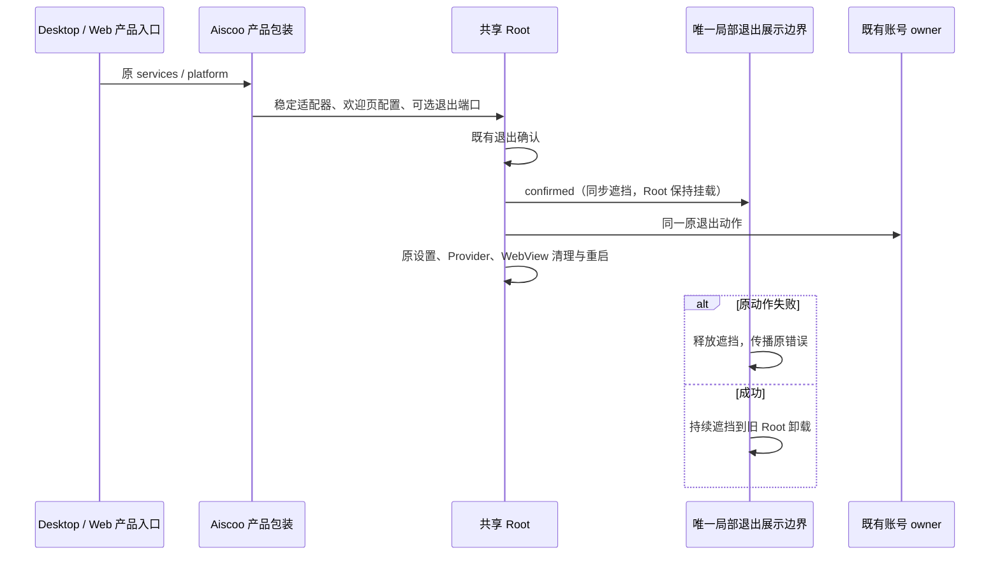

# Aiscoo 唯一账号登录

状态：用户于 2026-10-31 明确要求“删除，清理 Z.ai／BigModel 登录相关的”。本规格覆盖旧规范中保留官方主登录、独立官方连接及条件式回退的规则；以本规格为准。

## 1. 产品规则与边界

- Aiscoo Desktop、Web 和 Aiscoo CLI 产品入口只允许 Aiscoo 账号（内部稳定 provider ID 为 `new-api`，CLI 沿用现有 Zen/Aiscoo 授权实现）。不再展示、发起或恢复 Z.ai／BigModel 产品账号登录。
- 删除 Aiscoo 的官方主账号回退、Z.ai polling 登录、独立 `official-cloud` 连接入口及其产品装配。缺配置、空配置、非法配置、服务失败、退出和旧会话恢复均不得启用旧官方账号；服务端/RPC 与原生 deep-link 边界也必须拒绝，不能只隐藏按钮。
- 自配模型/API Key、供应商模型协议、BigModel/Z.ai 的自配 Provider、主题名、上游归属、第三方插件/MCP 的 OAuth 不属于产品账号登录，不随本次清理删除。历史 token、数据库和安全库条目不自动删除、迁移或认领；产品入口不再读取它们作为当前身份。
- 通用上游认证实现可留作未注入产品策略时的能力；Aiscoo 的所有产品入口必须显式装配唯一账号策略。复用扩展点、只追加配置及最小装配接线，不重写上游 OAuth 状态机。
- 没有 Aiscoo 权益替代的官方 MCP/闲时云功能进入真实不可用状态，不重新开放官方登录，不使用 Aiscoo token 请求官方服务，不伪造额度或可执行模型。

## 2. 配置与平台

公开账号源仍为 `AISCOO_ADMIN_BASE_URL`，必须是严格 HTTPS origin 或现有允许的 loopback HTTP；没有生产默认地址，不读退役的 `NEW_API_BASE_URL`，不复用 Z.ai/BigModel 端点推断账号源。

Desktop Aiscoo 渠道始终启用产品账号限制。Main、Host、scheduler 对同一配置作一致决策；未配置或非法配置显示稳定且不含实际地址的配置错误，不能创建旧官方 OAuth owner、恢复旧官方会话或出站请求。设置和会话数据仍由既有 owner 持有。正式包没有运行账号配置时也必须失败关闭，不能依赖开发 `.env` 存在。

本机 Web 复用已实现的浏览器 New API authority、同源控制 API 代理和严格 loopback PKCE callback；未启用/未配置显示不可用。远控/分享原有 Z.ai/BigModel 浏览器登录入口停止使用；不在本次绕过或改写现有 relay、配对、权限、Host attachment、回调或 CORS 边界。已有可用 attachment 的恢复链路与公开只读分享尽量保持，不支持 Aiscoo 身份的路由明确不可用，不静默读取旧官方浏览器登录态。

Aiscoo CLI 复用已有 Zen/Aiscoo 命令与安全存储。默认登录只引导 Aiscoo；指定 Z.ai/BigModel 或旧官方自动登录/恢复路径在产品入口拒绝并提示 Aiscoo。通用 CLI 实现仍可按上游扩展原则保留，产品命令不可绕回官方登录。

## 3. 唯一状态所有者与事件顺序

有效配置下仍由 Desktop `NewApiAccountService`、Web 浏览器 New API authority、CLI Zen credential owner 分别持有自身既有会话；不新建第二份 accepted login 状态。配置不可用适配器只提供不可用投影，不伪造账号、SID、token 或授权流程。Renderer 通过服务 hook 投影。

退出、取消、换号、过期、迟到回调继续沿原 owner 的同步失效、异步撤销和一次消费规则；不恢复旧官方 identity。冷启动尚未发布 active provider、授权仍 pending 或恢复请求未返回时，退出也必须立即委托同一 owner 失效，不能因 UI 前置查询为空而跳过或延迟失效。Desktop `desktop-continuous` 与手机 `web-remote-replayable` 维持原含义，手机不新建 Agent 或 Host。

凭据端口在判断退役命名空间和读取 manual 来源前，使用与底层一致的规范化 key。首尾空白不能绕过旧官方读取/写入/删除限制，也不能绕过 CLI 手工 API Key 来源判定；批量接口同样在任何 IO 前检查每个 key。

## 4. 验收

1. 登录界面、设置、使用统计、Web 预连接及 CLI 入口不再出现可点击的 Z.ai/BigModel 产品登录；旧官方用户缓存不构成已登录 Aiscoo。覆盖空 providers、仅旧官方、混合 provider 和合法 Aiscoo。
2. 服务/RPC/原生边界拒绝官方 provider、polling 和独立连接；缺失/空/非法配置及旧凭据存在时均无官方 restore、刷新或登录请求；自配模型和第三方 MCP OAuth 保持原行为。
3. 合法 Aiscoo 配置继续使用真实原有 PKCE、渠道精确 callback、取消/退出/过期与 stale owner 防护；不改后端协议、API 路径或登录凭据格式。
4. 交互先维护既有 E2E/浏览器验收场景，再修改实现；App 不新增已退役业务单测。复用获批下游回归与 CLI/工程入口，使用隔离数据和假后端，不访问真实账号/钥匙串或调用计费模型。
5. 执行 root typecheck、lint、架构、对应回归和 Desktop/Web 构建，列明上游最小装配文件及 `git merge-tree` 预演结果。平台、真实后端或工具受限的验收如实记录，不以定向通过宣称完整 E2E。

## 5. 已验证新登录的定向凭据恢复

2026-10-31 运行日志确认：授权码兑换和真实 Me 校验之后，读取已有 New API 登录记录发生 `ZCODE_CREDENTIAL_DECRYPT_FAILED`，新登录在提交前失败。单独忽略 `loadActive()` 错误仍会在覆盖 active 指针时再次解密失败；具体密钥失配或密文损坏来源尚未确认。

- `NewApiAccountService` 仍是唯一账号 owner。只有当前代次的交互式登录完成 PKCE 换码、bundle 校验与真实 Me 身份核对后，才允许调用 repo 的已验证登录提交端口；冷恢复、刷新、退出和公共凭据 RPC 不获得该能力。
- 提交在现有凭据文件跨进程锁内读取最新 active 指针及其精确 owner 记录，并只替换当前 origin 的 active 指针和新授权的精确 `userId:sid` 记录。旧记录不可解密、明文、schema 无效或 owner 不一致时可恢复；无关 SID、其他 origin、官方历史及第三方凭据逐字节保留，不遍历解密、不重建安全库密钥。
- 发生定向恢复时，先使用现有私有备份机制保存完整原始密文字节（0600），备份成功才允许原子替换；备份失败、文件 IO、整份 JSON/schema 损坏或安全库不可用均失败关闭，不能视为空 store 覆盖。
- 在锁内读取后、备份后和写入前核对 pending/generation/到期。写入期间的取消、退出或换号继续执行现有 CAS 补偿和未发布 SID 撤销；另一窗口已提交的不同 owner 不可被迟到补偿删除，恢复不发布第二份登录状态。
- 同一进程仍持有旧会话、其磁盘记录随后不可解密或 schema 无效时，已验证并发布的新登录不能被旧记录清理错误反转。保留已备份的旧密文，使用内存中已确认的旧 SID 尝试撤销；其他存储 IO 或安全库错误仍原样传播，不扩大恢复范围。

验收先补现有 Aiscoo Native 回归：坏 active、坏 owner 记录、与新 SID 同 key 的旧坏密文、不同加密 key、健康记录、Me 失败、坏 JSON、备份失败、等锁期间取消、提交后取消和跨窗口更新；确认备份字节、权限、无关密文及冷恢复。真实 Electron/浏览器验收使用隔离路径、合成账号与本地假后端，不读取真实凭据或发计费模型请求；真实用户登录只由用户在原授权界面操作。

## 6. Aiscoo 开发桌面的性能浮层

Aiscoo 下游本机桌面启动器（含 Aiscoo 命名入口转发）默认通过已有 `ZCODE_REACT_SCAN=0` 关闭 React Scan 工具栏（含 FPS）。配置只在下游启动环境组装点生效，上游 Vite 插件和通用启动默认行为保持原样；正式构建原本不注入 React Scan。已有 `desktopEnvironment.ZCODE_REACT_SCAN` 的显式值优先保留；未配置时允许调用环境 `ZCODE_REACT_SCAN=1` 显式启用，否则默认 `0`。

验收：缺省为 `0`；显式 `0`/`1` 原值传递且不修改传入配置；调用环境显式 `1` 在缺少配置时生效；工程回归不启动真实 Desktop、不读取用户启动规格或凭据。重启 Vite 后检查开发页面不含 React Scan 注入脚本或工具栏，并保留登录正常渲染。已有 launchd 作业环境继续遵守原配置核对流程，不自动覆盖或重启。

## 7. Desktop 退出重启的展示过渡

用户确认保留上游退出、缓存清理与整应用重启逻辑，只优化旧进程的呈现：`确认退出 → 正在退出… → 原有清理与重启 → 新进程登录页`。不先展示可操作登录页，不复制退出实现，不用定时器推测清理或重启完成。

- 原 `useRootWorkspaceActions` 仍独占确认、OAuth logout、设置更新、Provider 刷新、WebView 清理及 `RelaunchApp` 的调用顺序。只追加通用可选 `onLogoutConfirmed` 通知，确认成功后、任何账号状态变更之前同步触发；未注入时上游行为原样。
- Aiscoo 账号 UI 模块只持有当前 Root 的展示状态（不持久化、不广播、没有账号或队列事实）。Desktop 本地根节点装配边界，Web、手机远控及未注入场景不启用。通知到达时同步提交不透明的“正在退出…”过渡，屏蔽旧内容、登录按钮和后台键盘交互，原 Root/effects 保持挂载以完成既有流程；Windows/Linux 的原窗口控制仍可访问。
- 用户取消确认不启动过渡；重复退出入口合并为同一次原动作。原动作抛错时解除过渡并原样抛出错误，不伪造已退出或已重启；成功返回只代表重启命令已接受，过渡持续到旧 Root/进程结束，不在 Promise 返回后短暂露出登录页。新进程创建独立 idle 展示状态，再按原冷恢复规则显示登录页。
- 原 Host owner/generation、撤销、任务退出处理、Desktop continuous 与手机 replayable 语义完全沿用。展示层不调用 logout/清理/重启以外的第二条写入路径，不拦截真实授权结果，不改上游登录页打开 reason 与时序。

先维护隔离真实 Electron/浏览器验收：确认前与取消不出现过渡；确认后保持旧 Root 挂载但登录按钮不可见/不可操作；持有各清理步骤时完整调用顺序与上游相同且只执行一次；清理和重启拒绝后解除过渡并保留错误；重启命令成功返回仍保持过渡；卸载旧 Root 后新 Root 不继承展示状态。覆盖中英、深浅主题、Windows/Linux 窗控、普通 Web 与手机不启用；不操作真实账号退出或发计费请求。

### 退出过渡验证记录（2026-10-31）

- 现有 Electron 验收入口 `aiscooLoginBrandElectron.mjs --logout-only` 已维护 14 个场景。最小真实链路独立运行 1/1 通过；扩展矩阵顺序完成 12 项断言（中英/深浅、mac 展示及 Windows/Linux 窗控、取消后重试、6 个失败步骤、普通 Web 对照）。旧 Root 在各清理 barrier 保持挂载，过渡同步提交、登录按钮隐藏且 inert，重复入口共用一次原动作，重启返回后仍遮挡，新 Root 正常显示登录页。
- 第 13 项远控夹具导航等待 `networkidle` 超过 5 秒，第 14 项通用对照未执行；按连续三次夹具失败规则停止重试。可疑假设为“每次连续导航都能在 5 秒内进入网络静默”，不将该失败认作产品失败或完整矩阵通过。12 项结果为顺序控制流与保留截图的部分证据；不宣称最终 runtimeErrors 全空检查已到达。夹具内容按 800 行限制拆入 `aiscooLogoutFixtureRenderer.mjs`，不放宽检查。
- 独立复核发现 DOM inert 不会阻断原生菜单或 `window` capture 快捷键。产品平台包装追加只读退出门禁，边界在子 Root 注册快捷键前建立 capture 拦截；只屏蔽新用户意图，保留 Tab、窗控 Enter/Space、OAuth、Host 业务事件及原清理命令。专用 `aiscooLogoutShortcutsElectron.mjs` 使用真实 `useAppKeyboard` 和平台适配器验证 idle/busy/失败恢复/新 Root、OAuth 与窗控通过；原生菜单事件投递为合成端口，未验证 OS 菜单加速器或真实用户退出。独立静态复核两项 P2 均关闭。
- Root 下游既有回归 24/24（新增平台门禁 1 项）通过；最终 `pnpm typecheck`、`pnpm lint`（308 warning、0 error）、任务文件格式检查、`git diff --check` 和架构检查通过。未新增 App 业务单测套件；Windows/Linux 窗控在 macOS Electron 内渲染验证，不代表真实两平台运行通过。
- 已启动当前开发桌面，Main/Host 就绪；renderer 实际加载一个 idle 过渡边界，过渡未误开启，React Scan/FPS 未注入。界面服务器独立运行，避免应用内重启结束服务器。实施阶段未代用户退出真实账号、未调用计费模型、未重启后端，持续白屏根因不在此次展示优化中宣称修复；用户随后要求协助验证后的真实退出结果见下文。上游仅增加通用可选通知、Root 组合及追加 i18n 文案，原退出副作用和 Main 重启逻辑未改写；代码仍为修复分支工作树，未提交或合入 release。

用户要求协助验证后，已在本机 macOS 的实际 Aiscoo Dev 完成一次真实账号退出与 OS 重启验收：从现有账号菜单点击“断开连接”，确认前不显示过渡；确认点击开始后 42 毫秒观察到不透明过渡、原内容 hidden/inert，旧进程结束前未观察到可见或可操作登录按钮。旧 Main 结束并由不同 PID 的新 Main 接替，确认后 4914 毫秒登录按钮可见；继续观察 15 秒，PID 不变、登录页保持可见、退出过渡解除，FPS 未注入、已连接窗口未收到 renderer pageerror。已人工查看旧进程首尾过渡帧、新进程品牌加载帧和稳定登录页截图；本次未复现持续白屏或登录页后的第二次重启。重新登录回调及历史持续白屏根因不包含在此次退出验证结论中，原远控/通用矩阵的未完成范围不变。操作后停留在实际登录页，未重新登录、读取凭据或调用模型；证据存于本机临时目录，不在仓库写入账号资料。

本轮 20 个任务文件的未提交工作树已通过临时 Git index 执行 `git merge-tree --write-tree --merge-base=<共同祖先> <工作树 tree> upstream/main`，退出 0、无冲突，实际 index 的 SHA-256 前后相同。上游基线与共同祖先均为 `a60ba6a7e5a06742270ca605f5d2cc2766afa7e1`；这只证明与当前上游基线可合并，不代表未来上游变更无冲突。无关品牌文件及 `.zcode/` 未纳入预演。

本轮完整工作树触及的上游文件与原因：

| 上游文件                                                | 最小扩展及原因                                                                             |
| ------------------------------------------------------- | ------------------------------------------------------------------------------------------ |
| `packages/services/src/credential/credentialService.ts` | 追加 Host 私有、持锁的已验证登录提交端口，解决旧记录解密阻断；复用原加密、备份与原子写入。 |
| `packages/ui/src/root/useRootWorkspaceActions.ts`       | 追加可选确认通知，在原副作用之前同步遮挡旧界面；未注入时顺序与行为原样。                   |
| `packages/ui/src/Root.tsx`                              | 装配下游退出展示边界、原动作包装与用户意图门禁，保持原 Root 挂载及唯一退出执行者。         |
| `packages/ui/src/i18n/locales/en-US.ts`、`zh-CN.ts`     | 只追加退出过渡标题和自动重启说明，不改已有文案。                                           |

## 8. 登录恢复与 FPS 阶段验证（2026-10-31）

基线 `release@275495a8`，修复分支 `fix/aiscoo-login-recovery`。源码未提交或合入 release；无关品牌工作区改动保留。

- 定向 Native 回归 56/56 通过，覆盖账号生命周期、私有凭据 RPC 隔离、Aiscoo-only Host 与桌面回调路由。新增恢复场景先复现 6 项失败，再验证坏记录恢复、0600 原字节备份、Me 失败、坏 JSON、备份失败、等锁取消和跨窗口补偿。只使用独立临时目录、合成凭据和假后端。
- 既有 `aiscooLoginBrandElectron.mjs --recovery-only` 的隔离真实 Electron 通过：`WelcomeScreen` 实际点击 → 真实 account service/adapter/client → 换码和 Me → repo 持锁恢复 → 原回调成功投影与 `onComplete` 事件 → 新 service/repo 冷恢复 `authenticated`。合成回调传输与后端，不覆盖 OS 全局深链、安全库或真实账户；初始夹具模块解析及授权码长度失败已修正，最终遵守真实 43 位 code schema，不放宽产品校验。
- 下游启动工程回归 12/12 通过，继承环境显式 `ZCODE_REACT_SCAN=1` 时同组 12/12 也通过。真实开发桌面正常退出后以 `ZCODE_REACT_SCAN=0` 重建并启动；Main 窗口和 Host 已就绪，实际 renderer HTML 返回 200 且无 React Scan 注入，实际 Host bundle 包含新提交端口。用户原有登录记录仅由后续主动重新登录触发恢复，未人工读取、删除或改写凭据。
- `pnpm typecheck` 通过；`pnpm lint` 通过（308 条既有 warning、0 error）；任务文件 `oxfmt --check`、`git diff --check`、架构检查通过（0 violation）。独立只读复核无阻断发现。服务目录仍为既有 unmanaged 边界，架构通过不代替运行时验收。未重跑全 Native 或全仓格式检查，不改变前轮记录的历史失败结论。
- 登录恢复与 FPS 阶段唯一触及的上游文件为 `packages/services/src/credential/credentialService.ts`：只追加不进入 RPC 的 Host 私有提交端口及文件类型导入，复用既有锁、加密、备份和原子写入，不改写原有凭据函数或公共默认行为；原因是已有更新接口在回调前强制解密旧值，无法安全承载经验证的新登录恢复。任务工作树使用临时 Git index 与 `upstream/main` 预演合并退出 0，未暂存无关文件。后端未重启，真实模型推理未调用。后续真实桌面日志于 14:53:59 和 15:03:09 均记录 `oauth.handleCallback OK`，确认原凭据解密错误未再阻断这些登录回调；未记录或读取实际 token。

真实开发实例另暴露既有启动器生命周期问题：应用内 `relaunchApp` 让原 Electron 正常退出（0），`concurrently -k` 随即停止 Vite，新 Electron 无法访问 5174，外层启动命令因此返回 1。此处没有改写上游启动器；恢复方式为独立运行现有 `vite dev`（显式 `ZCODE_REACT_SCAN=0`）及已编译的开发 bundle。最终重启后的 Main、Host 与独立 Vite 均在运行，renderer HTTP 200、页面标题为 Aiscoo，React Scan 未注入。该处理解决当前运行实例，不宣称通用 `dev:desktop:prod` 已修复应用内重启的生命周期。

## 9. 产品入口装配与共享 Root 默认（2026-11-01）

Desktop renderer 与 Web 的共同业务 Root 组合点通过公开子路径 `@zcode/ui/aiscoo-account-login-root` 显式调用既有账号 UI 入口 `logout-presentation.tsx` 追加的 `createAiscooAccountLoginRoot`；架构层次保持原定义，仅追加公开包子路径及品牌/法律模块依赖。产品包装在头像和启动归属包装之外，固定安装既有账号 services/platform 适配器；安装与否不依赖 providers、配置或当前身份。Desktop 业务入口及 Web 普通、远控 workspace、远控 home-only 三条渲染路径使用同一组合，旧 callback/share 入口继续遵守各自既有拒绝规则。

共享 `Root` 直接使用传入的 services/platform，仅追加通用可选 `welcomeScreenPresentation` 与 `logoutPresentation` 接点。前者转交 WelcomeScreen 已有 header/footer/API key/等待文案插槽，后者只提供原退出动作的 `run` 与确认后的 `confirmed` 通知。未注入时保留通用欢迎页、服务、平台和原退出动作，不隐式构造 Aiscoo 策略；Aiscoo 产品入口固定注入，缺配置不会暴露官方登录。该默认行为不等于给 Aiscoo 增加可切换的官方账号选项。

服务适配器随原 accessor 稳定复用；平台适配器随原 platform 和同一个退出展示端口稳定复用，产品内层包装、Root props、Context 与 effects 消费同一实例。原工作区注册表继续负责工作区服务路由，不成为账号 owner。Desktop 本地产品包装负责唯一退出展示边界及窗控所需的平台 Context；确认前保持 idle，确认后同步遮挡，失败释放，成功持续到卸载。Root 不导入产品账号、法律或退出展示模块，不移动或复制原退出副作用。

验收先维护已有 Root、Electron 登录/退出/快捷键脚本：原始 Root 不注入时保留默认配置与官方 provider 委托；产品包装覆盖三类客户端、empty/official/mixed/disabled、唯一适配器引用、退出门禁及错误恢复。runtime 夹具必须复用生产公开装配入口，不能自行复制策略后将结果视为生产入口已装配。普通 Web、手机远控不启用桌面退出展示。沿用原浏览器 authority、Host generation、desktop-continuous 与 web-remote-replayable；不新增 App 业务单测，不操作真实账号。

## 10. 提交前最终复核（2026-10-31）

用户要求提交并合入本地 `release`。提交范围为登录恢复、退出展示与开发 FPS 配置共 20 个文件，原有品牌交付压缩包及 `.zcode/` 保留，不把本地安装器提交到 Git。

独立审查发现并通过真实已有 fixture 复现同进程重新登录的清理缺陷：旧 owner 磁盘记录损坏，新 B 已提交并发布，后续 `remove(A)` 再次解密旧记录抛错，令回调错误且跳过 A 撤销。新增 ciphertext/schema 两场景修复前 0/2；现仅在已发布后的旧记录清理处处理记录解密或 schema 错误，保留旧密文并沿用内存中已确认的 A 撤销，其他存储错误仍抛出。修复后定向 Native 回归 58/58 通过，包含备份、旧密文不变、A 撤销、B 不被撤销和冷恢复验证。

最终 Node 24.14.0 / pnpm 10.33.2 下类型检查、Lint（308 warnings / 0 errors）、架构（0 violations）、任务文件格式与差异空白检查通过。Root 24/24、启动器 12/12、隔离 Electron 登录恢复和快捷键/原生用户意图门禁均通过；未重跑全 Native，历史 9 项失败不因此宣称已修复，完整退出矩阵仍保留前述 12/14 限制。此次未修改安装包生产账号配置、Developer ID 或公证链路，安装后登录配置缺失仍是待完成的发行条件。

## 11. 产品装配优化验证（2026-11-01）

基线为本地 `release@d0a250ca`，改动位于 `fix/aiscoo-root-account-assembly`，本轮未提交、推送或合并。开工新鲜度检查发现本地 release 相对 origin/release 领先 21、落后 2；两个新增远端提交为品牌/桌面身份与 PTY 的独立 PR 集成，合并预演产生 23 个冲突文件。本轮保留该已知分叉，仅优化当前本地产品源码，不将历史集成冲突混入本次行为重构；原品牌素材及未跟踪文件未纳入任务范围。

| 验证                | 实际结果与范围                                                                                                                                                                                                                                                                              |
| ------------------- | ------------------------------------------------------------------------------------------------------------------------------------------------------------------------------------------------------------------------------------------------------------------------------------------- |
| 默认 / 产品接线回归 | 先运行新增默认行为对照，4 项均失败；实现后 Root 29/29、Web callback 13/13 通过。SSR 使用受控组件，真实 provider 委托由下面的 runtime 对照补充。                                                                                                                                             |
| 登录与恢复 runtime  | 12 个 Chrome 尺寸/语言/主题、4 个产品 provider admission、2 个隔离 Electron 场景通过；未装配的轻量 Root 实际委托 Z.ai/BigModel polling 并保留 API key 与 New API 原文，产品只启动 new-api。真实 WelcomeScreen → 原账号服务/PKCE/Me/repo 加密恢复 → 冷恢复通过；后端与凭据均为合成隔离数据。 |
| 退出 runtime        | 14/14 完整矩阵通过，最终 runtimeErrors 为空；覆盖确认/取消、清理失败、成功持续遮挡、新 Root、普通 Web、远控与通用对照。props/Context 同实例，父重渲染及 busy/失败不重建适配器或订阅；Win/Linux 窗控在 macOS Electron 渲染，图标线宽 1.5 断言通过，不代表真实两平台或 OS 重启验收。          |
| Web 边界            | 9/9 profile 工程检查、32 项真实浏览器首页/旧回调/远控拒绝及 6 项公开匿名分享检查通过；缺配置不回退、旧 JWT 不消费、公开只读分享可用。                                                                                                                                                       |
| 工程门禁与构建      | Node 24.14.0 / pnpm 10.33.2：typecheck、lint（308 warnings / 0 errors）、architecture（0 violations）、任务文件格式与 diff 空白检查通过；最终 Desktop renderer 与 Web 均构建成功。未重打 DMG 或运行全 Native 套件。                                                                         |

首次完整退出矩阵在普通 Web 品牌角色可见断言失败。夹具原先只等待登录 test-id 可见，但运行证据显示品牌节点已经存在且 CSS 可见，确认弹窗仍在 `closed/exit` 动画期、品牌祖先仍 `aria-hidden`；等待真实确认控件卸载后，品牌恢复可访问，原断言及 14 项完整矩阵通过。快捷键夹具的重复初始 `page.goto` 与 Main `loadURL` 竞争也已移除，改为等待同一次导航的订阅就绪及退出按钮可见，不增加 sleep 或放宽产品断言。

独立复核发现退出边界外移失去原 LucideProvider，导致窗控线宽回退；产品包装已补足同样的 1.5 配置并增加实际 SVG 断言。工厂复用既有公开 UI 文件，架构策略保持原 layers，仅追加品牌、法律依赖；没有新增账号 owner、退出副作用或退役 App 单测套件。

本轮 14 个任务文件通过临时 Git index 与 `upstream/main@a60ba6a7` 预演合并，退出 0、无冲突，实际暂存区 SHA-256 前后相同。该上游已经是本地基线祖先，结果仅证明与当前基线可合并，不覆盖前述 origin/release 分叉或未来上游改动。

| 本轮修改的上游文件                                                | 最小扩展与原因                                                                                                |
| ----------------------------------------------------------------- | ------------------------------------------------------------------------------------------------------------- |
| `packages/ui/src/Root.tsx`                                        | 移除强制产品依赖，只转交通用可选欢迎页配置与退出展示端口；原 Root 默认服务、平台和退出链保留。                |
| `packages/ui/src/root/types.ts`                                   | 追加两个窄展示契约及可选 props；既有 Root 未提供扩展点，无法从外层转交展示或确认通知。                        |
| `packages/desktop/src/renderer/src/main.tsx`                      | 在唯一业务 Root 组合点追加公开产品包装器。                                                                    |
| `packages/web/src/main.tsx`                                       | 在共同组合点追加产品包装器，覆盖普通 Web 与两条远控 Root 路径。                                               |
| `packages/ui/package.json`                                        | 只追加产品装配公开子路径，原 Root 导出不替换；严格 JSON 的原因在此登记。                                      |
| `packages/web/test/e2e/manual-review/pending/remote-login-v2.mjs` | 在既有下游产品 admission 矩阵追加首页、旧官方 callback 和 remote query，对历史 JWT 与无网络请求断言保持原样。 |
