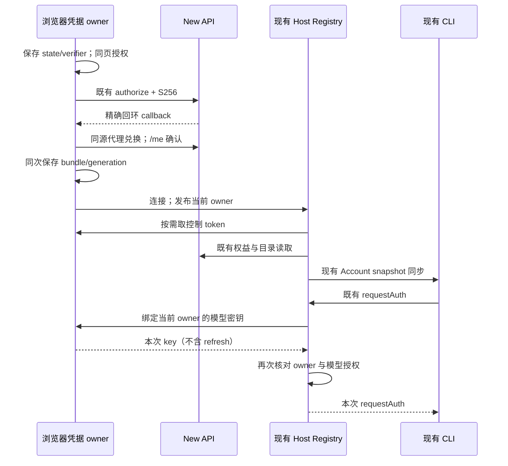
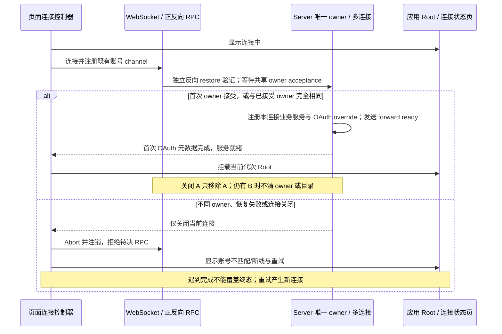

# 本机 Web：浏览器持有 New API 凭据

状态：浏览器登录与凭据适配已实现，2026-10-30；普通 standalone Web 创建项目和聊天首发尚未验收。用户明确选择尽量少改、浏览器持凭据；替代已关闭且未合并的 PR #47。范围仍为同机浏览器 + 现有 Server + 本机 CLI，不扩展部署 Web、多用户或手机远控。

## 1. 复用与范围

- 沿用 `pnpm dev:web`、现有 WebSocket RPC、`IOAuthService`、`WebCallbackPage`、AccountProviderService、Native 目录解析及 Worker 的请求期鉴权协议。2026-10-31 起按 [唯一登录规格](aiscoo-only-login.md) 仅提供 Aiscoo 登录，不再挂载 Z.ai/BigModel 浏览器主登录、官方 callback 或旧会话恢复；公开只读分享保持匿名能力，不自动附带旧官方 cookie。
- 浏览器通过 WebCrypto 生成 state 和 S256 PKCE，使用现有公共客户端 `xwork-cli` 和精确 `http://127.0.0.1:<Web端口>/oauth/callback`，同页跳转到 New API 原生授权页，回调成功返回 `/`。源码允许这种回调，不要求独立 listener。仅本机模式启用专用同源控制 API 代理，不修改 New API 后端和 CORS。
- 公开配置为 `AISCOO_BROWSER_NEW_API=1` 与 `AISCOO_ADMIN_BASE_URL`；旧键 `NEW_API_BASE_URL` 不再读取，也不提供 fallback。浏览器访问地址必须是有显式非默认端口的 `http://127.0.0.1`。无论是否启用 profile 都不得回退官方账号；未启用或配置无效时登录明确不可用。远控、分享受保护动作不能借用旧官方会话；Desktop 使用自身 Aiscoo authority。本机代理必须保留原 `/api/v1/oauth/token`、`/api/v1/remote` 专用目标，所有专用条目排在 `/api` 通配之前；只将本机 `/ws` 与 `/api` 目标切到精确回环 Server。
- 不带入 #47 的 Host 登录状态机、OS keyring、私有磁盘凭据库、CLI adapters 依赖、新网络 session/token 系统和专用进程启动器。
- 普通 standalone Web 的项目创建仍存在既有边界：UI 默认传 `hostId=local`，Server 持库 owner 为 `remote:server:<id>`，因而目录/保存会被 `project.host-offline` 拒绝；未选择项目的草稿被 `project.remote-project-required` 拒绝。本次不改写 owner、workspace identity 或远端项目权限。真实 CLI 的 helper 查询通过，不能据此声称普通新用户从创建项目到聊天首发已可用；该交互需要独立的当前 Server 项目适配。

## 2. 所有权与接口

| 状态                     | 唯一 owner                                  | 派生边界                                                                      |
| ------------------------ | ------------------------------------------- | ----------------------------------------------------------------------------- |
| 登录尝试、state/verifier | 浏览器，sessionStorage                      | 精确回调、一次消费、5 分钟有效；导航后仍可取回                                |
| SessionBundle 与刷新轮换 | 浏览器，独立 localStorage key               | 不读取/覆盖上游 OAuth key；按 New API origin 隔离；Web Locks 串行写入/refresh |
| 当前身份                 | 浏览器保存的 user/SID/generation            | `/me` 远端确认；Server 仅保留连接期 owner 投影                                |
| 目录/权益/可执行模型     | 现有 Host AccountProviderService / Registry | 继续复用现有 Native 解析、owner/authorization revision 校验及 Worker 同步     |
| 模型请求密钥             | 浏览器持久保存，按请求临时交付              | 通过同连接反向 RPC 到现有 Host/CLI requestAuth；不进入配置或日志              |

现有服务工厂增加可选的 Native account authority 注入，默认为原桌面实现。浏览器 authority 是窄接口：`oauth/getOwner/isCurrent/withControlSession/getRelayCredential`；它不创建第二个可持久会话库。Host 只按需读取短期 control token或本次模型密钥，不读取 refresh token，不替浏览器刷新。

现有 socket 上增加可选反向 channel 装配；普通 `/ws` 仍是 `web-remote-replayable` / terminal-client，不获得 trusted-host 或 provisioning 权限。2026-11-02 按用户要求对齐上游逐 WebSocket 连接的策略：同源浏览器中共享同一登录会话的多个标签可以并行使用，每个连接保留独立 connectionScope、反向 channel 与 OAuth facade。Host 继续只持有一份账号 owner/revision 和现有目录；owner 的相等性仍是完整 origin/userId/SID/authGeneration，不降为 userId。它不是多租户服务。

- 新连接先通过自身反向 `restore` 验证会话并等待唯一 owner hook，再暴露业务 channel 和发送 forward RPC 初始化；不同 owner 的连接拒绝准入，不能读取现有账号的目录、身份或凭据，也不能改变其 owner。未完成的 restore 事件只作为本连接回声核对，不能抢先改写 Host。
- 相同 owner 的并发首次恢复共享一次 owner acceptance，不重复写目录、不递增 owner revision。新增或关闭一个同 owner 页面不影响其他已准入页面；最后一个持有该 owner 的连接离开才同步失效 owner 和目录。已断连接的迟到 restore/control/relay/OAuth 结果仍然拒绝，即使另一个连接具有相同 owner。
- `IOAuthService` 通过既有 per-connection service overrides 注入，并复用相同的 accountPolicy 包装。登录、取消、回调、刷新和退出固定回到调用标签；不能将 B 的 state/verifier 写到 A 的 sessionStorage。Host 后台的按需凭据读取仅可选择完整匹配当前 owner 的已准入连接，不复制或持久化凭据。
- 未登录的新浏览器遇到已有 Host owner 时，账号不匹配页仍提供本页的 Aiscoo 登录入口：调用同一浏览器 authority 的 `oauth.startOAuth`，将 proof 留在本页 sessionStorage，同页导航原生授权，不需要放行任何 Host 业务 RPC。成功 callback 先写入本浏览器自己的会话，再重新连接并按完整 owner 准入。已经验证为另一个 owner 的页面保留明确不匹配和显式重试；不清除其他页面凭据、不自动夺权。
- 已准入页面发布退出或换号时，同步替换唯一 Host owner/revision，撤销其他不再匹配的连接。被撤销页面重新加载自身已有存储；若存储仍属于其他会话，则明确拒绝，不自动抢占。普通 token 轮换保持 owner 不变，不触发其他标签整页重载。

## 3. 时间和失败规则

- callback 处理单飞；state/回调/provider/期限必须匹配。code 兑换不自动重试；合法 proof 重放会撤销已签发 SID。旧尝试不能覆盖后来接受的登录。非法回调不访问 token endpoint。
- refresh 在浏览器 Web Lock 内重新读取当前 bundle，轮换后同次写回；保持原 user/SID/relay key，只有同一 owner 可接受结果。退出/换号/断连之后的迟到结果不能发布给新 attachment。
- 恢复必须经 `/me` 确认，过期 control 先刷新。网络失败显示不可用并保留可恢复存储；控制接口确认 SID/凭据用途无效时，Host 在异步通知前同步使捕获 owner 和目录失效，再通知浏览器按 generation/user/SID 清除匹配凭据。迟到错误不得清除后来新账号；网络或服务故障不得伪装撤销。不能把 opaque token 或缓存头像当身份验证。
- 退出先使本地 owner 无效、清存储并通知 Server 使执行失效，再尝试原 SID 的远端 logout。撤销失败明确报错，不声称远端已撤销；不撤销后来新登录的 SID。登录/退出均通过原 `IOAuthService` 消费路径。
- 关闭单个浏览器标签只释放其连接及待决操作；其他同 owner 标签仍可提供凭据。最后一个匹配连接关闭后 Server 无可用 credential source，同步失效唯一 owner；不保存 control/refresh/relay key 到 Host 磁盘。已有已接受任务的恢复仍由现有 CLI 管理；新请求不能借用已关闭 attachment 的迟到凭据。
- 本机 Server 与 Vite 明确监听 loopback，代理目标固定为已验证 New API origin；不能把任意 URL、凭据或 token 编入公开配置。不为浏览器方案开放公网/局域网访问。开发服务器使用明确 Host/Origin 边界；该边界不引入新登录 session 系统。
- 2026-11-02 登录黑屏修复合同：浏览器账号连接的启动生命周期由一个页面级连接控制器持有。WebSocket `open` 只表示传输打开；首个既有 OAuth 元数据 RPC 完成后，才向普通 Web Root 交付服务。初始化中显示连接状态；跨 owner 接入拒绝、初始化失败或使用中断线均结束当前连接，取消其正向待决 RPC、注销反向账号 channel，并显示中文/英文的账号不匹配或断线说明与重试按钮。同 owner 第二标签应正常进入 Root，不能再用占用页代替支持。
- 关闭是当前连接代次的终态：关闭、dispose 或页面离开后，迟到的服务/RPC 结果不能重新渲染旧 Root、覆盖故障页或改变账号存储。重试重新加载当前应用入口，由 Server 再次准入；已准入连接因 owner 切换被撤销时也重新加载入口，重建自己的作用域，不转移旧 OAuth 命令。不同 owner 的新连接拒绝后不自动重试，避免重载循环。不使用定时器猜测握手成功，不增加第二份账号状态。页面正常导航离开时只清理，不闪现断线错误；公开分享、旧官方拒绝入口、Desktop continuous 与手机 replayable 恢复路径保持既有语义。

## 4. 验收

1. 从干净 release 安装后直接 typecheck，源码无 CLI dist/keyring 依赖；无 profile、缺配置、非法配置和旧官方缓存存在时，不展示官方登录或访问官方 token endpoint；公开只读分享保持匿名行为。
2. 真实回环假后端 + 浏览器完成授权、callback、恢复、refresh、退出；未知 state/重复 callback/过期尝试拒绝；不触碰真实账号和生产 New API。
3. 现有目录/权益解析与请求期 resolver 接入，合成模型请求仅到回环假模型接口；凭据不落 Host 文件，不伪造可执行目录。真实 CLI 集成回归通过既有 `generateWorkspaceText`、`app-server --stdio` 发出 Chat Completions HTTP 并核对返回文本、模型与用量；该回归需要先构建 CLI，不替代普通聊天 UI 的交互验收。
4. 账号变更、断连、刷新/读取迟到、第二 attachment 都不会释放旧或错误账号密钥；无身份时目录不可执行。
5. 必需的 typecheck、lint、架构检查、受影响测试、Web 构建和上游合并预演如实记录。真实部署支持、真实账号及跨平台未验内容单独列出，不以源码检查代替。
6. 真实浏览器中保留已就绪标签 A，再打开同源同会话标签 B：A/B 都进入真实 Root，B 无额外 token exchange、A 不被抢占。关闭 A 后 B 仍可用且 Host owner/目录不变；B 刷新后仍可恢复。初次并发 restore 只接受一次 owner hook，最后关闭才撤销 owner。禁止用 mock 为 `null` 的 Root 作为无黑屏验收。
7. 首次 RPC 等待期间收到 1008、服务断线、初始化拒绝及页面离开，均会取消当前代次；失败页可见，迟到成功不能覆盖。已就绪后断线也显示恢复操作；重试成功后套餐和模型可读。覆盖中文/英文、宽屏/窄屏以及浅色/深色，确认不展示原始异常、凭据或授权 URL。
8. 两个未登录标签中从 B 发起登录：PKCE 仅写入 B 的 sessionStorage，B 自己完成原生授权和回跳；A 的取消/关闭不能消费 B 的 proof。普通 refresh 保持完整 owner 和其他标签的文档、草稿，不整页重载；logout/换号同步失效旧 owner，旧连接迟到结果不得复活或清除新账号。
9. 独立 browserContext 的不同合成账号 C 在 A/B 活跃时不能进入业务 Root或借用其身份、目录和密钥；拒绝 C 不修改 A/B 的 owner。相同 userId 但不同 SID/generation 也按不同 owner 拒绝。服务端准入前不得暴露业务 RPC。原 owner 最后释放后，C 可通过显式重试完成自己的恢复。

## 5. 2026-11-02 登录黑屏验证（多标签调整前的阶段性证据）

以下记录验证旧单连接策略下的错误恢复；第二标签拒绝用例已由上面的并发使用规则取代，不代表多标签支持已验收。

- 现场确认第二个 WebSocket 先 `open`，随后收到 `1008 / Browser account is already attached`。旧入口只注销反向 channel，不结束正向启动 RPC；普通 Web Root 在等待恢复期间返回空内容。
- `aiscooBrowserCallbackEntry.test.ts` 30 项通过，包含原有 13 项、连接就绪/终态/双语/离页与迟到结果等 15 项，以及调用真实通用连接函数的 2 项无 signal 默认行为保护。账号、bridge、profile、registry 的 79 项相邻回归通过。
- 真实浏览器入口 `pnpm exec tsx packages/web/test/e2e/manual-review/pending/aiscoo-browser-connection.mjs` 12 项通过：中文宽屏浅色、英文窄屏深色，真实 OAuth 回跳至真实 Root、第二标签拒绝且首 owner 不变、释放后 Retry、刷新、断线和服务重启后 Retry；未用空 Root mock 证明无黑屏。
- 对照运行 `--baseline-entry` 时，HEAD 为 `ed120bf8`；Vite 仅在内存加载该旧入口，首个页面登录/Root 正常，第二标签 body 为空并在占用提示断言处失败，证明本回归能捕获修复前问题。
- 类型检查通过；Lint 0 错误、308 警告；changed 架构检查 0 违规。上游接点仅为 `packages/client/src/websocket.ts` 的可选取消端口与 `packages/web/src/main.tsx` 的 Aiscoo 装配点，默认通用连接行为和 Server 单 attachment 准入保持既有合同。
- 浏览器 E2E 使用独立合成账号、回环假后端与临时数据目录，模型推理次数为 0。真实账号的注销再登录、Windows/Linux 与手机真机未在本次重做。

## 6. 2026-11-02 多标签并行验证

- 旧单 attachment 桥接的核心红灯为 31 项通过、2 项失败；同 owner 并发恢复和关闭 A 保留 B 均在第二次 attach 抛出 `XCODE_BROWSER_ACCOUNT_ATTACHED`。修复后 Bridge 58 项、Registry 12 项全部通过，包含完整 owner 准入、一次共享 acceptance、B 在途读取跨 A 关闭、逐连接 OAuth、Native 撤销及迟到结果隔离。
- 审查补获旧退出 hook 迟到清空新 owner 的竞态：旧 null hook 延迟 resolve/reject 两项先出现 68 通过、2 失败；失败清理统一收敛到 transition 的捕获 revision 内后，70 项全绿。旧 hook 不能关闭已经承载新 owner 的同一连接。
- Web 入口 49 项、浏览器账号 58 项通过，包含真实 BrowserAccount/WebCrypto 的本页 PKCE、连接终态、未登录冲突页的本地登录入口、单次导航、双语提示及 storage 失效顺序。来源/profile 8 项通过；合计 185 项账号与连接定向回归。未新建或恢复 App 业务单测套件。
- 真实入口 `pnpm exec tsx packages/web/test/e2e/manual-review/pending/aiscoo-browser-connection.mjs` 28 项检查通过：中文 1440×960 浅色、英文 390×844 深色。覆盖 A/B 同会话并行、B 普通刷新不重载 A、关闭 A 保留 B 文档/草稿/目录、首次并发仅一次 hook 且准入前业务 RPC 等待、B 的 proof 不受 A 取消/关闭影响、不同用户及不同 SID/generation 拒绝、最后释放后 C 显式 Retry、断线重启、一次共享 refresh、退出一次重载及旧恢复隔离。C 使用真实本地按钮完成合成账号授权和 callback，没有以未登录拒绝代替异账号验证，也没有 mock Root。
- 浏览器验证的模型推理次数为 0；`pageErrors`、`fixtureErrors`、`forbiddenRequests` 均为空。测试浏览器、Host、Vite 与合成后端均已清理。结果与截图保存在 `.zcode-runtime/black-screen-verification-20261102/multi-tab/`。
- 真实 HTTP/WS/RPC runtime smoke 6 项通过，包含 web/replayable 与 desktop/continuous、临时 host capability、provisioning 权限、独立 connectionId、逐连接 OAuth、反向恢复先于 forward Initialize、拒绝或关闭后不再暴露服务。7 条客户端连接和 4 个临时服务全部清理；证据位于 `.zcode-runtime/connection-mode-verification-20261102/`。另外定向执行现有 CLI gateway/shutdown 6 项及 Window Host 两种 mode 权限 2 项，全部通过；不将 HTTP spy 验证代替真实 CLI delivery 验证。
- Node 24.14.0 下 `pnpm typecheck`、`pnpm lint`、Web 生产构建与 changed 架构检查通过；Lint 为 0 错误、308 个既有警告。Web 构建保留既有大 chunk/无效动态拆分警告；Windows/Linux 与手机真机未在此轮重做。

上游接点仅限以下四个既有文件，产品状态与界面位于 Aiscoo 扩展模块：

| 上游文件                            | 最小接点与原因                                                                                                                                         |
| ----------------------------------- | ------------------------------------------------------------------------------------------------------------------------------------------------------ |
| `packages/client/src/websocket.ts`  | 可选 AbortSignal 接入已有 ChannelClient 取消机制，关闭时结束待决 RPC；未提供时保留默认生命周期。                                                       |
| `packages/server/src/http.ts`       | 扩展既有可选 browserPeer 的连接级覆盖/关闭端口；复用 ChannelServer deferInit/ready，在准入前不注册业务服务。Agent scope 与 provisioning 限制继续后置。 |
| `packages/server/src/entry-http.ts` | 同一个 accountPolicy 包装本连接 attachment.oauth，注入现有 per-WS overrides，固定映射失效关闭原因。                                                    |
| `packages/web/src/main.tsx`         | 只在本机浏览器账号装配点调用产品 startup，保持公开分享、远控与普通无注入连接的原路径。                                                                 |

使用独立临时 Git index 对当前未提交工作树生成 tree，并以实际 merge-base 对 `upstream/main` 运行 `git merge-tree --write-tree` 预演；未创建提交或改变真实 index。结构化结果见 `.zcode-runtime/black-screen-verification-20261102/multi-tab/merge-preview.json`。
