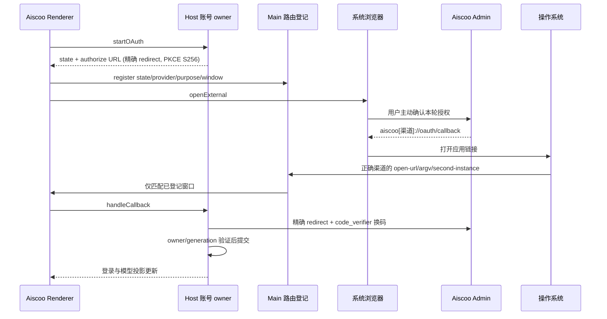
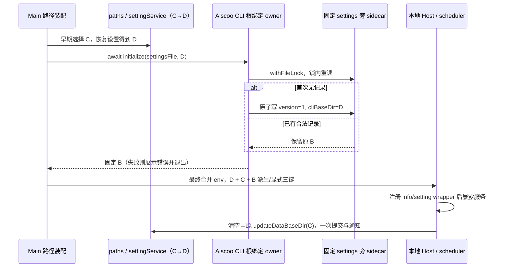

# Aiscoo 桌面身份与原生登录回调

状态：已确认，2026-10-30。

## 产品身份

| 渠道        | 应用 ID                | 显示名 / Electron 数据目录名 | URL scheme     | Native redirect URI             |
| ----------- | ---------------------- | ---------------------------- | -------------- | ------------------------------- |
| production  | dev.aiscoo.app         | Aiscoo                       | aiscoo         | aiscoo://oauth/callback         |
| development | dev.aiscoo.app.dev     | Aiscoo Dev                   | aiscoo-dev     | aiscoo-dev://oauth/callback     |
| preview     | dev.aiscoo.app.preview | Aiscoo Preview               | aiscoo-preview | aiscoo-preview://oauth/callback |

Aiscoo 正式版、开发版、Preview 和上游 ZCode 必须能够共存。Aiscoo 不默认声明或注册 zcode scheme，不删除或注销 ZCode 的注册。上游默认配置、NEW_API_CALLBACK_URI 及稳定 client_id=xcode-desktop 保留，通过可选配置扩展，不批量替换协议标识。

唯一身份配置位于 @zcode/shared/aiscoo-desktop-identity，构建工具和运行时复用。Desktop 构建显式固化渠道；未注入 Aiscoo 渠道的通用运行时保持上游默认值。系统应用 ID、Windows executable/AUMID、Linux executable/package/desktop MIME、macOS开发副本与正式协议声明均须与该配置一致。

合并最新 release 时，Main、Host、scheduler 的共享服务依赖图必须继续可构建。旧本机 Web 适配器删除后，Desktop 依赖图不再引入原生钥匙串，`@napi-rs/keyring` 不再列入 Desktop 外置依赖；Zen CLI 的钥匙串仍由 CLI 构建自行外置。打包闭包检查仍须证明运行时依赖完整。历史本机 Web 快照不因身份合并恢复为现行产品入口，现行 Web 规范仍为 [browser-new-api.md](browser-new-api.md)。

macOS 的 `node-pty` `spawn-helper` 经 asar 解包再重打包后会丢失执行权限：应用能构建成功，但终端启动时 `posix_spawnp` 失败。修复位于 `electron-builder.config.js` 的 `afterPack`，由 `ensurePackagedNodePtyHelperExecutable` 在原生资源策略校验之后、`assertPackagedNodePtyPrebuild` 之前恢复执行位，仅对 macOS 目标生效。

位置必须在最后一次重打包之后：`injectHoistedRuntimeModulesIntoAsar` 与 `stripPackagedSourcemapReferences` 都会解包并重打包 `app.asar`，helper 位于 `app.asar.unpacked` 中，此后再增加任何重打包步骤都会让执行位再次丢失，因此新的 `afterPack` 步骤不得放在它之前，若新增了会重打包的步骤，需同步更新工程回归中的顺序断言。修复直接放在配置内，不依赖入口脚本选择哪个配置文件，`bundle.mjs` 与直接运行 `electron-builder --config electron-builder.config.js` 均有效。现有 `assertPackagedNodePtyPrebuild` 只检查 helper 存在，不检查执行位；执行位与上述顺序由工程回归守护。

工程回归覆盖真实 asar 重打包后的执行权限恢复。最终安装包须以实际 PTY spawn 验收，不能仅检查文件存在；该验收不涉及签名与公证。

## 授权接口与所有者

Native New API authorize、callback parser 与 token exchange 必须使用同一精确 redirect。后端先增加允许的精确 URI，保留旧版 zcode URI；不得接受任意自定义 scheme、URI前缀、额外路径、fragment、用户信息、端口或重复 query。开发/Preview 回调只有后端明确登记才可用。既有 refresh/logout client ID 与凭据 namespace 保持不变。

Host NewApiAccountService 是 pending/PKCE、换码、会话持久化和账号 generation 的唯一 owner。Main 只拥有 state/provider/purpose/window 的投递登记；Renderer 只发起和呈现状态。取消、超时、旧 state、错误 provider/purpose、重复回调仍由现有 owner 校验；不向当前活动窗口兜底。不记录 code/state/token。

desktop-continuous 与手机 web-remote-replayable 语义不变；手机继续复用已有 Host attachment。本变更不增加登录、会话或队列 owner。

2026-10-31 起 [唯一登录规格](aiscoo-only-login.md) 退役 Aiscoo 产品中的 BigModel/Z.ai 登录。Aiscoo 渠道不登记或派发官方主账号/独立连接回调；不通过抢注 zcode、放宽校验或官网中转重建登录。通用上游实现未注入产品策略时仍保留原协议边界。

## 深链覆盖

Main scheme 注册、URL提取/解析、冷/热启动、支付返回、工作区打开、分享导入、Finder 生成链接均读取同一配置，保留每条现有路由参数及用户确认规则。Web 分享默认指向 Aiscoo 正式版，开发渠道须显式配置。远控的 HTTPS 链路不改为桌面 OAuth 深链，Android 原生注册单列平台验收。

## 数据与凭据

Electron userData/sessionData 使用各渠道独立目录。业务数据根、Host、CLI DB/日志与单例锁也须按实际路径验证；保留系统 HOME。早期 Chromium 硬件加速设置也读取本渠道固定的设置文件，不能反读旧 HOME 设置而覆盖本渠道偏好。使用已有显式路径覆盖，不假设改 appId 就完成所有数据隔离。

新安装使用 Aiscoo 独立业务数据根。既有用户数据不得按 ZCode 目录名称自动认领，也不得从正在写入的数据库复制。历史迁移必须由用户选定旧 Aiscoo 来源、停止旧写入者、创建一致备份、暂存导入、验证密钥后原子启用。此次不对真实数据自动执行迁移。

macOS 历史钥匙串名 XWork / XWork Dev / XWork Preview 与密文版本保留。**2026-11-01 起 New API 登录凭据不再使用该钥匙串**（见 [客户端集成规格 §4.2](new-api-integration.md#42-安全持久化与恢复)），下面关于“新 bundle/签名访问旧钥匙串”的实机验证只适用于仍使用它的 CLI Zen 存储与此前已写入的条目。新 bundle/签名访问旧钥匙串须实机验证，失败保留旧密文并明确恢复或重新登录，不用新 key 覆盖。CLI 目录派生账户、AAD与refresh锁单独验收；禁止两数据根同时刷新同一凭据。回滚保留原数据与安装，token 已轮换时允许要求重登，不承诺旧 token 可用。

## App 数据目录与固定 CLI 根（2026-11-01）

- 默认 App 根 **C** 在早期 bootstrap 取 `ZCODE_DATA_BASE_DIR` 显式值或 `appData/渠道目录`，固定设置文件由现有 `ZCODE_SETTINGS_FILE_PATH` 或 `C/.zcode/v2/setting.json` 决定。恢复后的当前 App 根 **D** 仍由 `paths` 与 `settingService` 唯一持有。
- CLI 基准根 **B** 由 `aiscoo-desktop-runtime` 单独负责：Main 恢复设置后、任何 Host/scheduler 启动前异步初始化。固定设置文件旁的 `setting.json.aiscoo-cli-root.json` 保存 `{ "version": 1, "cliBaseDir": "绝对路径" }`；首次缺失使用当时的 **D**，之后始终读取已记录的 **B**，包括升级前已使用自定义目录的用户。初始化只记路径，不创建、复制或移动 CLI DB。
- 显式设置文件 basename 不为 `setting.json` 时，sidecar 使用 `setting.json.aiscoo-cli-root-<原 basename 的完整 SHA-256>.json`。因此同目录多个设置文件互不冲突，且始终匹配原 `copyDataDirectory` 的 `setting.json.*` 排除规则，不随 v2 迁移。锁及原子写临时文件只在 Host 启动前的初始化期间存在。
- 初始化复用 shared/node 的 `withFileLock` 与 `atomicWritePrivateTextFile`，锁内重新读取。只接受 version=1、非空绝对 `cliBaseDir`；损坏、未知版本、读取/锁/写失败均显示清晰错误并阻止 Host/scheduler 启动，不能回退默认根造成空会话库。
- Host 环境在 `.env → process` 合并后派生：storage、session DB、log 三个显式覆盖分别优先，否则从 **B** 派生；Aiscoo 始终下发 `ZCODE_DATA_BASE_DIR=D`，包括 D 等于真实 HOME。早期 bootstrap 不写这三个默认覆盖键到 `process.env`；HOME/USERPROFILE 保持原值。Main 只装配路径，不拥有 App 设置或迁移。
- 新的 `host-aiscoo-data-directory` 薄包装在本地 Host 服务暴露前注册，接收 Main 下发的 **C**（`AISCOO_DESKTOP_DEFAULT_DATA_BASE_DIR`）。`system.info` 追加可选 `defaultDataBaseDir=C`，真实 `homedir` 不变。设置页使用 `info.defaultDataBaseDir ?? info.homedir`；清空目录调用已注册的 `settingService.updateDataBaseDir(C)` 一次，保留原迁移、持久化和 `this.update` 提交后通知。用户显式选择真实 HOME 保留该绝对路径。
- 未注入 Aiscoo profile 的 bootstrap、环境 helper、Host 注册行为保持上游语义；不增加通用 AppSettings 字段，不修改 CLI 或上游迁移算法。

## 验收

1. 身份工程回归：三个渠道 appId/scheme/dataName 成对唯一，打包和运行时一致，通用未注入配置仍使用上游值。
2. Native 授权回归：authorize 与 token exchange 参数一致；正确渠道成功，跨渠道、重复参数、未知 state、过期/取消和重复回调拒绝。
3. 系统共存：ZCode、Aiscoo正式/Dev/Preview 冷/热启动回跳各自实例，不随安装启动顺序互相接管；Windows/Linux在对应系统执行后才记通过。
4. 真实 macOS：新app身份启动，原钥匙串名称不变；新建测试凭据跨重启恢复，旧版合成密文迁移验证；真实用户迁移另行授权执行。（2026-11-01 起登录凭据不经钥匙串，本条中的“测试凭据”指仍使用钥匙串的存储。）
5. 后端精确白名单与客户端完整 Native E2E；登录成功、模型目录和实际推理分别记录。执行 typecheck、lint、架构及相关回归，未执行的平台或官方服务端部分如实记录。
6. 固定 CLI 根：首次默认/已有 custom 捕获 D；App 切换目录并重启后 B 不变；并发初始化收敛到一个 B；非法 JSON/版本/相对或空路径、读取/写入失败阻断启动；非标准 settings basename 的记录不冲突且不随 v2 复制。真实隔离 IO 回归不得触碰用户数据。
7. 环境与设置：三键独立显式覆盖、`.env` 与 process 优先级、D=HOME 仍显式下发；默认根 C 与 HOME 不同时清空→C、显式 HOME→HOME，真实原服务一次提交一次通知；未注入 Aiscoo 时无副作用。E2E 通过本地 Host 的实际设置入口切换 App 根、重启并读取原 CLI 会话，核对清空默认与显式 HOME。
