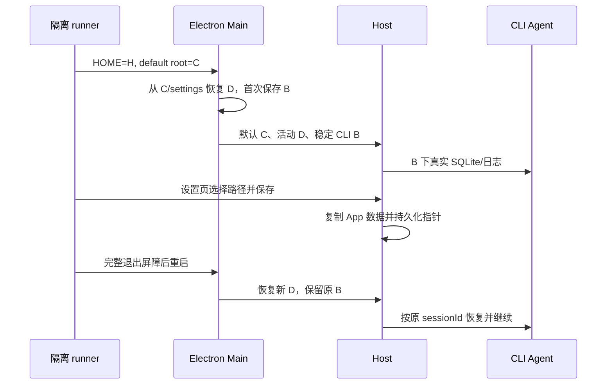

# Aiscoo 数据目录冷恢复验收

2026-11-01 已批准的下游候选。本文仅登记本轮 accepted cases 和实际运行证据；上游 CDD01、catalog、matrix 与 WDIO 默认入口保持原样。

## 合同与边界

- `H` 是测试合成 HOME，`C=H/channel` 是默认渠道根，始终要求 `C != H`；`D` 表示当前 App 根，迁移目标为 `H/moved`。旧 custom 安装初始 `D=H/legacy`，迁移后 `D=H/moved`。
- `B` 是首次恢复 settings 后捕获的 CLI 基准根。新安装 `B=C`；旧 custom 安装 `B=H/legacy`，固定为原 custom 根。后续 App 迁移不能改变 B。
- settings 固定在 `C/.zcode/v2/setting.json`。旁边的 `setting.json.aiscoo-cli-root.json` 为 `{version:1,cliBaseDir:B}`。
- UI 默认路径读取 `SystemInfo.defaultDataBaseDir`。选择默认 C 后，经 Host wrapper 保存显式 C；选择真正的 HOME H 后保存显式 H，复制目标与重启生效根相同。
- 验收不配置 `ZCODE_STORAGE_DIR`、`ZCODE_SESSION_DB_PATH`、`ZCODE_LOG_DIR` 或 settings override，防止测试覆盖固定 CLI 路径而产生假通过。
- 只在 idle 保存并立即完整退出 Electron/Host/Agent。不覆盖 busy guard、非项目 workspace 迁移、并发写入或异常中断。
- 返回已有数据的 C 沿用 `force:false`：只验证新增 canary 的复制与既有目标文件保留，不要求 task-index 合并。



## Accepted cases

| ID     | 前置与操作                                                                                                                             | 必须断言                                                                                                                             | 状态              |
| ------ | -------------------------------------------------------------------------------------------------------------------------------------- | ------------------------------------------------------------------------------------------------------------------------------------ | ----------------- |
| ACDD01 | 新安装 C≠H；真实只读工具 completed task；选择空 D，保存后完整冷重启，同 task 续聊                                                      | UI 默认 C；复制 canary/task-index；settings=D；B=C；原 CLI session/message 行仍在同库；新 App index 推进，旧 index 不变；D 无 CLI 库 | pending；本轮通过 |
| ACDD02 | ACDD01 后由 D 返回已有 C，再选择 H，每次保存后完整冷重启                                                                               | C 保存显式 C，H 保存显式 H；新增 canary 到达实际目标；C 已有同名文件不覆盖；UI 和活动根一致；CLI 仍 B=C；H 无新 CLI 库               | pending；本轮通过 |
| ACDD03 | 旧 settings 指向旧 custom 根 H/legacy；在该根真实创建 CLI 历史库；完整退出后移除本测试生成的 sidecar，模拟首次升级捕获，再冷启动并续聊 | 首次捕获 B=H/legacy；原 CLI SQLite 文件身份与原 sessionId/message 不变；C 无替代 CLI 库；随后迁移空目标并续聊仍用原库                | pending；本轮通过 |

## 可重复入口

候选：`packages/desktop/test/e2e/conversation-session/manual-review/pending/aiscoo-data-directory.test.ts`。
薄配置：`packages/desktop/test/e2e/aiscoo-data-directory.wdio.ts`。

先由整合负责人完成生产改动、根 typecheck/lint、CLI/CUA 与桌面 E2E 构建；不能在 `tsc -b` 写入 out/host 时启动。本轮使用 Node 24.14.0、pnpm 10.33.2、Electron 44.7.0。构建命令从仓库根执行：

```bash
env -u AISCOO_ADMIN_BASE_URL ZCODE_ENV=test VITE_ZCODE_E2E_STORE_BRIDGE=1 \
pnpm --filter @zcode/desktop build:no-runtime-assets
```

从仓库根运行，每个 mode 使用不同的全新 `.e2e-home-*`，路径必须位于当前 desktop 包中。以下为本轮通过命令；复跑时换一个未使用的 HOME 后缀：

```bash
env -u AISCOO_ADMIN_BASE_URL ZCODE_ENV=test \
AISCOO_E2E_STORAGE_HOME="$PWD/packages/desktop/.e2e-home-aiscoo-storage-new-20261101-d" \
AISCOO_E2E_STORAGE_MODE=new \
ZCODE_E2E_SKIP_BUILD=1 ZCODE_E2E_SKIP_AGENT_BUILD=1 \
pnpm --filter @zcode/desktop exec wdio run test/e2e/aiscoo-data-directory.wdio.ts

env -u AISCOO_ADMIN_BASE_URL ZCODE_ENV=test \
AISCOO_E2E_STORAGE_HOME="$PWD/packages/desktop/.e2e-home-aiscoo-storage-legacy-20261101-a" \
AISCOO_E2E_STORAGE_MODE=legacy \
ZCODE_E2E_SKIP_BUILD=1 ZCODE_E2E_SKIP_AGENT_BUILD=1 \
pnpm --filter @zcode/desktop exec wdio run test/e2e/aiscoo-data-directory.wdio.ts
```

配置显式只使用 `common.json` 与本例 provider fixture，禁止 capture；本地 HTTP 账号 fixture 供真实 NewApiAccountService 冷恢复核验 Me，不修改 UI 登录状态，不访问真实账号或模型。它仅代表合成账号恢复，不代表正式 OAuth/服务端验收。

退出由既有完整重启 helper 与 runner 负责。原生目录选择只替换当前 Main 的单次返回，调用后立即恢复；设置页、复制、保存与重启仍走生产实现。spec 完成时保存截图，after 写事实；runner 进程退出屏障后清理测试 HOME，失败保留现场。禁止在活跃 Main/Host 下删除数据根。

## 实际运行证据（2026-11-01）

产物根为 `packages/desktop/.e2e-artifacts/`。所有运行均在本机 macOS、同一协调完成的 Preview source build 上串行进行；未修改上游 CDD01 或其 helper/config。ACDD01–03 保留 pending，没有推广或 Docker admission。

| 覆盖             | runId                             | 结果（worker 耗时）        | 关键文件                                                                      |
| ---------------- | --------------------------------- | -------------------------- | ----------------------------------------------------------------------------- |
| ACDD01/02 新安装 | `desktop-e2e-20261101-142913-417` | exit 0，1 spec passed，34s | `summary.json`、`aiscoo-directory-new.json`、`aiscoo-directory-new.png`       |
| ACDD03 旧 custom | `desktop-e2e-20261101-143035-105` | exit 0，1 spec passed，18s | `summary.json`、`aiscoo-directory-legacy.json`、`aiscoo-directory-legacy.png` |
| 原 CDD01 基准    | `desktop-e2e-20261101-143220-907` | exit 0，1 spec passed，17s | `summary.json`、`aiscoo-cdd01-account.json`                                   |

summary 记录的总耗时依次为 43s、25s、27s；上表为 worker 耗时。

新安装 run 的 Main PID 为 `45480 → 45873 → 46728 → 46974`，Host PID 为 `45491 → 45907 → 46771 → 47054`，依次对应 C、D、C、H；每次冷启动均出现新的已授权 Me，累计 `1 → 2 → 3 → 4`。原 CLI session 消息数 `10 → 12`，原 message ID 前缀与数据库 inode 断言保持；旧 index 为 `1793543379326` 且未变，新 index 从 `1793543379036` 推进到 `1793543385612`。返回 C 的新增 canary 被复制、已有同名 canary 未覆盖，选择 H 后保存显式 H，H 未生成替代 CLI 数据库。

旧 custom run 的 Main PID 为 `47919 → 48372 → 48615`，Host PID 为 `47930 → 48436 → 48630`，覆盖已有库、无 sidecar 的首次捕获以及迁移后恢复。只在旧进程树完全退出后移除测试 sidecar，原 SQLite 未移动或重建；恢复后原 message ID/inode 断言保持，续聊消息数 `10 → 12`，旧 index `1793543449555` 未变，新 index 从该值推进到 `1793543458493`，C 和新 D 均未生成替代 CLI 库。

已查看两张成功截图：legacy 截图显示迁移前后回复；new 截图为常规设置页顶部，路径控件不在该截图视口内，具体路径依据 JSON 中每阶段实际输入框读数和运行断言，不以该截图单独证明。

### 失败定位与观测边界

- 首次加载未启动 Electron：上游 reporter 的 CJS named export 导致 WDIO 回退 jiti，而整个下游 wrapper 含顶层 await。薄配置现用 WDIO 公开 `FileSystemPathService.loadFile` 加载上游配置，兼容仅作用于上游模块；未改依赖或上游文件。
- `desktop-e2e-20261101-142215-152` 在初始路径观测失败：macOS `ps eww` 在进程设置 `process.title` 后不再给出环境字段，独立子进程已复现。最终不读取或记录完整环境，不把缺失字段认定为产品传递失败，也不宣称观察到 Host 内部环境。运行时由 Main HOME/settings、真实 Host PID、设置页路径、canary、原库及新旧 index 共同证明；精确 fork 环境由独立 native 回归覆盖。
- `desktop-e2e-20261101-142637-571` 已通过 C→D 及续聊，随后返回 C 时目录选择超时。WDIO 9 的 mock registry 跨冷重启保留旧 mock，新 Main 上未重装原函数；下游改为一次原生 dialog 返回并立即恢复后，完整 new/legacy 均通过。未改变产品断言、未强制 Renderer 状态、未增加等待 sleep。
- 本次仅覆盖 idle、空目标保存、完整冷恢复；不证明 busy guard、并发/断电迁移、跨平台或正式账号服务端行为。返回已有 C 沿用既有 `force:false`，不声明 task-index/SQLite 合并。

### CDD01 临时隔离入口

本轮使用 `packages/desktop/.e2e-cache/aiscoo-cdd01-runner/wdio.ts`，该忽略目录内的临时配置不进入提交。它复用下游账号 fixture、WDIO 原生命周期及生成 Main 入口，令 C=H，选择原 CDD01 与原回放文件。原 CDD01 的 after 仍有活跃 custom root 清理行为，本轮仅原样基准执行；其成功不代表该旧清理行为符合当前规范，也不覆盖 C≠H。

```bash
env -u AISCOO_ADMIN_BASE_URL ZCODE_ENV=test \
AISCOO_E2E_STORAGE_HOME="$PWD/packages/desktop/.e2e-home-aiscoo-storage-cdd01-20261101-a" \
ZCODE_E2E_SKIP_BUILD=1 ZCODE_E2E_SKIP_AGENT_BUILD=1 \
pnpm --filter @zcode/desktop exec wdio run .e2e-cache/aiscoo-cdd01-runner/wdio.ts
```

### 静态与整合验证

验收侧 fixture check 通过，E2E typecheck 通过；运行期修改后使用 `pnpm exec tsc -p packages/desktop/tsconfig.e2e.json --noEmit` 复核，未覆盖 out/host。自有 TypeScript 的 oxlint 为 0 warnings / 0 errors，architecture check 为 0 violations。

主审报告：根 `pnpm typecheck` exit 0；根 `pnpm lint` 308 warnings、0 errors（与基线相同）；architecture 0；desktop 四文件 41/41、storage native 14/14、notary 29/29；整合文件格式检查通过；`ZCODE_ENV=test` + E2E bridge 的 `build:no-runtime-assets` exit 0。完整 patch 通过临时 index/write-tree 与 `git merge-tree --write-tree --name-only --merge-base=a60ba6a7e5a06742270ca605f5d2cc2766afa7e1 <patchTree> upstream/main` 预演。HEAD 为 `dc5695e4`，upstream/main 为 `a60ba6a7` 且已纳入基线；预演仅证明当前无文本冲突，不代替未来上游行为兼容验证。最终 patch 由主审在收尾后复核，不固定写入临时 patchTree。

### 本修复修改的上游文件与理由

| 文件                                             | 最小接线理由                                                |
| ------------------------------------------------ | ----------------------------------------------------------- |
| `packages/desktop/src/main/index.ts`             | settings 恢复后初始化稳定 B，并在 Host 启动前检查 readiness |
| `packages/desktop/src/main/desktopRuntimeEnv.ts` | 向既有下游环境 helper 传入 B                                |
| `packages/desktop/src/host/index.ts`             | 注册本地数据目录服务包装                                    |
| `packages/shared/src/protocol.ts`                | 追加可选 `defaultDataBaseDir` 字段                          |
| `packages/ui/src/SettingsPage.tsx`               | 读取可选渠道默认根，缺失时保留 HOME fallback                |
| `scripts/run-native-unit-tests.mjs`              | 只追加下游公证脚本回归                                      |

生产实现集中在 Aiscoo 扩展与自有公证脚本；原 paths、setting/system service 和 CLI 函数实现未改写。
