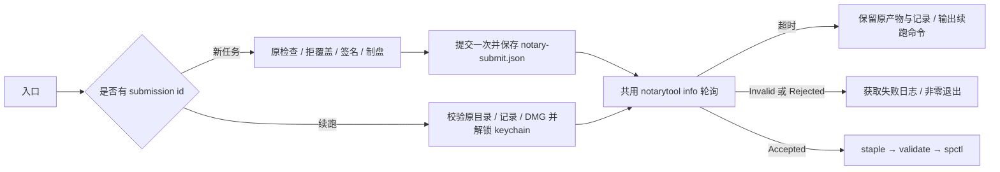

# macOS 公证续跑

状态：已实现，2026-11-01。离线脚本回归通过，未使用真实 Apple 提交验证。

## 产品规则与边界

`scripts/aiscoo/notarize-macos.sh <APP> <OUT_DIR> [--no-notarize]` 在入口按 `AISCOO_NOTARY_SUBMISSION_ID` 分流。设置 id 时，第一个位置参数仍必填，但不解析或读取 APP；续跑不依赖 Info.plist、entitlements、签名身份，不重新签名、制盘或提交。id 与 `--no-notarize` 同时出现立即失败。

续跑必须提供原输出目录及其中原有的 `notary-submit.json`。记录必须是有效 JSON 对象，包含与输入完全相同的非空字符串 `id` 和原提交 DMG 的绝对 `path`。路径按实际文件系统规范化，兼容空格、符号链接目录以及 macOS `/var` / `/private/var` 别名；DMG 必须是原输出目录内的现存文件。目录、记录、字段、id 或 DMG 不符合要求时清晰失败，不猜文件名，不重写原提交记录。

续跑只解锁查询所需的专用 keychain，并沿用 `AISCOO_SIGN_DIR`、`AISCOO_NOTARY_PROFILE` 与已有轮询配置。新任务保持原 APP 检查、拒覆盖、签名、制盘、提交顺序，已有同名 DMG 仍拒绝覆盖。两种模式共用轮询、失败日志、staple、validate、spctl；任何最终验收失败均非零退出。等待超时保留 DMG 和原提交记录，输出包含 id、原目录及正确 shell 转义的可执行续跑命令。

本修复只核对记录关联与文件位置；id/path 不证明 DMG 字节未变。调用者应保留原产物，不新增 artifact hash 侧文件或发布状态体系。

续跑依赖 `notarytool submit --output-format json` 输出中的 `path` 字段。离线回归的命令替身按 `{id, path, message}` 输出；尚未用真实 Apple 提交记录核对，首次真实超时续跑时需确认该字段存在。

## 所有者与事件顺序

Apple 拥有公证处理状态；本脚本拥有本地签名、提交与验收流程。`notary-submit.json` 是原提交 id/path 的既有记录，`notary-result.json` / `notary-log.json` 继续承载查询结果与失败日志。

## 离线验收

`scripts/test/aiscoo-notarize-macos.test.mjs` 以清洁子进程环境运行真实 Bash 脚本，用 fake external tools 与临时 synthetic HOME、keychain、APP、输出目录隔离所有 Apple 操作；不读取真实凭据，不外发请求。

覆盖超时后同目录 Accepted（累计 submit 一次）、APP 不存在的续跑、路径空格与规范化、缺损/坏记录、id 不匹配、DMG 不存在或在目录外、new 拒覆盖、`--no-notarize` 冲突、Invalid 及 staple/validate/spctl 失败传播。新打包用例仅在 `/usr/libexec/PlistBuddy` 可用的 macOS 上读取 synthetic plist；Linux 明确跳过新打包用例，续跑用例在非 Windows 平台执行。

验证入口：`bash -n scripts/aiscoo/notarize-macos.sh` 与 `node --test scripts/test/aiscoo-notarize-macos.test.mjs`。
