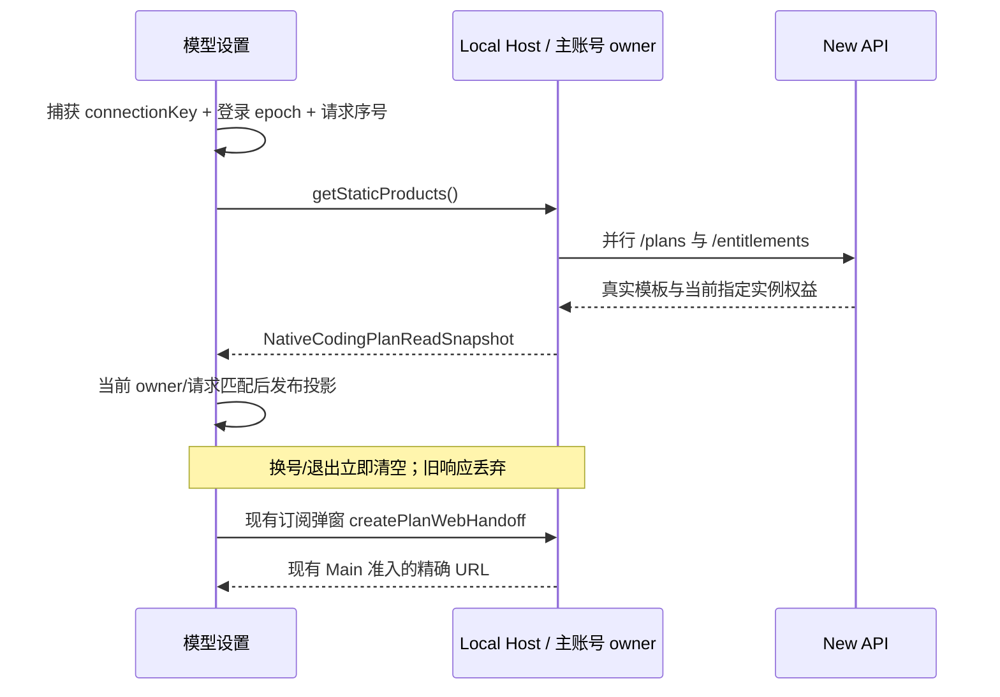

# New API 模型设置：恢复 ZCode 原版呈现

状态：2026-10-12 已实施，本机 UI 与回归验收完成；不替代集成计划的正式发布门禁。

## 产品规则

- 复用现有模型设置外壳、左右分栏、导航、标题、状态卡和套餐入口样式；不另造一套 New API 配置页。
- 官方模型入口只有 `account:new-api-openai-chat-completions`，名称固定为 `XWork`。隐藏协议不恢复，不自动迁移历史模型选择，不借用 BigModel/Z.ai 的 Provider 身份。
- New API 入口是托管套餐，不进入自定义 Provider 表单。未登录、查询中、未开通、有效、额度用尽、过期、撤销和查询失败分别呈现；查询失败不解释为未开通。
- 套餐状态、名称、有效期与额度来自 `/entitlements`；模板、价格、币种、周期和说明来自 `/plans`。不取官方静态价格或官方权益，不硬编码截图中的商品。
- 个人套餐卡片保持原版单套餐摘要样式：按 `/plans` 返回顺序只展示首个已启用模板的价格、币种、完整周期和说明，不按价格重新排序、不按币种/周期生成多条参考价、不拼接其他模板说明。缺目录或全部模板禁用时显示真实空态，不补假价格；套餐比较页继续展示完整目录。
- 团队套餐保留原版卡片位置和样式，明确“当前不支持团队套餐”，禁用购买，不展示虚构价格、席位或组织能力。
- 订阅/升级与个人套餐入口复用现有升级弹窗及 Native handoff；实际授予仍是 `manual_admin`。不调用官方支付、自助支付或额度重置。
- 托管套餐不提供自配 API Key、修改端点、改名、删除或“解绑套餐”。不把退出主账号冒充解绑；真实主账号退出仍走既有账号菜单。
- 模型详情只在真实授权允许时显示 New API 的只读模型；未开通页面保持状态卡及套餐入口，不堆叠自定义配置表单。
- 自定义供应商的添加、编辑、测试、删除与排序不变。
- 移除套餐详情顶部独立官方云横幅。2026-10-31 起按 [唯一登录规格](aiscoo-only-login.md) 一并移除使用统计中的 Z.ai/BigModel 官方连接、解绑及额度卡；不再创建或恢复独立官方账号，不伪造缺失的 MCP 权益。
- 浅色/深色、中文/英文和手机窄屏使用现有组件与 `text-ui-*` 字号。
- 模型上下文默认值逐项依据模型发布方的官方 API 规格或公开模型配置核验，不把服务商目录的 `200K`、`1M` 等概数直接当成精确 token 数；允许按用户明确要求设置更低的应用上下文上限，部署策略不冒充官方规格。模型规格不等于代理链路已验证的接入上限。
- 模型容量 badge 使用固定 K/M 技术单位并保留 token 整数对应的精度；`1,050,000` 显示为 `1.05M`，不能四舍五入成 `1.1M`。普通用量统计的 compact 精度不变。
- 对话模型菜单只显示可选模型，不显示“不可选择”诊断条目或仅含诊断的空分组；全部不可选时保留管理模型入口。模型设置页继续展示目录问题及原因，底层授权与执行校验不变。
- 模型设置的模型列表行在模型名前显示图标，规则与 composer 模型菜单一致（见 `docs/ui/chat-model-select-menu.md`）：New API 下发的 `icon` 优先，自定义模型按模型名映射同一套 @lobehub/icons 名称；都无法识别时不显示图标。
- 模型设置的模型列表行在容量 badge 后保留“视觉 / Vision”徽标（模型声明支持图片输入时显示）；对话模型菜单等其他位置不显示。
- 目录诊断遵循上游单一模型列表：只在选中的 Aiscoo Zen 详情模型列表内显示，原因位于对应行下方；不在设置详情上方全局置顶，不另设“不可用模型”分组。正常模型继续使用上游行的名称、图标、容量、视觉与操作样式。
- `catalogIssues` 没有完整 metadata 时只投影模型名称与真实原因，复用模型行的身份呈现，不伪造容量、视觉能力、candidate 或可执行 ref，也不加入排序、测试、编辑或提交路径。已进入模型列表的条目继续复用上游行内校验提示。
- 全部模型异常、没有可执行模型时，Aiscoo Zen 详情仍在同一模型列表内显示只读诊断。真实授权门禁继续限制正常模型的展示与执行；切到自配供应商或添加供应商时，不显示 Native 目录诊断。托管模型只读权限、自配模型操作及状态所有者不变。
- 没有可用模型且套餐入口属于 New API 时，Aiscoo 的聊天缺模型横幅显示“未订阅 Aiscoo Zen 套餐或者自定义模型”；英文显示“No Aiscoo Zen subscription or custom model”。既有套餐入口和模型配置操作保持不变。该横幅沿用现有缺模型判断，不能据此断定套餐实际未开通：目录为空、授权或模型不可用也可能触发。

## 所有者与读取路径

New API 业务事实唯一所有者是窗口 Local Host 的主账号及订阅服务。Renderer 通过现有 `ICodingPlanSubscriptionService.getStaticProducts()` 读取 `NativeCodingPlanReadSnapshot`，不增加 HTTP/RPC 协议、凭据或持久缓存。

UI hook 仅保存当前读取的投影、loading/error 和请求序号。owner key 复用 Host `connectionKey` + 主登录 `authSessionSeq` 的现有 `useUsageAccountScope`。换号/退出的首帧清空旧数据，旧请求不得覆盖新 owner；服务实例变化同样隔离。手动刷新与关闭订阅弹窗重新读取当前 owner 的快照。

Desktop handoff 复用既有 Main/Host admission 与临时分区；Web/远程不新建 Host，不绕过现有平台能力门禁。Aiscoo 产品无有效账号配置时不恢复旧官方界面或账号；未注入产品策略的通用上游实现不在本规格范围。

## 验收

1. New API 模式只见一个 `XWork` 官方导航，右侧为原版标题、编程套餐状态、个人和团队入口，没有官方云横幅或自配连接表单。
2. 未开通/额度用尽/过期/撤销与查询失败区别明确；有效状态展示真实套餐名、有效期和指定实例额度，不显示官方五小时/周/MCP 额度。
3. 目录含多个价格、币种或周期时，个人入口只显示首个启用模板的一条价格、其周期与说明；后续更便宜的模板也不能替换首项或追加价格/说明。跳过禁用模板，空目录或全部禁用时不补旧官方价格；套餐比较页仍可查看完整目录。
4. 手动刷新可以更新套餐；owner A 的延迟响应不能在换到 B 或退出后出现，重复刷新只发布最新请求。
5. 订阅及个人入口实际打开现有 Native 套餐比较页；团队不能触发购买。自定义供应商仍可操作。
6. 在真实 Electron 的模型设置中验收未开通、有效、错误、换号、刷新、订阅入口和两种主题；确定性 fixture 不冒充真实账号或真实推理。
7. 模型容量 badge 能准确表达 `1,050,000`、`1,048,576`、`202,752` 与 `204,800` token，中文和英文不改变技术规格数值；保留模型目录的禁用/授权语义。
8. 目录同时含有效模型、元数据缺失模型和能力表达式错误模型时，对话菜单只显示有效模型；全部不可选时没有问题模型条目，仍可进入管理模型。设置页的目录诊断不受影响。
9. 无可用模型且套餐入口属于 New API 时，中文和英文缺模型横幅使用对应 Aiscoo 文案，仍可打开订阅套餐和模型配置；通用词典与非 New API 的缺模型提示不变。验收覆盖宽屏和窄屏，确认操作可用。
10. 模型目录混合正常、缺 metadata 和非法 CEL 条目时，真实设置详情只显示一个模型列表：正常行保留图标、精确容量、视觉徽标及连接测试；两类诊断使用同一行身份样式，真实原因置于对应行下方，没有全局置顶卡片或独立不可用分组。
11. 全部模型异常时列表仍显示诊断，诊断不显示能力 badge、不参与排序、测试、编辑或保存；切到自配供应商后没有 Native 诊断且保留添加模型入口。中文/英文、浅色/深色各验收 1000px 与 393px，诊断均可完整滚动查看。

## 本机验证记录

- `newApiModelSettings.test.ts` 覆盖首个启用模板的目录顺序、空目录、全部禁用与精确十进制价格；已纳入现有 New API Node 回归入口。
- `newApiModelSettingsElectron.mjs` 已纳入既有 Electron smoke 入口。真实 React 状态卡和 owner hook 验证未开通、有效、耗尽、过期、撤销、查询失败、空模板、换号/退出首帧、迟到响应、同 owner 重复刷新、手动刷新、英文深色及 393px 窄屏；业务输入是确定性 fixture，不冒充部署授权或真实推理。
- 当前运行的完整 XWork 桌面在 Renderer 重新加载后实际读取部署后端套餐、价格、有效期与额度；状态卡与个人套餐入口均打开同源只读套餐 WebView，手动刷新后授权状态正常。自定义供应商仍显示原有连接和模型编辑操作。未修改真实授权、模板或凭据。
- 根 `typecheck` 通过，Lint 0 错误/71 警告，changed 架构检查 0 违规；任务涉及文件格式检查通过。真实官方账号连接/解绑、Windows/Linux 与正式发布矩阵未在本任务重做。
- 2026-10-13 上下文精度核验：通过正常管理员接口修正 8 个模型、回读全部 20 个启用模型；真实 Electron 刷新后逐项容量 badge 与精确数值一致，且没有截断。GPT 依据 [OpenAI 原生规格](https://developers.openai.com/api/docs/models/gpt-5.6-sol) 使用 1,050,000；MiniMax 依据[官方 API 表](https://platform.minimax.io/docs/api-reference/text-anthropic-api.md)使用 204,800；GLM-5 与 DeepSeek V4 依据发布方公开模型配置使用 [202,752](https://huggingface.co/zai-org/GLM-5/raw/main/config.json) 与 [1,048,576](https://huggingface.co/deepseek-ai/DeepSeek-V4-Flash/raw/main/config.json)。Claude 的 200,000/1,000,000 与[原生上下文文档](https://platform.claude.com/docs/en/build-with-claude/context-windows)一致，未改动。公开模型配置数值不冒充代理 API 的实测接入上限；本次没有边界长度推理、价格、输出上限或其他能力变更。
- 同次验证：容量精度回归先复现 `1.1M` 错误、修复后通过；Node 24.18.0 下完整既有 New API Node 入口 169 项通过，根 `typecheck` 通过，Lint 0 错误/71 警告，任务涉及文件格式检查通过。
- 随后的用户指定覆盖：GPT-5.6 Sol / Terra / Luna 的应用上下文上限均设为 272,000 tokens。通过正常管理员接口更新并回读三条配置，真实 Electron 刷新后均显示 `272K`；其他模型配置、价格、输出上限和能力标志未改动。该值是用户指定的部署策略，不是对 OpenAI 官方 1,050,000-token 规格的更正。
- 2026-10-17 模型菜单过滤：Node 边界回归覆盖有效项与目录问题并存、全部无候选时不生成空分组；真实 Electron 回归先确认问题项可见而失败，修复后通过，并确认 Host 设置诊断仍保留。运行中的完整桌面菜单已实际确认 `auto-kiro`、`deepseek-3.2`、`qwen3-coder-next` 及“不可选择”说明均不再显示，20 个可选套餐模型及管理模型入口仍在，当前选择未改变。未修改后台模型配置或授权。
- 同次验证：既有 New API Node 回归入口 169 项通过，Composer 能力 Electron 回归（含自定义模型、中英文、浅深色、360px 窄屏）通过；根 `typecheck` 通过，Lint 0 错误/71 警告，changed 架构检查 0 违规，任务文件格式检查通过。未重做 Windows/Linux 或手机真机验收。
- 2026-11-02 官网套餐摘要：Node 与真实 Electron 回归先复现后续低价模板替换首项、多周期/币种并列和说明拼接，修复后 Node 定向 4 项及 `newApiModelSettingsElectron` 通过。确认禁用首项被跳过、个人卡只有一条价格和对应说明、空态与换号/退出隔离有效；既有英文深色、393px 窄屏场景通过。根 `typecheck` 通过，Lint 0 错误/308 警告，changed 架构检查 0 违规。本次只调整 Aiscoo 展示 helper，未修改上游文件；业务数据为隔离 fixture，未重做真实账号、Windows/Linux 或手机真机验收。
- 2026-11-02 上游模型列表对齐：扩展既有 `newApiModelSettingsElectron.mjs`，挂载真实详情与模型行，先复现诊断在详情内缺失，再通过混合目录、全异常、自配隔离、只读无写入及 1000px/393px 中英浅深色验收。正常行使用真实 OpenAI SVG，并验证 `8.192K`、视觉徽标和连接测试回调；诊断不构造候选或操作。隔离 fixture 显式承接源版主题背景，覆盖桌面根节点为 vibrancy 透明的样式，并验证两条诊断可滚动完整查看。
- 同次验证：Node 实际 `24.18.0` / pnpm `10.33.2`，`mise.toml` 的 `24.14.0` pin 未改；根 `pnpm typecheck` 通过，根 `pnpm lint` 为 0 错误/308 警告，任务源码及 fixture 定向 Lint 为 0 警告/0 错误；changed 架构与任务文件格式通过。最新 `upstream/main` 为 `a60ba6a7`，未提交工作树使用独立临时索引预演合并无冲突，真实分支 HEAD 与索引未变。未运行生产桌面、真实账号、Windows/Linux、手机真机或全量回归。
