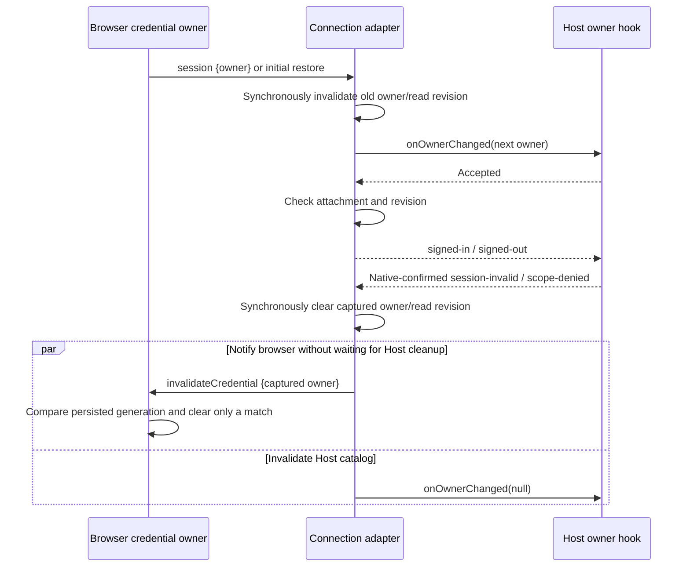

# Browser account reverse bridge

The enabled entry profile reads its backend origin only from `AISCOO_ADMIN_BASE_URL`. The retired backend variable is not an alias or fallback; origin validation and the existing loopback/Origin boundaries are unchanged. Desktop, CLI, the Host-to-Worker environment, and the existing local launcher use the same configuration name. This rename does not migrate user files, credential keys, provider IDs, or OAuth client IDs.

The browser alone owns credentials, refresh rotation, and its user/SID/generation. This adapter retains multiple independent live attachments and one frozen, validated Host owner projection. Same owner means the complete origin/userId/SID/authGeneration tuple, including null for unauthenticated pages; userId alone never grants admission. An initial authenticated restore may establish the owner only while no authenticated owner exists. A mismatched new attachment rejects its own ready promise without changing the incumbent owner. It has no credential cache, persistence, network session, or model authorization policy. `origin` is normalized with the existing aiscoo-admin helper; wire owners must already use that exact canonical origin, a positive decimal user ID, a nonempty trimmed SID, and a positive safe integer generation. Additional owner fields are rejected.

The browser serves `aiscoo/browser-account` on the existing socket. `restore(undefined)` returns `{owner, session}`. `control({owner})` returns `{owner, accessToken}`. `relay({owner})` returns `{token, expiresAt}`. `oauth({method, args})` uses only the fixed `BROWSER_ACCOUNT_OAUTH_METHODS` list and positional IOAuthService arguments. `invalidateCredential({owner})` is a narrow reverse command with a void result: Native-confirmed `XCODE_SESSION_INVALID` / `XCODE_CREDENTIAL_SCOPE_DENIED` synchronously clear the captured Host owner/revision before the first await, then notify the browser to clear only that origin/user/SID/generation. Browser remains the only persistent credential owner; no refresh token crosses this command. Network failures do not invalidate. Late failures cannot clear a replacement owner or attachment. `session` emits `{owner}`. Public restore/profile/metadata/callback results are projected explicitly; void OAuth results are discarded. Refresh tokens and session bundles have no wire result or authority property.

Every read checks the captured attachment, owner, and local revision before and after asynchronous work. A control response additionally binds its returned owner. Initial restore echoes are checked against that connection's eventual validated restore; they cannot independently change the Host owner. Concurrent matching restores share one owner acceptance and one signed-in event. Adding or removing a matching attachment does not increment the owner revision. Detach clears ownership synchronously before the Host hook only when the final matching source leaves; it does not dispose another socket. Late restores, hooks, reads, and events cannot mutate a later attachment, even if its owner fields match. Duplicate projections and disposal are idempotent. Failed validation or owner acceptance fails closed. Unrecognized remote errors become a fixed error code without remote messages, stacks, or secret-bearing data.

Each attachment exposes an explicit `oauth` facade fixed to its own reverse channel. The parent reuses accountPolicy.wrapOAuth and the existing per-WS service override map; only this facade is reflectively registered. Background Host authority operations may select a live, validated source matching the complete owner, but page OAuth never moves to another source. A confirmed logout or owner change from an admitted source synchronously replaces the Host owner/revision and invalidates other mismatched attachments. `onDidInvalidate` requests closure of only that socket: owner-changed reloads an already admitted page for fresh admission, account-mismatch rejects a new conflicting page, and unavailable reports validation/acceptance failure. A Native invalidation synchronously clears the Host owner, notifies the captured browser to invalidate only that credential generation, and revokes the other matching attachments; their fresh admission must revalidate their own storage against Native.

Forward service registration and RPC Initialize wait for `attachment.ready`, using the existing ChannelServer deferInit/ready seam; the reverse browser channel remains live to complete restore. Rejected or closed connections never expose business services. The bridge, attachment, and credential authority must never be passed to reflective RPC registration. The parent owns loopback/Origin checks, service injection, and socket disposal. The channel is a live connection boundary, not an additional replay or task owner; Desktop continuous and mobile replayable transports retain their existing owners and delivery semantics.
