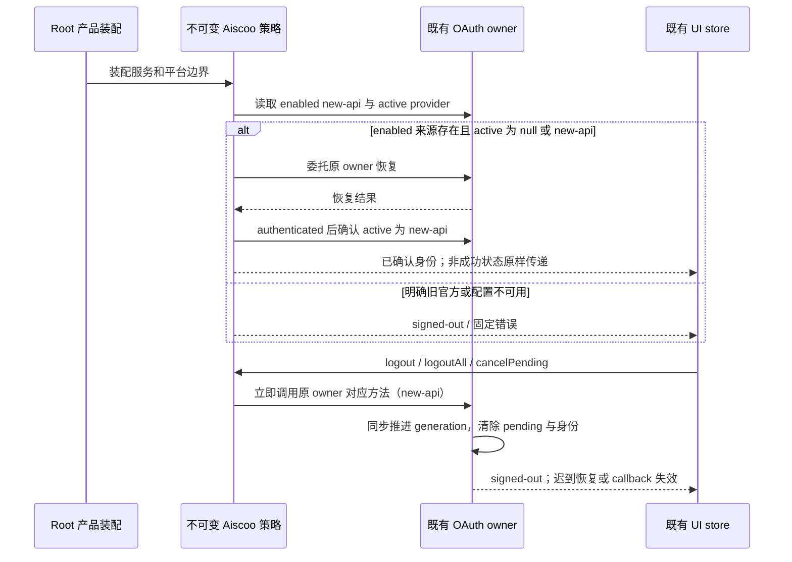

# Aiscoo 唯一账号 UI 装配

按 `docs/aiscoo/specs/aiscoo-only-login.md` 在 Desktop / Web 产品入口显式装配 `createAiscooAccountLoginRoot`，位于既有头像与启动归属包装之外。安装不依赖配置、providers 或当前身份，覆盖 Desktop 和普通 Web、远控 workspace、远控 home-only；缺配置仍失败关闭。共享 Root 不导入本模块，未注入产品接点时保留上游默认服务、平台与欢迎页。此模块是不可变产品限制；账号、凭据、pending state、generation 和事件仍由既有 OAuth owner 持有，不建立第二份状态。

`createAiscooAccountLoginServices` 仅暴露 enabled 的 new-api metadata。恢复前要求此合法来源存在并拒绝明确的官方 active provider；冷启动 active 为 null 时允许委托既有 owner 恢复，authenticated 结果必须后置确认 active 为 new-api。expired、unavailable 等非成功投影原样传递，不把临时不可用变成退出。拒绝官方 start、polling、refresh 与 callback；不读取旧官方用户缓存、不删除旧凭据。缺配置投影为空渠道，错误使用固定码，不携带 origin。第三方服务、模型自配与其他 MCP OAuth 保持原接口。

`logout` 与产品 `logoutAll` 均立即委托既有 owner 的 `logout(new-api)`，`cancelPending` 同样立即委托 `cancelPending(new-api)`，不先等待 providers 或 active 查询。原 owner 同步推进 generation、清除 pending 与身份后，再执行异步撤销；挂起恢复或迟到 callback 不能重新登录。只操作 Aiscoo 作用域，不调用通用 `logoutAll`，不清除历史官方凭据；不可用 owner 自身无状态退出或取消保持 no-op。

`createAiscooAccountLoginPlatform` 注入可选通用 `oauthAccountPolicy`，拒绝 official state 注册并过滤官方 callback。未注入的通用组件仍使用上游默认行为。登录面板按此策略过滤渠道与成功信号，不将旧 user 或官方成功序号认作 Aiscoo 登录。现有本机 Web 生命周期若已装配则继续保留。

`AiscooLogoutPresentationBoundary` / `useAiscooLogoutPresentation` 只协调当前 Desktop 本地 Root 的展示。原退出动作通过可选 `onLogoutConfirmed` 在确认后同步通知；边界显示不透明过渡并隔离旧内容的交互，但保持 Root/effects 挂载。`run(action)` 只委托同一个原动作，合并重复调用；取消保持原界面，错误复原并原样传播，成功确认重启后持续 busy 到旧边界卸载。展示状态仅由边界的 React 局部状态与在途调用引用持有，不进入共享 Zustand、持久化或广播，不保存账号、凭据、pending、generation 或任务事实。`isExiting()` 是对同一局部状态的只读查询，供已有 `createAiscooAccountLoginPlatform` 的可选交互门禁使用：只暂停原生菜单/快捷键的新建、打开项目等用户意图订阅，不拦截 OAuth 回调、Host 业务事件、清理命令或窗控；错误复原后自动放行。Web、手机远控不挂边界；原退出和 Main 重启顺序不变。

公开子路径 `@zcode/ui/aiscoo-account-login-root` 指向既有 UI 入口 `logout-presentation.tsx`，追加 `createAiscooAccountLoginRoot`，复用已有账号适配器、品牌登录头和法律链接，不改原架构层次。它向共享 Root 传递通用 `welcomeScreenPresentation` 与 `logoutPresentation`，不重新实现欢迎页或退出动作。服务适配器随传入 accessor 稳定复用；同一平台适配器同时传给内层 Root props 与 Context，退出展示变化不重挂 Root 或重建订阅。产品包装为退出边界补足 PlatformProvider，Intl 继续由生产入口持有。Desktop 本地只创建一份展示状态；Web/远控不启用展示端口。

`logout-presentation.tsx` 保留既有公开 UI 入口，使用自身 `contract.ts` 的窄展示契约与既有 hooks/共享组件；账号过滤适配器仍位于原 adapters 层。

